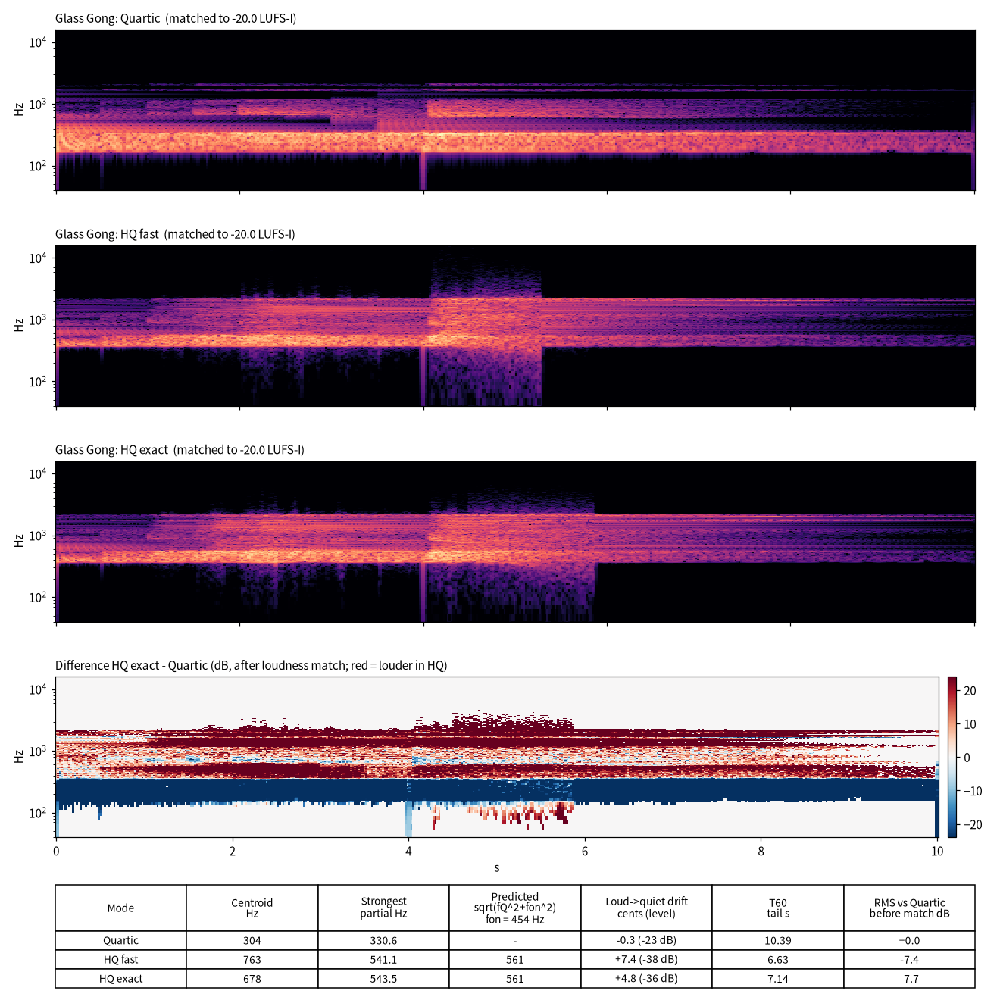
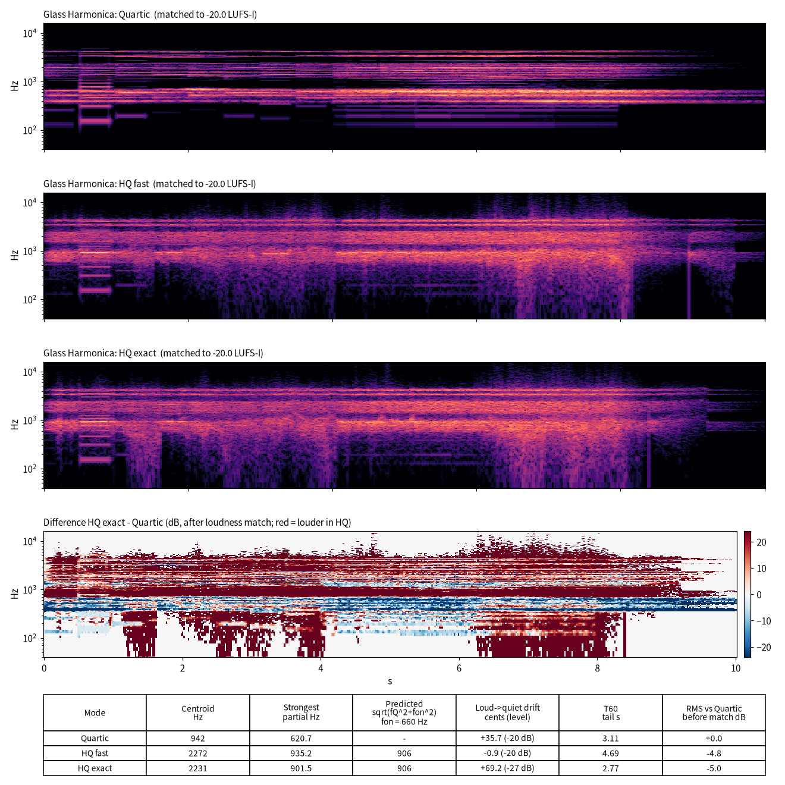
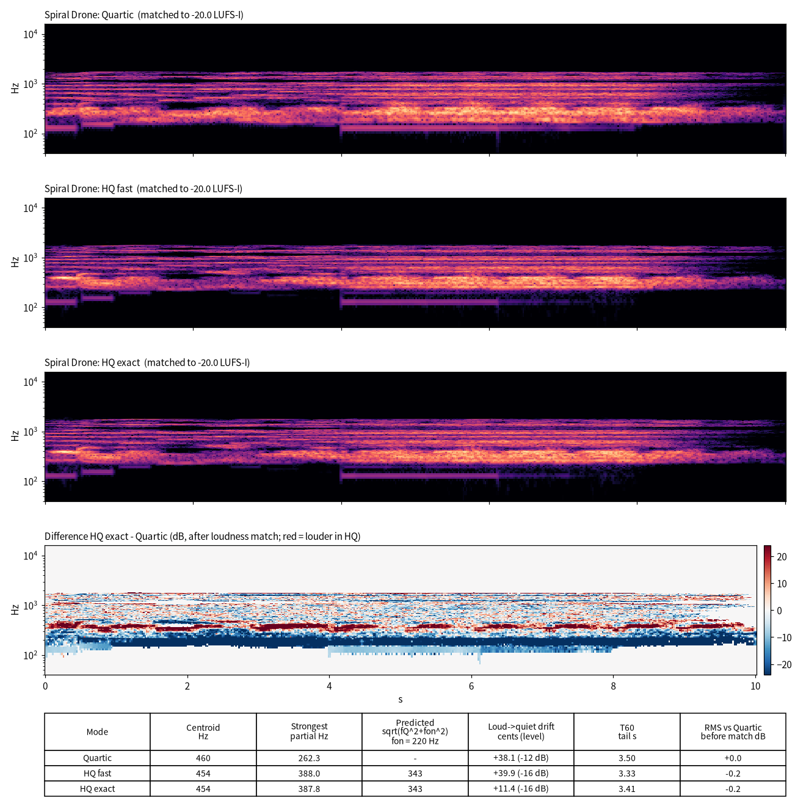
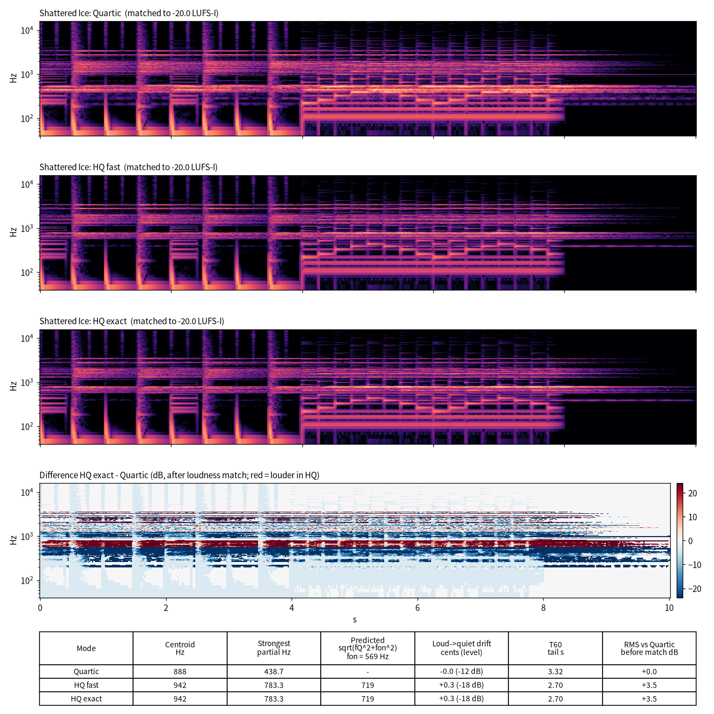
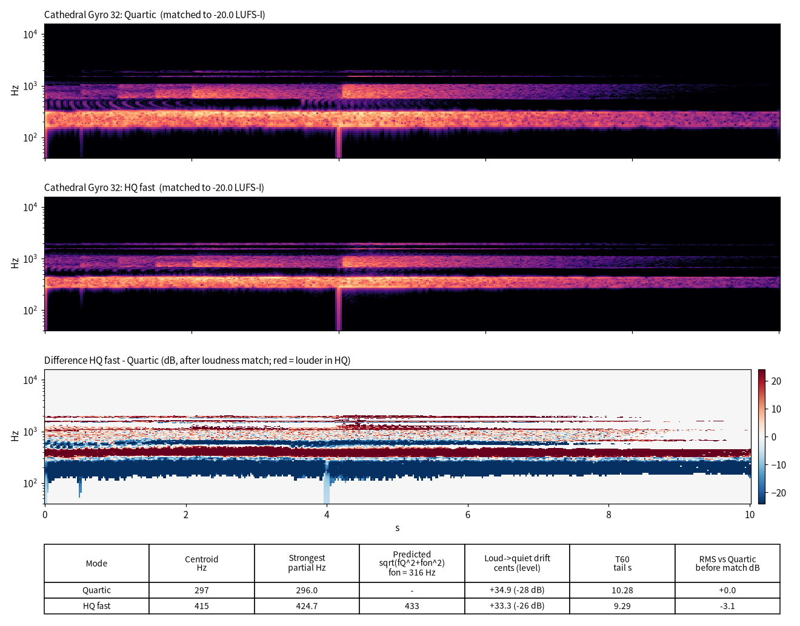

<!-- SPDX-License-Identifier: AGPL-3.0-only -->
# HQ 势能 A/B：Quartic、HQ fast 与 HQ exact 的区别

生成于 2026-10-31（Asia/Shanghai），在 box（Linux, GCC）上渲染。PC 未参与。

## 1. 结论

- **Quartic 和 HQ 的差别不细微。** 在这几个预设的 hq 取值（0.3–0.85）下，HQ 把整个分音列往上推。低频模态被推得最多，低端被挖空，音色更像玻璃或钟。响度对齐以后，频谱质心最多翻倍（Glass Harmonica 942 → 2272 Hz），最强分音上移 40–80 %。这更像换了一件乐器或换了一个音区，而不是"更高品质"。
- **HQ fast 和 HQ exact 的差别很细微。**
  - 接近线性的素材（Shattered Ice）两者几乎逐样本相同，波形相减后残差为 −64 dB。
  - 自持或混沌的素材（Glass Gong、Glass Harmonica）波形会完全分叉，但频谱平均只差 2–3 dB，音色特征相同，只有混沌爆发段的细节和时长不同。
  - HQ exact 更耗 CPU，并且只能用于 16×16 及以下，所以 fast 仍然是合理的默认。
- **振幅相关的音高弯曲在这些演示里很小。** 衰减 36 dB 的过程中，Glass Gong 在 HQ 下只上滑 +5 到 +7 cents，在 Quartic 下约为 0。物理上确实存在这种弯曲，但在正常力度下很难听出来。

## 2. 物理上 HQ 改了什么

每个格点的在位势能是

  U(s) = α/4 · s⁴ + β · logcosh(s)，  力 U'(s) = α s³ + β tanh(s)

- **Quartic 模式**：β 被设为 0（`MorphoEngine.hpp`：`b0 = potential == 0 ? 0 : hq·0.2·ω_u²`），所以 HQ 旋钮在 Quartic 下不起作用，只剩 α s³ 的硬化非线性（由 Nonlinear 控制）。
- **小振幅**：logcosh(s) ≈ s²/2，相当于每个格点多了一根线性弹簧 β。每个晶格模态变成 ω² → ω² + β/m，频谱底部出现一个带隙：

    f_on = √(0.2·hq) · Tone （由 b0 = 0.2·hq·ω_u²、m = 1/r²、r = Tone/1500 推出），f_HQ ≈ √(f_Q² + f_on²)

  低分音被推得最多，高分音几乎不动，所以分音列被向上压缩、更不谐和。下表中"预测"一列就是这个公式：
  - Glass Gong、Glass Harmonica、Cathedral Gyro 32 的实测与预测相差不到 4 %；
  - Spiral Drone、Shattered Ice 实测偏高，因为 HQ 下最强的分音换成了另一个模态。
- **大振幅**：tanh 饱和，在位力最多只有 β。等效刚度 β·tanh(s)/s 随振幅下降，而 quartic 项 α s² 随振幅上升。两者的作用方向相反：
  - logcosh 部分让**响的时候分音偏低，衰减时向上滑回小振幅极限**；
  - quartic 部分让响的时候偏高。

  Glass Gong 的 +5 到 +7 cents 上滑就是 logcosh 的软化效应。弓奏和螺旋预设的漂移数字主要来自弓压包络、能量门和 Barkley 调制，不能当作势能的证据。
- **能量与能量门**：同样的激励下，没有 β 的 Quartic 版本储能更大（匹配前 RMS 高 3–8 dB），更常触发引擎的能量门。Glass Gong 的 gate 占比为 Quartic 0.27、HQ 0.00，Emax/E_cap 为 3.2 对 1.0。所以 Quartic 版本的长尾部分也受能量门影响。
- **HQ fast**：用 3 项 √(c²+s²) 和函数逼近 logcosh（Phase 3 的替代式），可以完全向量化。小振幅时与 exact 一致；大振幅时有微小差别，混沌素材会把这个差别放大成波形分叉。

## 3. 测量结果

| 预设 | 模式 | 质心 Hz | 最强分音 Hz | 预测 √(f_Q²+f_on²) | 响→弱漂移 cents（电平） | 尾音 T60 s | 匹配前 RMS 差 dB | fast vs exact |
|---|---|---|---|---|---|---|---|---|
| Glass Gong (f_on=454 Hz) | Quartic | 304 | 330.6 | — | -0.3（-23 dB） | 10.39 | +0.0 |  |
| Glass Gong (f_on=454 Hz) | HQ fast | 763 | 541.1 | 561 | +7.4（-38 dB） | 6.63 | -7.4 |  |
| Glass Gong (f_on=454 Hz) | HQ exact | 678 | 543.5 | 561 | +4.8（-36 dB） | 7.14 | -7.7 | 频谱平均差 3.06 dB；波形零差 +1 dB |
| Glass Harmonica (f_on=660 Hz) | Quartic | 942 | 620.7 | — | +35.7（-20 dB） | 3.11 | +0.0 |  |
| Glass Harmonica (f_on=660 Hz) | HQ fast | 2272 | 935.2 | 906 | -0.9（-20 dB） | 4.69 | -4.8 |  |
| Glass Harmonica (f_on=660 Hz) | HQ exact | 2231 | 901.5 | 906 | +69.2（-27 dB） | 2.77 | -5.0 | 频谱平均差 1.78 dB；波形零差 +2 dB |
| Spiral Drone (f_on=220 Hz) | Quartic | 460 | 262.3 | — | +38.1（-12 dB） | 3.50 | +0.0 |  |
| Spiral Drone (f_on=220 Hz) | HQ fast | 454 | 388.0 | 343 | +39.9（-16 dB） | 3.33 | -0.2 |  |
| Spiral Drone (f_on=220 Hz) | HQ exact | 454 | 387.8 | 343 | +11.4（-16 dB） | 3.41 | -0.2 | 频谱平均差 0.32 dB；波形零差 -16 dB |
| Shattered Ice (f_on=569 Hz) | Quartic | 888 | 438.7 | — | -0.0（-12 dB） | 3.32 | +0.0 |  |
| Shattered Ice (f_on=569 Hz) | HQ fast | 942 | 783.3 | 719 | +0.3（-18 dB） | 2.70 | +3.5 |  |
| Shattered Ice (f_on=569 Hz) | HQ exact | 942 | 783.3 | 719 | +0.3（-18 dB） | 2.70 | +3.5 | 频谱平均差 0.00 dB；波形零差 -64 dB |
| Cathedral Gyro 32 (f_on=316 Hz) | Quartic | 297 | 296.0 | — | +34.9（-28 dB） | 10.28 | +0.0 |  |
| Cathedral Gyro 32 (f_on=316 Hz) | HQ fast | 415 | 424.7 | 433 | +33.3（-26 dB） | 9.29 | -3.1 |  |

说明：
- **质心**：整段的能量加权频谱质心。
- **最强分音**：在和弦段（4.1–7.9 s）里取最强的分音，再在 4.15–5.15 s 的窗口内用抛物线插值求峰值频率。
- **漂移**：同一分音从 4.15–5.15 s（响）到 8.3–9.8 s（释放后的尾音）的频率变化，搜索范围 ±50 cents。括号内是这期间的电平变化。
- **T60**：8.05 s 之后 40 dB 范围内的线性拟合外推。
- **fast vs exact**：Welch 频谱在最大值以下 50 dB 内的平均绝对差，以及原始波形相减后残差相对于信号的电平（高于 0 dB 表示波形已经完全不相关）。

## 4. 方法

- **预设与版本**：
  - Glass Gong：拨奏/钟，原为 HQ fast，hq 0.85；
  - Glass Harmonica：弓奏持续音，原为 HQ fast，hq 0.45；
  - Spiral Drone：螺旋 Barkley 纹理，原为 Quartic，hq 0.3；
  - Shattered Ice：FX Defect Freezer，处理鼓加琶音循环，原为 HQ fast，hq 0.5；
  - 另加 Cathedral Gyro 32 的 L32 Quartic 对 L32 HQ fast（HQ exact 只能用于 16×16 及以下）。
- **改动**：每个预设只改势能（以及 lattice = 16×16），其余参数不动。out_gain 统一降低 12 dB，保证任何版本都不触发输出限幅器。
- **演奏**：使用同一演奏，即乐器用 DemoPhrase（MPE 旋律 0–4 s，和弦 4–8 s），FX 用 DemoInput（鼓 0–4 s，琶音 4–8 s，种子 12345，`--noise portable`）。每段播放 8 s 加 2 s 尾音，共 10 s。命令为 `morpho_cli qa <variants> <raw> --play 8 --tail 2 --noise portable --seed 12345 --bits 32`。
- **响度**：每个预设的所有版本都对齐到 −20 LUFS-I（ITU BS.1770，pyloudnorm），所有版本的真峰值都 ≤ −1 dBTP。
- **ABC 文件**：顺序为 Quartic、HQ fast、HQ exact，每段前有 1/2/3 声 3 kHz 短促点击（无人声），点击后留 0.3 s，段间间隔 0.5 s。
- **脚本**：`scripts/hq_ab/make_variants.py`、`scripts/hq_ab/analyze.py`。

## 5. 图

差值面板为 HQ exact（L32 时为 HQ fast）减 Quartic，单位 dB，在响度对齐之后计算。红色表示 HQ 更响，两者都低于最大值 70 dB 的区域置零。可以看到红色带位于 f_on 以上，蓝色带位于 f_on 以下，这就是带隙。
