# Project Morphohedra (NR-PHMS) — Phase 0 深度研究与可行性审计报告

*生成日期：2026-10-30（Asia/Shanghai）｜执行环境：云端 box（Intel Xeon 2.4 GHz，8 vCPU，AVX-512；Python 3 + numpy/scipy；gcc 14 -O3 -march=native）｜所有数字均来自本目录下脚本的实际运行结果（`experiments/results/*.json`），未运行/未核实的内容均明确标注。*

---

## 0. 执行摘要与总体结论

**总体结论：项目“可做，但必须按修正后的版本做”。** 开题报告中的艺术方向与工程框架有价值，但其三项核心“科学突破”的原始表述有两项在数学上不成立、一项不是新方法；若按原文直接写论文或写插件，会在审稿与实测两端同时失败。经修正后，存在一条清晰、可验证、可实时运行的技术路线。

**最关键的 10 条发现：**

1. **原文晶格模型不可能有拓扑边缘态。** 每格点 1 个标量自由度的正方晶格只有 1 条正频带，Chern 数对任意 Φ 恒为 0（解析证明 + FHS 数值）；`sinΦ` 回旋项只产生无隙的非互易色散。16×16 开边界谱最大相对能级间距仅 3.0–3.5%，无带隙。→ 必须改为**蜂窝晶格 + Haldane 型次近邻回旋耦合**（C=±1，带隙 0.566）或 **2 自由度陀螺蜂窝**（Nash 2015 / Wang–Lu–Bertoldi 2015 型，C=[1,0,0,−1]）。我们已在时域有限片中复现单向边缘传输（图 a4）。
2. **“μ≤0 ⇒ 严格无源”在参数调制下不成立。** 形态场以 750 Hz 改变 mᵢ、αᵢ 本身就是一个功率端口：在 η=0、μ=0 的“无损”设置下，**任何**精确积分器（RK4、隐式中点-dG、原文 SSDG）在 43 ms 内能量增长到初值的 19–32 倍（参数共振）。必须单独设计“能量不增参数更新”（本报告给出 ENPU，已数值断言 E 不增）。
3. **原文 SSDG 不是无条件稳定的。** 8×8、1000 组极端冲击：原文 SSDG 发散 10.5%，单步能量增加（无源性违背）18.1%；RK4 发散 33.9%；Störmer-Verlet 32.1%（回旋项显式时无源性 100% 违背）；隐式中点-dG+Newton 0%；**修正格式 ESAV-LF 0%、无源性违背 0%**；16×16（200 组）结果一致（原文 12.5%、RK4 36%、Verlet 35%、ESAV-LF 0%）；8×8 各 10 000 组门槛：ESAV-LF 被动/有源均 0 发散，原文 SSDG 1190 发散（11.9%）。根因：“q 冻结的离散梯度”在数学上退化为显式 kick，其稳定性依赖振幅（|q|≳10.6 即失稳，数值在 |q|=10 首次爆炸）。
4. **原文印刷的 Bernoulli 公式在 μ=0 处是 0/0。** 无源模式（μ=0）下 100% NaN；μ≈0 时相对误差可达 2.8×10⁻³；10⁶ 次随机检验中 9172 次非有限。稳定形式（对 w=1/p² 的仿射精确流，用 φ₁ 函数）最大误差 1.6×10⁻¹⁶，10⁶ 次全部单调有界。另：√(μ/η) 只是子流不动点，真实极限环速度幅值为 √(4μ/3η)。
5. **Cayley 变换是 H-正交而非欧氏正交，且矩阵稠密。** 欧氏范数比在 3.1×10³–6.3×10³ 间变化；能量范数保持到 10⁻¹⁴。稠密 Q 在 16×16 需每样本 10⁶ flop（C 实测：空闲时 26.7 µs/样本，即单核 128%）；m 改变时须重分解（750 次/秒）。“FFT 块对角化 O(N)”在空间变化参数下不成立。
6. **“显式离散梯度”不是新方法，且已有更好的显式方案。** Bilbao–Ducceschi–Zama (JCP 2023) 已给出显式、精确能量守恒、对非负势无条件稳定的格式；Ducceschi–Bilbao 的能量二次化与 Lopes–Hélie–Falaize (2015) 的显式无源 PHS 方法均为直接先例。我们据此实现的 ESAV-LF 在 8×8 上 10 000 组冲击 0 发散（被动与有源两种情形，见 §3.5）。**论文的新颖性必须重新定位**（见 §2）。
7. **Gray–Scott 在 16×16 上原参数几乎不可用。** 用 Pearson 扩散系数，16×16 周期网格 5 组常用参数 × 8 个随机种子**全部消亡**；扩散系数缩小 4 倍后 3/5 组存活，但波长约 7–8 格（仅 2 个波长），并在 0.1–2.7 s 内**冻结为静态**。“缓慢有机演化/螺旋波”在该尺寸不成立。
8. **“声能催化图灵斑图”的耦合在数学上无效。** 声学源只加在 u 上，而 (u,v)=(1,0) 线性稳定且 v≡0 是不变集：6000 步后 v_max 精确为 0；需要 ≥~0.18–0.32 的有限幅度 v 种子。原文还把 v（自催化剂）误称为“抑制剂”。
9. **闭环反馈是正反馈并会“锁死”。** 按原文映射搭建 16×16 闭环（ESAV-LF@48 kHz ↔ GS@750 Hz），有种子时 <1 s 内 100% 格点 μ>0、v 被推到均匀饱和值（0.28/0.54），图案被抹平；无种子时 v 永远为 0、合成器永不“苏醒”。系统不发散（得益于 ESAV + η 饱和），但不会产生原文描述的“有机演化”。
10. **CPU 指标：原文路线（稠密 Cayley）在 16×16 即需 128% 单核，不可行；修正格式可满足原文指标的大部分。** 本机单核（Xeon 2.4 GHz，空闲，5 次中位数）C 实测 ESAV-LF：8×8 0.67–2.05%，16×16 2.4–6.1%，32×32 8.6–22.5%（快速超越函数近似；取值取决于回旋项求解方式）；标准 libm 约高 1.3–1.9 倍。即 8×8 <2% 与 16×16 ≈5% 可达，32×32 <14% 仅在“格点内回旋或 ≤4 次扫描 + 快速近似”时可达。Gray–Scott 计算成本可忽略（<0.03%）。（详见 §3.7。）

**引用问题（需在任何论文/对外材料前修正）：** “Michalakos & Rossi (2026)” 确有其文，但标题、作者名/顺序与内容均被误述（真实为 Marta Rossi & Christos Michalakos, *Gesture and Field: Ontological Approaches to Interactive Sound in Virtual Reality*, CMJ，doi 10.1162/comj.a.729，内容与反应-扩散形态发生无关）；Comunità et al. 2025 并未“明确指出 PHS 局限于一维电路”；arXiv:2602.15704 只研究单自由度振子、其 dG 为“inverse-explicit”，与“晶格实时”无关。

---

## 1. 文献核验表

状态说明：✅ 已核实且描述基本准确｜⚠️ 存在但被误述/夸大｜❌ 关键信息错误｜— 未能核实

| # | 原文引用 | 核验结果 | 状态 | 原文中的问题 |
|---|---|---|---|---|
| 1 | Comunità, Steinmetz, Reiss (2025), Frontiers in Signal Processing, doi 10.3389/frsip.2025.1580395 | 论文存在（可微分黑盒/灰盒非线性音频效果建模综述） | ⚠️ | PHS 仅一句话带过并引用 Falaize & Hélie；原文称其“明确指出 PHS 局限于简单一维电路”属夸大 |
| 2 | arXiv:2602.15704 (2026) | 存在。当前题名 *Controlled oscillation modeling using port-Hamiltonian neural networks*（Linares, Doras, Hélie, Roebel, IRCAM） | ⚠️ | 题名与原文不同（原文多出 “with second-order discrete gradient method”）；仅单自由度振子（谐振子/Duffing/自激振子）；dG 被称为 “inverse-explicit”；无晶格、无实时宣称 |
| 3 | Bernardini, Bozzo, Fontana, Sarti, *A Wave Digital Newton–Raphson Method…*, IEEE/ACM TASLP 2021, doi 10.1109/TASLP.2021.3084337 | 存在 | ⚠️ | 是波数字域 NR 求解器；原文将其作为“为保证离散无源性必须隐式迭代”的论据，部分误述 |
| 4 | Michalakos & Rossi (2026), CMJ | 真实论文：Marta Rossi & Christos Michalakos, *Gesture and Field: Ontological Approaches to Interactive Sound in Virtual Reality*, Computer Music Journal, doi 10.1162/comj.a.729（2026-01-12 录用，2026-09-25 发表） | ❌ | 标题副题 “Continuous Morphogenesis of Texture” 系虚构；作者名写成 “Rossi, R.” 且顺序颠倒；内容为现象学/海德格尔、SIIIGNAL、EEG 3-D Granulator，**不涉及反应-扩散形态发生**。PDF（abertay 仓储）被 Cloudflare 拦截，通过 DOI 与仓储页核实 |
| 5 | Miranda et al., *A musical instrument using in vitro neural networks* | 存在，ICMC 2011，pp. 567–570 | ✅ | — |
| 6 | *Artificial Life in Integrated Interactive Sonification and Visualisation* (2024) | 存在：Armitage, Crozzoli, Jones，ICAD 2024，doi 10.21785/icad2024.003 | ✅ | 原文未给作者/会议 |
| 7 | Remo De Vico Experimental Tools | 页面存在，列有 Aural Mirror、Spectrowalk、Pointillisme、Loom、Shatter 等；No/Input Synth 与 Hydroloop 位于 /maxforlive/（Hydroloop 亦见 maxforlive.com #16559） | ⚠️（轻微） | URL 归属不精确 |
| 8 | RAVE / nn_tilde (IRCAM ACIDS) | 两仓库均存在（nn_tilde 约 430 星） | ✅ | — |
| 9 | Magenta DDSP / DDSP-VST | 存在（约 3387 / 825 星；DDSP-VST 自述 “Realtime DDSP Neural Synthesizer and Effect”） | ✅ | — |
| 10 | Faust | 存在（GRAME 维护） | ⚠️（轻微） | “GRAME / Stanford CCRMA” 归属部分不准确 |
| 11 | Chowdhury-DSP：BYOD / ChowMatrix / ChowKick | 均存在；ChowMatrix 自述 “Matrix delay effect” | ⚠️（轻微） | “分形延迟矩阵”为意译夸张 |
| 12 | Mrugalla：ALLHaas / Hammer-and-Meiszel / Absorb | 均存在（分别为全通立体声展宽、键跟踪复音模态滤波器、侧链纹理混合） | ✅ | — |

*星数为核验时刻 GitHub 页面数值，会变化。*

---

## 2. 先行工作与新颖性评估

### 2.1 直接相关先行工作（均已核实 DOI/出处）
- **显式能量守恒格式**：Bilbao, Ducceschi, Zama, *J. Comput. Phys.* 472 (2023) 111697, doi 10.1016/j.jcp.2022.111697——显式、精确能量守恒、对非负势无条件稳定，代价与 Störmer–Verlet 相当。**这直接覆盖原文 “SSDG 无迭代显式离散梯度” 的核心卖点。**
- Lopes, Hélie, Falaize, IFAC-PapersOnLine 48(13):223–228 (2015), doi 10.1016/j.ifacol.2015.10.243——显式二阶无源 PHS 方法。
- Ducceschi & Bilbao：JASA 2021（doi 10.1121/10.0005008）、JSV 2022（doi 10.1016/j.jsv.2022.117021）——能量二次化（IEQ/SAV 类）用于音频物理建模。
- Falaize & Hélie, *Applied Sciences* 6(10):273 (2016), doi 10.3390/app6100273——音频电路 PHS 建模。
- **拓扑力学/声学**：Nash et al., PNAS 2015（doi 10.1073/pnas.1507413112，陀螺超材料）；Süsstrunk & Huber, Science 2015（doi 10.1126/science.aab0239）；Khanikaev et al., Nat. Commun. 2015（ncomms9260）；Wang, Lu, Bertoldi, PRL 115, 104302 (2015)（陀螺六角晶格 C=1，正方 C=2）。
- **奇弹性**：Scheibner et al., Nat. Phys. 16:475 (2020), doi 10.1038/s41567-020-0795-y——奇弹性是**有源、非保守**的，与原文“J 反对称、不产生能量”的保守框架不相容；“Willis 耦合”是另一回事（无源介质中可互易）。原文将“非互易威利斯奇弹性”并列使用且 A_odd(γ) 从未定义。
- **质点-弹簧/物理建模声音合成**：GENESIS/CORDIS-ANIMA（ACROE）；mi-gen~（doi 10.5281/zenodo.3249375）。
- **反应-扩散声音合成**：Sherstinsky & Picard 的 M-lattice（IEEE TIP，doi 10.1109/83.502393）；Serquera & Miranda 2008–2010（元胞自动机/RD 直方图映射合成）；*Spectral Morphogenesis*（Zenodo 2026，doi 10.5281/zenodo.22539109 → v1.1 10.5281/zenodo.22665327，实时 RD 频谱效果器；其注释所引 Martin 1996、REAGENTE 2026 **未核实**）。
- 检索中**未发现**完整的“拓扑绝缘体声学晶格乐器/插件”。

### 2.2 新颖性判断
| 原文宣称 | 判断 |
|---|---|
| 首个无迭代显式离散梯度 PHS 积分器 | **不成立**（BDZ 2023、Lopes 2015、SAV/IEQ 系列）；原文版本本身也不稳定 |
| 精确 Bernoulli 流处理 Rayleigh 项 | 精确子流属教科书结果；原文公式有缺陷；作为分裂子步是合理的工程选择但非贡献 |
| 非互易拓扑声学超材料用于实时音频 | **有潜在新颖性**（未检到先例），但必须采用真正有非零 Chern 数的晶格 |
| 声能–形态发生双向耦合 | 部分新颖（RD 合成已有先例；“声能反馈到 RD 再反馈到物理参数”的闭环未检到），但原文耦合方式无效，需重设计 |
| 可微分逆向超材料设计 | 方向合理（DDSP/可微分物理建模已有大量工作），新颖性取决于拓扑晶格 + 无源格式的组合 |

**建议的论文定位**：“面向实时音频的**拓扑保护**陀螺/Haldane 晶格合成器：基于显式能量守恒（SAV-蛙跳）格式与能量不增参数调制的无条件稳定实现”，并把“形态发生”降级为控制层（或在修正后作为次要贡献）。投稿顺序建议 DAFx →（扩展）JAES/TASLP；艺术部分投 NIME/CMJ。

---

## 3. 逐项数学审计（a–g）

### 3.1 (a) 拓扑与 Chern 数 —— 原文不成立；有可行替代
- 证明：原文模型 Bloch 矩阵特征向量 q 分量恒为 1（κ(k)≥k₀>0），存在全局光滑规范 ⇒ C=0（`docs/theory_corrected.md` 命题 2.1）。数值：所有 Φ 下 C=0；16×16 开边界无隙。
- 原文 `σ sinΦ` 不是 Peierls 相位，“人工规范磁通”提法不准确。
- 替代 A：蜂窝 + Haldane NNN（A/B 子格反号）：C=(+1,−1)，带隙 0.566；同号则无隙 C=0；带隙随 |sinΦ| 增长、0.566 饱和，C 符号随 sinΦ 翻转。
- 替代 B：2-DOF 陀螺蜂窝（Ω=0.6）：C=[1,0,0,−1]，三个隙 [0.416, 0.476, 0.255]；时域有限片中单向边缘传输绕过刚性缺陷，方向随 Ω 符号翻转。
- 图：`figures/a1_square_scalar_no_gap.png`、`a2_honeycomb_scalar_haldane.png`、`a3_gyro2dof_honeycomb_ribbon.png`、`a4_edge_transport_timedomain.png`。

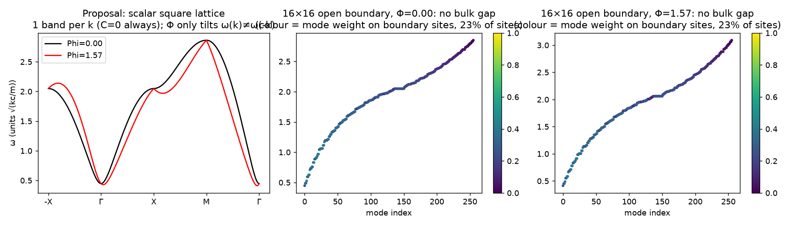
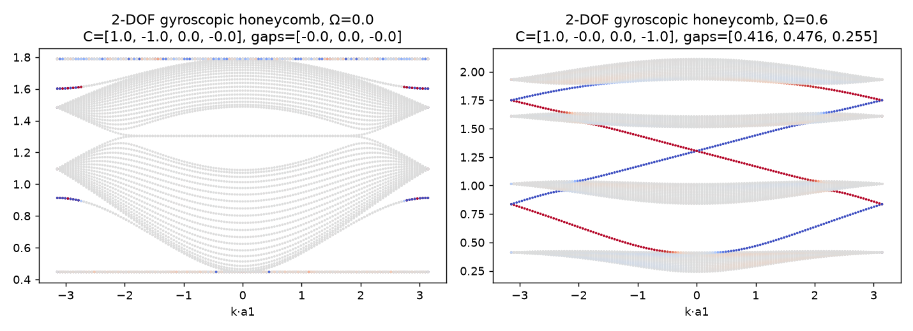
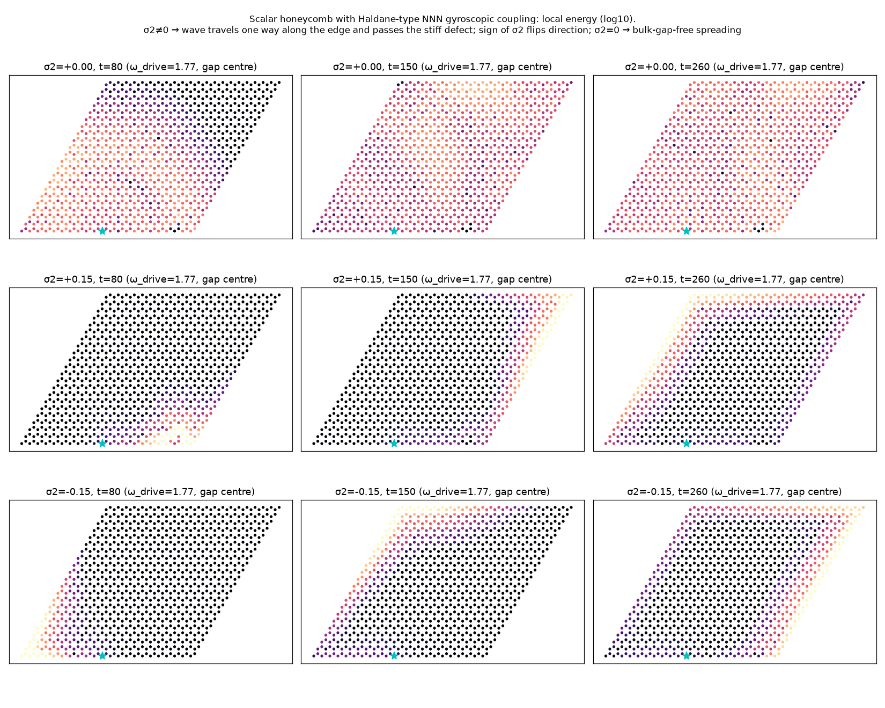

### 3.2 (b) Bernoulli 闭式解 —— 公式有缺陷，已给出稳定形式
- sympy 验证原式满足 ODE（残差 0），μ→0 极限 p₀m^{3/2}/√(m³+2ηp₀²t)。
- 原文印刷公式：μ=0 → NaN；μ≈0 相对误差最高 2.8×10⁻³（相消）；超大步长 → NaN；10⁶ 随机中 9172 个非有限。
- 稳定形式 w=1/p²：w(t)=e^{−z}w₀+(2ηt/m³)φ₁(−z)，最大相对误差 1.6×10⁻¹⁶，10⁶ 次单调有界全部通过，收敛到 p*=m√(μ/η)。
- 极限环：子流不动点 √(μ/η)=2000（测试参数）≠ 振子真实速度幅值 √(4μ/3η)=2309.4（仿真 2309.4）。
- 图：`figures/b1_bernoulli.png`

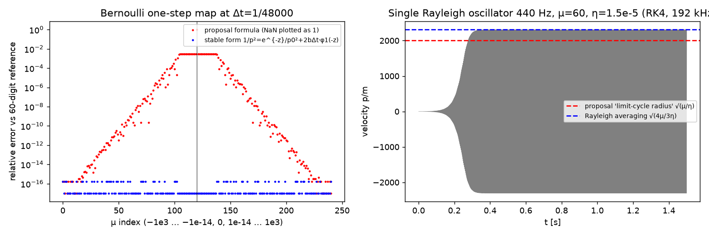

### 3.3 (c) Cayley 步 —— “正交保范”表述错误，代价被低估
- Q 满足 QᵀH_mQ=H_m（误差 1.4×10⁻¹⁴），但 QᵀQ−I 的最大元为 4.9×10⁷；‖Qz‖₂/‖z‖₂∈[3.1×10³, 6.3×10³]；奇异值 8.4×10⁻⁵…1.19×10⁴。
- 稠密：填充率 61%。每样本 flop：稠密 Q（8/16/32）= 6.6×10⁴ / 1.05×10⁶ / 1.68×10⁷；稀疏 LU = 1.6×10⁴ / 1.07×10⁵ / 6.8×10⁵；ESAV 模板 ≈1.3×10⁴ / 5.2×10⁴ / 2.1×10⁵。
- m 每改变一次需重分解：SuperLU（经 Python 调用）16×16 一次约 5.2 ms，32×32 约 10.4 ms；750 次/秒即 >100% 单核（C 中会更快，但仍不可忽略）——**未在 C 中实测**。
- 图：`figures/cd_cayley_and_kick_cfl.png`（左、中）

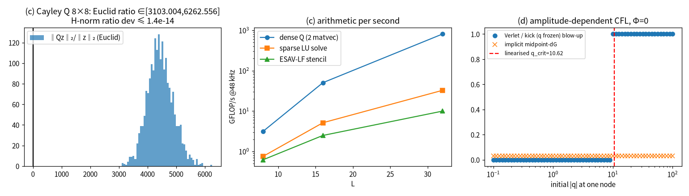

### 3.4 (d) “显式”离散梯度 —— 实为隐式；给出显式替代
- 含邻居耦合时，Gonzalez dG 与中点格式联立是对 q^{n+1} 的隐式（且因 ln cosh 为超越）方程；红黑排序本质是 Gauss–Seidel 迭代，并非闭式。
- 若按原文“q 冻结”理解，子步退化为显式 kick p←p−hU′(q)，稳定性需 h·ω_loc(q)<2，ω_loc²=(k₀+4k_c+3αq²+β sech²q)/m ⇒ **q_crit≈10.6**；数值：Verlet/kick 在 |q|=10 首次爆炸，隐式中点-dG 0 爆炸（Newton 平均 11.0、最大 40 次迭代）。
- 显式替代：**ESAV-LF**（诚实说明：回旋项 G 跨格点时——原文正方晶格与替代 A——左端为常系数线性系统，我们用 Jacobi 扫描求解（收缩因子≈0.16，15 次到 1e-13），即“线性隐式、固定步数”；G 为格点内 2×2 块（替代 B）时完全显式、逐点精确求解，这也是推荐替代 B 的工程理由之一。）
- 构成：（SAV 能量二次化 + 两步蛙跳 + 中心化回旋/阻尼）——见 `docs/theory_corrected.md` §5，离散功率平衡为恒等式，CFL 只依赖线性部分。另一可选为 BDZ 2023 的“精确 kick”变体。

### 3.5 (e) Strang 组合在参数泵浦与 μ>0 下的应力测试
设置：原文正方晶格，Φ=π/2，48 kHz，2048 样本；冲击=随机初始速度 10¹–10⁶、位移 10⁻¹–10²，外加 4 个随机力脉冲（10⁴–10⁹）；“pump”= m=m₀(1+0.8u)、α=α₀e^u 以 750 Hz 方波切换。

**8×8（ESAV/原文/RK4/Verlet 各 1000 组，IMDG 100 组，pump 64 组）：**

| 格式 | free_passive 发散率 | 无源性违背率 | passive 发散 | active 发散 | pump_lossless 最大 E/E₀ | Python µs/步/试验* |
|---|---|---|---|---|---|---|
| **ESAV-LF（修正）** | **0%** | **0%** | **0%** | **0%** | **1.000** | 12.5–13.4 |
| 原文 SSDG（稳定 Bernoulli） | 10.5% | 18.1% | 10.5% | 10.5% | 24.3 | 17.3–20.7 |
| 原文 SSDG（印刷 Bernoulli） | — | — | **100% NaN** | — | — | 13.3 |
| RK4 | 33.9% | 0% | 33.9% | 33.9% | 31.7 | 16.8–19.9 |
| Störmer–Verlet（回旋项显式） | 32.1% | 100% | 32.1% | 32.1% | 发散 | 5.6–11.9 |
| 隐式中点-dG + Newton | 0% | 0% | 0% | 0% | 18.8 | 124–185 |

\*批量向量化 Python 的摊销时间，**不代表实时单实例成本**（见 §3.7 的 C 实测）。原文 SSDG 在 pump 场景 2048 样本内 LU 重分解 33 次。

**16×16（ESAV/原文/RK4/Verlet 各 200 组，IMDG 16 组，pump 各 64 组；IMDG 因成本仅 16 组）：**

| 格式 | free_passive 发散率 | 无源性违背率 | passive / active 发散 | pump_lossless 最大 E/E₀ | pump（有阻尼）最大 E/E₀ | Python µs/步/试验* |
|---|---|---|---|---|---|---|
| **ESAV-LF（修正，含 ENPU）** | **0%** | **0%** | **0% / 0%** | **1.000** | **1.000** | 44–49 |
| 原文 SSDG（稳定 Bernoulli） | 12.5% | 20%（单步最大增幅 9×10⁻⁶） | 12.5% / 12.5% | 8.6 | 1.42 | 81–92（pump 中 LU 重分解 33 次） |
| RK4 | 36% | 0% | 36% / 36% | 8.1 | 1.41 | 56–75 |
| Störmer–Verlet | 35% | 100%（单步最大增幅 4.8%） | 35% / 35% | 100% 发散 | 34.1 | 19–45 |
| 隐式中点-dG + Newton | 0% | 0% | 0% / 0% | 9.5 | 1.40 | 680–1000（Newton 平均 3.5–4.0，最大 10） |

16×16 上无损泵浦的能量放大倍数（8–9.5）低于 8×8（19–32），但所有“精确”积分器均 >1，结论不变：参数调制是功率端口，必须由 ENPU 一类的参数更新规则约束。

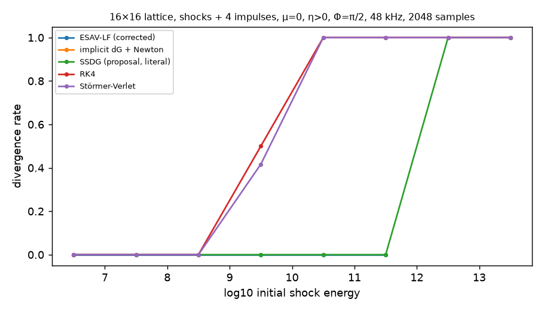
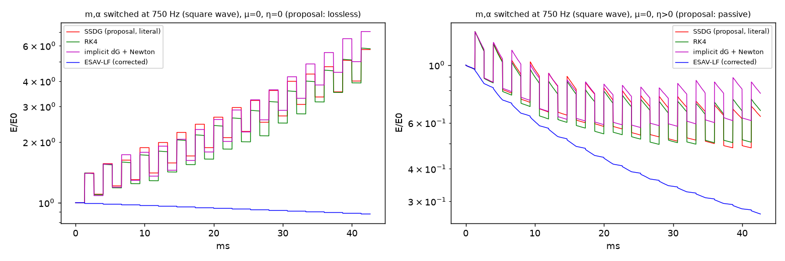

**10 000 次冲击门槛（原文 Phase 1 门槛：“10 000 次极端冲击零 NaN”，8×8，2048 样本）：**
| 格式 | 场景 | 试验数 | 发散数 |
|---|---|---|---|
| **ESAV-LF（修正）** | passive（μ≤0） | 10 000 | **0** |
| **ESAV-LF（修正）** | active（μ>0 自激 + η 饱和） | 10 000 | **0** |
| 原文 SSDG（稳定 Bernoulli） | passive | 10 000 | **1190（11.9%）** |

（来源 `experiments/results/e_gate10k_L8_ESAV.json`、`e_gate10k_L8_Literal.json`。原文 SSDG 使用印刷版 Bernoulli 公式时 passive 场景为 100% NaN，见上表。）

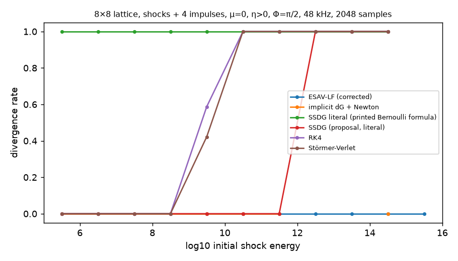
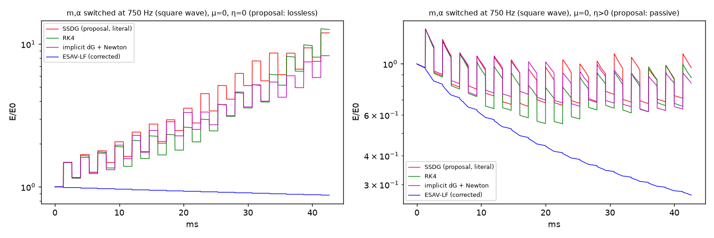

**结论**：(1) 原文 SSDG 的发散阈值约在初始冲击能量 10¹²（图 e1），根因是显式 kick 的振幅 CFL；(2) 参数泵浦对所有“精确”积分器都注入能量——这是物理而非数值问题，必须由 ENPU 处理；(3) 2 阶蛙跳类格式存在频率翘曲：解析色散关系 sin(ω̃h/2)=ωh/2，4 kHz（ωh≈0.52）处频率偏高约 1.2%（≈20 音分），需按 ω̃ 预畸变或过采样（解析值，未做听感验证）。

### 3.6 (f) Gray–Scott @ 750 Hz on 16×16
- 线性分析（`f_grayscott.json`）：所有常用参数集的 (1,0) 稳定（特征值 −F, −(F+k)）；非平凡均匀态要么在 k=0 已不稳定、要么全稳定——**没有一组是经典 Turing 不稳定**；图案是有限幅度/可激发机制，强依赖种子和尺寸。
- 尺寸鲁棒性（8 随机种子 × 5 参数 × 3 尺寸，15 000 慢步 = 20 s）：

| 参数集 | 16×16 存活 | 32×32 存活（λ, 稳定时间） | 64×64 存活（λ, 稳定时间） | 16×16，D/4 存活（λ, 稳定时间） |
|---|---|---|---|---|
| mitosis (0.0367,0.0649) | 0% | 62.5%（16 格，2.0 s） | 87.5%（14.3 格，3.6 s） | 100%（7.6 格，0.13 s） |
| coral (0.0545,0.062) | 0% | 0% | 100%（13.6 格，2.4 s） | 87.5%（8 格，0.67 s） |
| solitons (0.030,0.062) | 0% | 100%（14.3 格，0.67 s） | 100%（12.8 格，1.1 s） | 100%（7.2 格，0.33 s） |
| waves/chaos (0.014,0.045) | 0% | 0% | 0% | 0% |
| worms (0.078,0.061) | 0% | 0% | 0% | 0% |

（参数集名称沿用常见 Pearson/Munafo 命名，**未逐一核对其原始出处**；后两组在本扩散系数与种子下未能维持图案。）存活图案后期相对变化 ≈0（静态冻结）。
- u-源成核测试：6000 步后 v_max = 0（不变集）；3×3 v 种子幅度阈值介于 0.18 与 0.32 之间；u 被推到 1.14，超出原文声称的 [0,1]。
- 闭环（F4）：见发现 9 与图 f2/f3。
- 成本：GS 每慢步在 C 中 16×16 约 96 ns，摊销到每音频样本 <0.01% CPU——**计算不是问题，可听性与可控性才是问题**。750 Hz 阶跃式参数更新会产生 750 Hz 拉链噪声，必须逐样本插值。

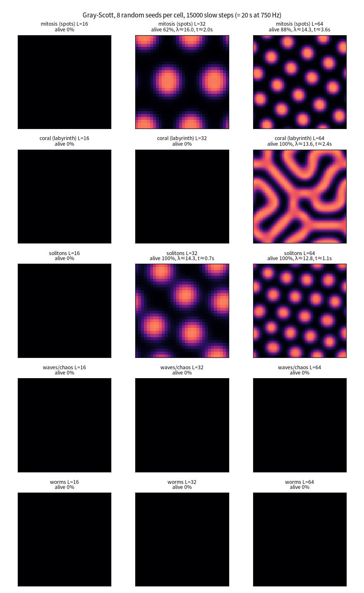
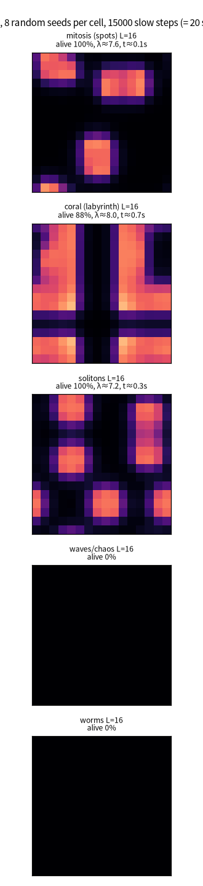
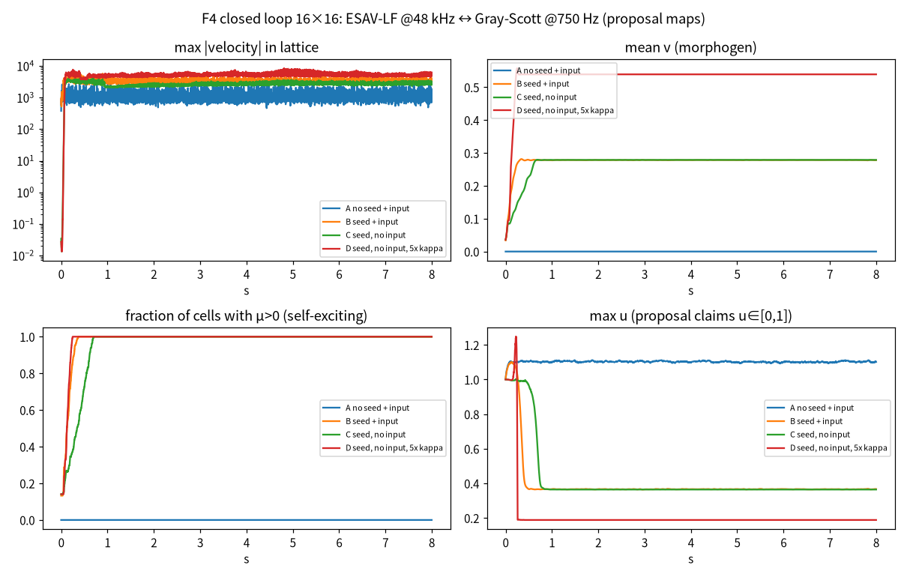
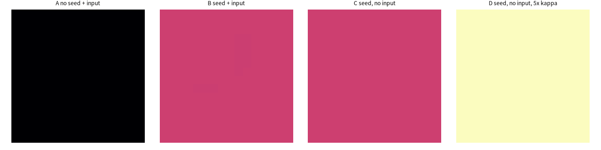

### 3.7 (g) CPU 指标可信度（C 实测）
测量条件：box 单核（Intel Xeon 2.4 GHz，AVX-512），`taskset -c 7` 绑核，负载均值约 0.6（基本空闲），每项 5 次取中位数（稠密 Q 为 3 次），float32，gcc -O3 -march=native -ffast-math -fopenmp-simd。`fast` = 有理 tanh + 多项式 exp/log1p + 带小 |x| 级数分支的 ln cosh；`libm` = 标准库超越函数。内核为原文的**标量正方晶格**（含填充晕区的向量化模板）；NJ = 回旋项 Jacobi 扫描次数（NJ=0 即 G=0，代表“完全显式”的下限，接近替代 B 的格点内回旋情形）。原始数据：`experiments/cbench/bench_final_raw.txt`，汇总：`bench_final.txt`。

**单实例、48 kHz、占单核百分比（中位数）：**

| 内核 | 8×8 | 16×16 | 32×32 |
|---|---|---|---|
| ESAV-LF，NJ=0，fast | **0.67%**（139 ns） | **2.41%**（502 ns） | **8.65%**（1.80 µs） |
| ESAV-LF，NJ=4，fast | 1.04% | 3.34% | 12.35% |
| ESAV-LF，NJ=15，fast | 2.05% | 6.07% | 22.5% |
| ESAV-LF，NJ=0，libm | 1.23% | 4.41% | 16.3% |
| ESAV-LF，NJ=15，libm | 2.61% | 8.09% | 30.3% |
| RK4（fast / libm） | 1.27% / 2.03% | 4.09% / 6.71% | 18.2% / 28.2% |
| 原文 SSDG 路线：稠密 Cayley Q 矩阵向量乘（fast） | 8.5% | **128%** | 不可行（早先负载下实测约 2.2 ms/样本，≈10 000%） |
| Gray–Scott 慢步（摊销到每样本） | 0.002% | 0.007% | 0.026% |

**判断：**
- 原文“8×8 <2%”：**可达**（显式/少量扫描 + fast：0.7–1.0%；libm 1.2–2.6%）。
- 原文“16×16 ≈5%”：**可达**，但仅限修正格式（fast 2.4–6.1%，libm 4.4–8.1%）；按原文 SSDG（稠密 Q）为 128%，**不可达**。
- 原文“32×32 <14%”：**仅在 G 为格点内或 ≤4 次扫描且使用快速近似时可达**（8.6–12.3%）；标准 libm 或 15 次扫描为 16–30%；原文路线不可行。
- 未计入：参数插值与 ENPU（逐样本 O(N) 小量）、输入/输出映射、立体声/多通道、GUI；若采用 2-DOF 陀螺蜂窝，自由度翻倍，成本约为同格点数标量晶格的 2 倍（**估计，未实测**）；MPE 每音一个晶格时成本 × 复音数。
- 现代桌面 CPU（4–5 GHz）单核预计约快 1.5–2 倍（**估计**），Phase 3 需在你的本地机器上复测（风险 R11）。
- 实现陷阱（已遇到并修复）：ln cosh 快速近似的绝对误差（~4×10⁻⁵）乘以 β≈8.9×10⁵ 会使 2U+c₀<0 → √ 产生 NaN；需保证近似满足 U_approx≥0（小 |x| 用级数分支）。

---

## 4. 修正后的理论表述（摘要；全文见 `docs/theory_corrected.md`）
1. **晶格**：蜂窝 2-DOF 陀螺晶格（首选，回旋项为格点内 2×2，可逐点精确求解）或标量 Haldane NNN 蜂窝。
2. **积分器**：ESAV-LF——两步蛙跳 + 逐自由度 SAV（ψ≈√(2U+c₀)）+ 中心化回旋与滞后 Rayleigh 阻尼；离散功率平衡恒等；CFL 仅依赖线性部分与 m_min；μ≤0 时能量单调不增（与振幅无关）。
3. **Rayleigh 项**：中心化 D^n（滞后速度）或作为分裂子步的稳定 Bernoulli 流（w=1/p² 形式）。
4. **参数调制**：ENPU（保持 q̄，按 √(m/m′) 缩放速度，再按能量上限裁剪），保证每次更新 E 不增；逐样本插值消除拉链噪声。
5. **慢场**：源项改作用于 v 或调制 F；D 按网格缩放使 λ≈6–8 格；限制环路增益（或采用负反馈）；若要螺旋波，用 Barkley/FitzHugh–Nagumo 可激发介质。
6. **实现约束**：float32 + 快速近似时须保证 U_approx≥0（我们在 C 基准中实际遇到 ln cosh 近似误差 ×β 导致 2U+c₀<0 的 NaN，已修复）。

---

## 5. 风险登记表

| # | 风险 | 可能性 | 影响 | 缓解措施 / 关口 |
|---|---|---|---|---|
| R1 | 审稿人指出原文拓扑模型 C=0 | 已确认 | 致命 | 改用蜂窝/陀螺晶格（Phase 1 关口：FHS Chern + 时域边缘传输图） |
| R2 | 新颖性被 BDZ 2023 等否定 | 高 | 高 | 重新定位贡献为“拓扑晶格 + 无源参数调制 + 实时实现”；引用并对比 BDZ |
| R3 | 拓扑边缘态在 16×16 小晶格中不可闻/不显著（边缘态占比、带隙内频率范围窄） | 中 | 高 | Phase 1 做听感原型 + 背向反射比测量；必要时用 24×24 或条带几何 |
| R4 | 参数调制导致能量注入/爆音 | 已确认 | 高 | ENPU + 平滑插值；10k 冲击门槛 |
| R5 | GS 在小网格上不成形/冻结 | 已确认 | 中 | 调 D、改源项、改为可激发介质或把形态场降级为控制层 |
| R6 | 正反馈环锁死为均匀态 | 已确认 | 中 | 负反馈设计/增益限幅/滞回；Phase 2 实验三重新设计 |
| R7 | CPU 超标（32×32、复音 MPE 每音一晶格） | 中–高 | 高 | 格点内回旋（免迭代）、SIMD、快速近似；MPE 改为共享晶格多激励点 |
| R8 | 2 阶格式频率翘曲（高频失谐） | 已确认 | 中 | 频率预畸变 / 2× 过采样 / 4 阶组合（Yoshida）评估 |
| R9 | 错误引用进入论文 | 已确认 | 高 | 采用本报告核验表；refs.bib 每条附 DOI |
| R10 | 可微分逆向设计不收敛（混沌/自激系统的 BPTT 梯度爆炸） | 中–高 | 中 | 先做被动区（μ≤0）参数辨识；截断 BPTT + 谱损失；Phase 2 关口 |
| R11 | 本机 C 基准与用户 DAW 机器不同 | 确定 | 低–中 | Phase 3 在用户本地 Windows 机器上复测 |

---

## 6. 修订后的 Phase 1–5 计划（含关口与云端/本地分工）

| 阶段 | 内容 | 关口（Gate） | 运行位置 |
|---|---|---|---|
| **Phase 1（理论与原型，2–3 周）** | 蜂窝 2-DOF 陀螺晶格 + ESAV-LF 的完整证明（离散功率平衡、ENPU 不增性、CFL）；mpmath 高精度验证；Chern/带隙/边缘态时域；16×16、24×24 小晶格的听感渲染 | G1：功率平衡残差 <1e-12；10k 冲击 0 发散（被动+有源+泵浦）；C≠0 且时域单向传输；边缘态可闻 demo | 云端 box（全部 Python） |
| **Phase 2（对比与消融实验）** | exp1 稳定性/漂移/RTF（含 BDZ 2023 作为强基线）；exp2 缺陷绕射与背向反射比；exp3 重设计的形态耦合（负反馈）；exp4 被动区参数辨识 | G2：ESAV-LF 在发散率与能量漂移上严格优于基线；exp3 能产生非冻结演化；exp4 在合成目标上收敛 | 云端（批量），可用其它 bot 的云机并行（需你授权） |
| **Phase 3（C++20 内核 + 插件）** | header-only 内核（float32 SIMD、快速近似、零分配）；Catch2；JUCE VST3/CLAP | G3：用户本地机器上 8×8<2%、16×16<5%（单实例，48 kHz）；pluginval 通过；10k 冲击 0 NaN | 内核与单测在云端编译（box 无 g++，需安装或用 clang）；插件构建与 DAW 测试在**你的本地 Windows** |
| **Phase 4（预设与听感评测）** | 预设、批量渲染、MUSHRA 页面 | G4：内部听评通过 | 渲染在云端；试听在本地 |
| **Phase 5（论文与开源）** | DAFx 稿 → JAES/TASLP 扩展；代码-论文一致性审计 | G5：所有图一键重绘；所有引用带 DOI 且已核实 | 云端撰写，本地终审 |

---

## 7. 需要你决定的问题
1. 是否接受把核心模型从“正方标量晶格”改为“蜂窝 2-DOF 陀螺晶格”（首选）或“标量 Haldane 蜂窝”？
2. 论文主贡献是否改定为“拓扑晶格 + 无条件稳定显式格式 + 无源参数调制”，形态发生降为次要/控制层？
3. 形态场：保留 Gray–Scott（改源项/扩散系数），还是改用可激发介质（可得螺旋波）？
4. MPE 复音：每个音一个晶格（CPU×复音数）还是共享一个晶格多激励点？
5. 目标硬件与 CPU 预算的参照机器（你的本地 CPU 型号）？
6. Phase 2 是否需要我调用其它 bot 的云端机器并行跑批（此前你要求隔离其它 bot，因此本阶段未使用）？
7. 是否需要在 box 上安装 C++ 编译器（当前 apt 因 held packages 失败；可尝试 clang 或修复依赖）？

---

## 附录 A：复现方式
见 `README.md`。所有脚本位于 `python/scripts/`，C 基准位于 `experiments/cbench/`，结果 JSON 位于 `experiments/results/`。
