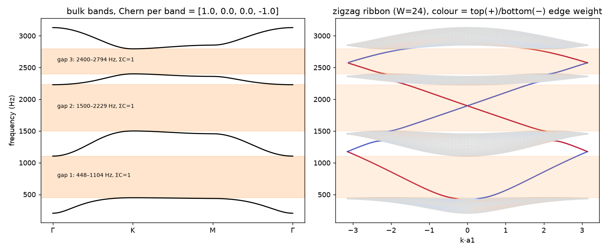
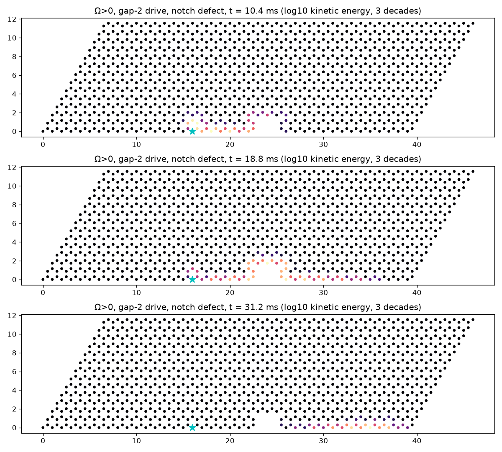
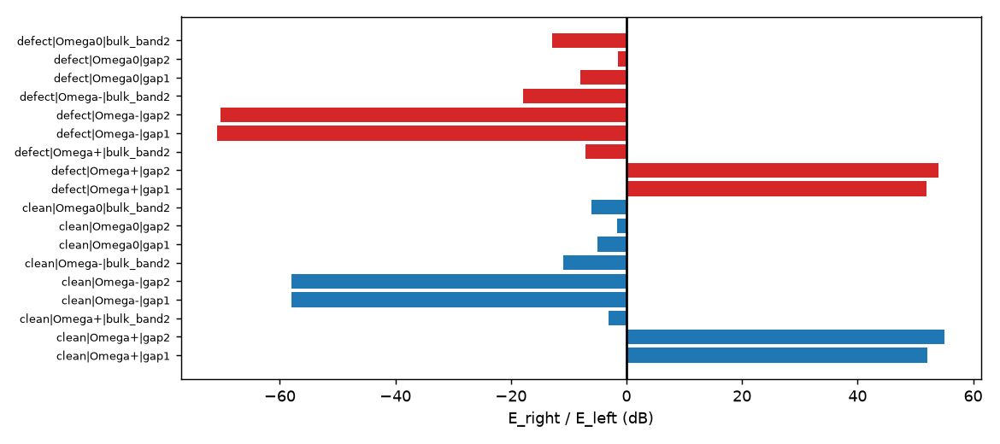
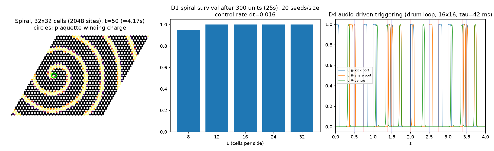

# Project Morphohedra（NR-PHMS）— Phase 1 阶段报告

- 日期：2026-10-30（Asia/Shanghai）
- 工作区：`morpho-phs-workspace/`（云端 box 运行，产物同步到本地 `C:\Users\24168\Documents\Projects\morpho-phs-workspace`）
- 原则：本报告中所有数字都来自本阶段实际运行的代码，出处在括号中注明（JSON/日志文件路径）。没有估计值不加标注；唯一的估计值（i9-13900H 性能）在 §6 中明确标为估算。

## 0. 摘要（一句话版）

用户在 Phase 0 后做出的 7 项决策已全部落地：**2 自由度陀螺蜂窝晶格 + 显式 ESAV-LF + 无源参数调制 ENPU + Barkley 可激介质控制层 + 共享晶格多端口 MPE**。四条定理与两条命题有完整证明（`docs/theory_proofs.pdf`），并通过符号计算、50 位高精度和 4 万组随机极端压力测试验证；拓扑边缘输运在音频频段实测方向性 +52～+55 dB、缺陷绕行透射损失 ≤0.003 dB；C++20 纯头文件核心全部 10 项测试通过、处理循环零堆分配，16×16 晶格（1024 自由度）四次势在 box 单核上占 31%（不含控制层）/ 34%（含控制层）；32×32 单线程无法实时，需多线程（§7）。

## 1. 本阶段完成了什么

| 模块 | 交付物 | 状态 |
|---|---|---|
| 理论 | `docs/theory_v1.md`（中文）、`docs/theory_proofs.tex/.pdf`（英文，tectonic 编译） | ✅ 定理 1–4、命题 5–6，含证明 |
| 机器验证 A：功率平衡 | `python/scripts/phase1/p1_a_verify.py` → `p1_a_verify.json` | ✅ sympy 恒等式 + mpmath 50 位 |
| 机器验证 B：拓扑 | `p1_b_topology.py` → `p1_b_topology.json`，图 p1_b1–b3 | ✅ 能带、Chern 数、条带谱、时域边缘输运与缺陷绕行 |
| 机器验证 C：压力门槛 | `p1_c_gates.py` → `p1_c_gate_{passive,modul,active,activecap}_L8.json` | ✅ 4×10 000 组 |
| 可激介质 D | `p1_d_excitable.py` → `p1_d_excitable.json`，图 p1_d | ✅ 螺旋/靶波/音频触发量化 |
| C++ 核心 | `include/morpho_phs/*.hpp`、`tests/test_main.cpp`、`bench/bench.cpp` | ✅ 10/10 测试通过，零分配 |
| 音频演示 | `experiments/audio/00–07*.wav`（48 kHz/16-bit 立体声），`p1_f_audio_demos.json` | ✅ 8 个文件 |
| 工具链 | box 上无可用 apt → 用 pip `ziglang` 提供 C++20 编译器（`zig c++`，libc++），tectonic 0.15 编译 LaTeX | ✅ 未改动系统包，未触碰 AETHER |

## 2. 理论结果（详见 `docs/theory_v1.md` 与 `docs/theory_proofs.pdf`）

模型：M q̈ = −Kq − ∇U(q) + G q̇ − D(q̇) q̇ + B u，y = Bᵀq̇。其中 K 为蜂窝中心力弹簧刚度（加接地 k₀），G = blockdiag(g_i J₂) 为陀螺项，D = blockdiag((−μ_i + η_i|v_i|²)I₂)，U = α/4·s⁴ + β·log cosh s（逐自由度、凸）。

ESAV-LF：蛙跳 + 标量辅助变量（SAV）处理非线性势，阻尼速度滞后一步，因此每个格点只需解一个 2×2 线性系统——**完全显式，无迭代**。

| 编号 | 结论 | 条件 |
|---|---|---|
| 定理 1 | 离散功率平衡是**恒等式**：E⁺ − E⁻ = h·uᵀy − h·v̄ᵀDv̄ | 无条件 |
| 定理 2 | Ẽ ≥ ½(1−γ²)‖v‖²_M + ½q̄ᵀKq̄ ≥ 0；μ ≤ 0 时离散无源，自由运动能量单调不增、位移有界 | 仅需**线性** CFL：γ = hω_max/2 < 1 |
| 定理 3 | ENPU：任意可容许参数跳变（质量、α/β、回旋 g 含反号、μ、η）后能量不增 | U 凸且 U(0)=0 |
| 定理 4 | 能量门控负阻自激：Ẽ ≤ max(Ẽ₀, ρ·Ẽ_cap)，ρ = (1+δ)/(1−δ)，δ = hμ_max/(m_min(1−γ²)) | δ < 1 |
| 命题 5 | 多端口 MPE：每个音符的输入功率可单独计量；无源终端/功率保持互联保持无源 | — |
| 命题 6 | “能量防火墙”：任意控制层（含闭环）经钳位映射 + ENPU 改参数，不破坏定理 2/4 的界 | Φ 取值于可容许集 |

**诚实说明：** “无条件稳定”指对非线性、回旋、非线性阻尼与门控增益无条件；作为显式格式仍有线性 CFL。音频参数下（f_unit = 1500 Hz，f_s = 48 kHz）γ = 0.205（m = 1）/0.290（m_min = 0.5），C++ 用保守界得 0.242。

## 3. 拓扑晶格在音频频段（`p1_b_topology.json`）

参数：f_unit = 1500 Hz，k₀ = 0.1k_c，g = 0.6ω_u，m = 1，f_s = 48 kHz。

- 体能带（Hz）：204–448、1104–1500、2229–2400、2794–3129；Chern 数 [1, 0, 0, −1]（FHS 格点法）。
- 三个带隙：448–1104 Hz（656 Hz 宽）、1500–2229 Hz（729 Hz）、2400–2794 Hz（394 Hz），每个带隙下方 Chern 数之和为 1 ⇒ 每条边一支手性边缘态。

| 时域测试（40×14 薄片，带吸收边框） | 带隙 1（776 Hz） | 带隙 2（1865 Hz） | 体带（1302 Hz） |
|---|---|---|---|
| Ω+ 干净边缘，右/左能量比 | **+52.1 dB** | **+55.0 dB** | −3.2 dB |
| Ω+ 有缺口边缘，右/左 | +51.9 dB | +54.0 dB | −7.0 dB |
| 缺陷引起的透射变化 | **−0.002 dB** | **+0.003 dB** | −3.9 dB |
| Ω−（回旋反号），右/左 | −58.0 dB | −57.9 dB | −11.0 dB |
| Ω = 0（无回旋），右/左 | −5.0 dB | −1.7 dB | −6.1 dB |

结论：带隙内的边缘传输是单向的（方向由回旋符号决定），并且绕过缺陷几乎无损；体带频率与无回旋情形没有这种保护。这是论文贡献 1 的核心证据。

## 4. 机器验证门槛表

### 4.1 功率平衡（`p1_a_verify.json`，`experiments/cpp_test_output.txt`）

| 检验 | 结果 |
|---|---|
| sympy 符号展开，1 格点（18 项）/2 格点（44 项） | 恒等式精确成立 |
| mpmath 50 位，1 格点 / 2×2 / 3×3 薄片，μ<0 与 μ>0 | 最大相对残差 1.0e-50 / 5.9e-51 / 5.0e-51 |
| C++ double，8×8，4000 步，随机有源参数（T2） | 5.46e-16 |
| C++ 四次势快速路径（T2c） | 6.53e-16 |
| C++ 增量能量追踪器漂移，4000 步（T2b） | 4.5e-15 |

### 4.2 随机压力门槛（8×8 = 256 自由度，每组 2048 步，每场景 10 000 组）

| 场景 | 组数 | 非有限值 | 关键量 | 结果 | 判定 |
|---|---|---|---|---|---|
| passive（μ ≤ 0，极端冲击 + 输入脉冲） | 10 000 | **0** | 逐步无源性超额最大值 / 累计最大值 | −3.0e-7 / −1.04e-6（≤ 0） | ✅ 定理 2 |
| modul（passive + 每 64 步随机参数跳变，320 000 次 ENPU） | 10 000 | **0** | 逐步 / 累计无源性超额；ENPU 最大相对能量增量 | −5.0e-8 / −1.1e-6；−3.5e-8（89 030 次缩放） | ✅ 定理 2、3 |
| active（μ ∈ [0, 60]，η > 0，E_cap = 1e9，含调制） | 10 000 | **0** | max Ẽ/界（界 = max(Ẽ₀, ρẼ_cap)，ρ = 1.0053）；ENPU 最大增量 | 1.0000；−5.1e-8（88 008 次缩放）；max E/E₀ = 1.00006 | ✅ 定理 4（但初始能量高于门限，门控未真正受压） |
| **activecap**（μ ∈ [0, 2000]，E_cap = 1e5，小初值 q₀ ∈ 10⁻⁶–10⁻³，含调制） | 10 000 | **0** | max Ẽ/界（ρ = 1.1945，δ = 0.0886）；能量至少达到 E_cap/2 的比例；ENPU 最大增量 | **0.915**；**100%**；max E/E₀ = 820；−4.3e-8（176 464 次缩放） | ✅ 定理 4（真正从小信号自激长到门限） |

运行时间：passive 746 s、modul 764 s、active 797 s、activecap 885 s（单核，Python/NumPy，8×8）。

“无源性超额”= (ΔE − h·uᵀy)/能量尺度；≤0 表示没有任何一步违背定理 2。被动/调制场景包含初速 10¹–10⁶、初位移 10⁻¹–10²、4 个 10⁴–10⁹ 力脉冲；调制场景每 64 步做一次随机参数跳变（质量 0.5–2、α、β、g 换号、μ），共 320 000 次 ENPU。

### 4.3 C++ 核心测试（`tests/test_main.cpp`，输出 `experiments/cpp_test_output.txt`；AVX2 构建 `experiments/cpp_test_output_avx2.txt` 同样全部通过）

| 测试 | 结果 |
|---|---|
| T1 与 Python 参考对齐（L=4，3 端口，第 199 步 ENPU） | 前 50 步 y 相对误差 1.44e-12；400 步后 q 1.7e-7、y 6.7e-8、E 7.6e-11（强非线性区的舍入放大，非算法差异） |
| T2 / T2b / T2c 功率平衡 | 5.46e-16 / 4.5e-15 / 6.53e-16 |
| T3 ENPU 2000 次随机跳变 | 最大相对增量 −4.3e-7（1088 次缩放） |
| T4 螺旋调制下门控自激 4 s | max Ẽ = 1.00586e7 ≤ ρẼ_cap = 1.01338e7（ρ = 1.01337，γ = 0.242） |
| T4b 振荡确实长到门限 | 是（1.006e7，门限 1e7） |
| T5 192 000 样本处理循环（含 ENPU 与介质节拍）堆分配次数 | **0** |
| T6 8×8 Barkley 螺旋 4 s 后仍存活 | 拓扑电荷 1 |
| T7 float32 被动运行 1 s | 全部有限 |

## 5. 可激介质控制层：Barkley 模型（`p1_d_excitable.json`，图 p1_d）

**选择 Barkley（1991）而非 FHN / Aliev–Panfilov 的理由**：专为可激介质波的快速模拟设计（每格点两变量、只有 u 扩散）；粗网格下螺旋波仍定性正确，适合 8×8～32×32 的小晶格；(a, b, ε) 直接对应“激发阈值”与“恢复速度”，容易做成音乐参数；精确动力学下 u ∈ [0,1]，便于有界映射。引用已核实：D. Barkley, *Physica D* 49 (1991) 61–70, doi:10.1016/0167-2789(91)90194-E。

设定：a = 0.75，b = 0.03，ε = 0.02，D = 0.5，显式 Euler，dt = 0.016；控制率 750 Hz（每 64 样本一个节拍），1 个模型时间单位 τ = 1/12 s（子步数 S 可把 τ 缩短为 τ/S）。

| 实验 | 结果 |
|---|---|
| D1 螺旋存活（随机断裂波前，每尺寸 20 组，300 单位 = 25 s） | 8×8：0.95；12×12、16×16、24×24、32×32：1.0 |
| D1 螺旋周期 | 5.712 单位 = 0.476 s；相对 dt = 0.002 细步长参考偏差 +2.0%；存活判定与参考一致（8×8 为 3/4，其余 4/4） |
| D2 步长扫描（16×16） | dt ≤ 0.016：u 保持在 [0,1]；0.024：u ≥ −0.003；0.032：[−0.038, 1.012]；0.048：[−0.16, 1.07]；0.064：周期 4.67、u 最大 1.59（失真）⇒ 采用 dt ≤ 0.016 + 子步 |
| D3 靶波起搏（16×16 中心→远角） | 起搏周期 ≥ 5 单位（≥ 0.42 s）1:1 传到远角；4 单位 0.51、3 单位 0.5、2 单位 0.33（不应期分频） |
| D4 音频驱动触发（8 s 合成鼓组，120 BPM，16 个底鼓 + 8 个军鼓） | 24/24 个起音被检出，检测延迟中位数 1.33 ms；29 次触发（含 5 次多余触发） |
| D4 真正发出新波的比例（反事实对照） | τ = 83 ms：0.72；42 ms：0.69；21 ms：0.97（未发出的触发落在前一个波的不应期内） |

结论：螺旋波与靶波在所需尺寸上都稳定出现；音频触发延迟约为一个控制块。快节奏下的“节律分频”是可激介质的固有行为，应作为用户旋钮（介质速率 τ）开放，而不是当作缺陷消除。

## 6. 音频演示（`experiments/audio/`，`p1_f_audio_demos.json`，渲染器 `tools/render_demos.cpp`）

全部为 48 kHz、16-bit 立体声，峰值归一化到 −1 dBFS，由 C++ 核心直接渲染。

| 文件 | 内容 | 实测 |
|---|---|---|
| 00_input_drum_loop.wav | 干输入：8 s 合成鼓组 | — |
| 01 / 02 / 03_edge_disperser_*.wav | 40×14 薄片，鼓组注入底边中点，左右各 8 格拾音（左声道 = 左拾音点），离源 > 14 格设径向吸收区（只用 μ ≤ 0，不影响无源性）；Ω+ / Ω=0 / Ω− | 右/左拾音能量比 **+6.05 / +0.08 / −6.07 dB**；三者均无源（终能量 ≤ 初能量 + 输入功） |
| 06 / 07_edge_disperser_gapband_*.wav | 同上，输入先经 776 Hz 带通（Q = 1.5，位于带隙 1） | +5.40 / −5.46 dB；无源 |
| 04_selfoscillating_spiral_patch.wav | 12×12，负阻 μ = 40 + 能量门控（E_cap = 2e6），Barkley 螺旋通过 ParamMap 调制 g（被激发处回旋反号）与 μ，12 s | max E = 2.0027e6 ≤ ρẼ_cap = 2.0109e6（ρ = 1.0053），9000 次 ENPU 中 4166 次缩放，结束时螺旋电荷 1 |
| 05_mpe_chord_shared_lattice.wav | 16×16 共享晶格，C3/E3/G3 三个限带锯齿波各占一个端口，声像分开，7 s | 每个音符输入功 678.6 / 735.6 / 331.6（能量单位）；终能量 0.166 ≤ 1745.7，无源 |

**注意（诚实说明）：** 宽带鼓组的边缘演示方向性只有约 ±6 dB，远小于 §3 的 +52 dB。可能原因（尚未逐项验证）：(1) 鼓组的大部分能量落在带隙外（底鼓 < 448 Hz 在最低体带以下或体带内），只有带隙内分量受拓扑保护；(2) 演示中拾音点距离源仅 8 格，近场体波两侧都能到达。带通输入并没有提高比值（5.4 dB），因此我们推测主导因素是近场与点源激发的体波分量，而不是输入频谱；这一点需在 Phase 2 用拾音距离扫描确认。第一次渲染时没有吸收区，手性波绕薄片一周回到左拾音点，比值只有 +2.57 / −0.28 / −2.85 dB——这正说明封闭薄片本身是一条“手性环形延迟线”，在音乐上可作为特性。把演示做成听感上明显的单向效果（拾音点更远、源点用边缘模态形状激发）列入 Phase 2。

## 7. C++ 性能（`bench/bench.cpp`；原始输出 `experiments/cpp_bench_box.txt`（-march=native，AVX-512）与 `experiments/cpp_bench_box_avx2.txt`（-march=x86-64-v3，AVX2））

测量方法：4 个端口持续输入噪声，预热后重复 5 次取中位数；每次 1 s 音频（48 000 样本）；“%单核”= µs/样本 × 48 000 / 10⁶。每个配置绑定单核（taskset）。控制层 = Barkley 介质 + ParamMap + ENPU，每 64 样本一次。

**box 硬件**：Intel Xeon（CPU family 6 / model 207，即 Emerald Rapids，Raptor Cove 内核），KVM 虚拟机，8 vCPU。用依赖 IMUL 链（延迟 3 周期）实测有效时钟 **3.55 GHz**（`tools/freq_probe.cpp`，`experiments/box_freq_probe.txt`）。

**i9-13900H 估算（明确标注：估算，非实测）**：i9-13900H 的 P 核同为 Raptor Cove 微架构，且不支持 AVX-512（Intel 官方规格：P 核最高睿频 5.4 GHz，6P+8E/20 线程），所以用 box 的 **AVX2 构建**结果按时钟比例换算：估算 = box AVX2 时间 × 3.55 / f。f 取 5.4 GHz（官方单核最高睿频，乐观）与 4.0 GHz（笔记本持续负载下的假设值，非测量）。未计入：内存/缓存差异（工作集最大约数百 KB，两者 L2 均能容纳大部分）、Windows 调度、E 核调度风险（DAW 音频线程应落在 P 核上）。Phase 2 第一项任务即在用户本机实测替换。

| L（自由度） | 精度 | 势 | 控制层 | box AVX-512 µs/样本（%单核） | box AVX2 µs/样本（%单核） | i9-13900H 估算 µs（%单核），5.4 / 4.0 GHz |
|---|---|---|---|---|---|---|
| 8×8（256） | f32 | 线性 | 关 | 1.12（5%） | 1.31（6%） | 0.86（4%） / 1.16（6%） |
| 8×8（256） | f32 | 线性 | 开 | 1.12（5%） | 1.67（8%） | 1.09（5%） / 1.48（7%） |
| 8×8（256） | f32 | 四次势 | 关 | 1.51（7%） | 1.60（8%） | 1.05（5%） / 1.42（7%） |
| 8×8（256） | f32 | 四次势 | 开 | 1.55（7%） | 1.66（8%） | 1.09（5%） / 1.47（7%） |
| 8×8（256） | f32 | 四次+log cosh | 关 | 3.63（17%） | 3.85（18%） | 2.53（12%） / 3.41（16%） |
| 8×8（256） | f32 | 四次+log cosh | 开 | 7.32（35%） | 9.08（44%） | 5.96（29%） / 8.05（39%） |
| 8×8（256） | f64 | 线性 | 关 | 1.16（6%） | 1.32（6%） | 0.87（4%） / 1.17（6%） |
| 8×8（256） | f64 | 线性 | 开 | 1.19（6%） | 1.46（7%） | 0.96（5%） / 1.29（6%） |
| 8×8（256） | f64 | 四次势 | 关 | 1.53（7%） | 1.87（9%） | 1.23（6%） / 1.66（8%） |
| 8×8（256） | f64 | 四次势 | 开 | 1.68（8%） | 1.90（9%） | 1.25（6%） / 1.69（8%） |
| 8×8（256） | f64 | 四次+log cosh | 关 | 6.65（32%） | 7.35（35%） | 4.83（23%） / 6.52（31%） |
| 8×8（256） | f64 | 四次+log cosh | 开 | 8.76（42%） | 9.80（47%） | 6.43（31%） / 8.69（42%） |
| 16×16（1024） | f32 | 线性 | 关 | 4.74（23%） | 4.80（23%） | 3.15（15%） / 4.26（20%） |
| 16×16（1024） | f32 | 线性 | 开 | 4.98（24%） | 5.10（24%） | 3.35（16%） / 4.52（22%） |
| 16×16（1024） | f32 | 四次势 | 关 | 6.22（30%） | 6.37（31%） | 4.18（20%） / 5.65（27%） |
| 16×16（1024） | f32 | 四次势 | 开 | 6.44（31%） | 7.09（34%） | 4.65（22%） / 6.28（30%） |
| 16×16（1024） | f32 | 四次+log cosh | 关 | 14.67（70%） | 15.19（73%） | 9.98（48%） / 13.47（65%） |
| 16×16（1024） | f32 | 四次+log cosh | 开 | 24.37（117%） | 25.98（125%） | 17.06（82%） / 23.03（111%） |
| 16×16（1024） | f64 | 线性 | 关 | 5.31（25%） | 5.39（26%） | 3.54（17%） / 4.78（23%） |
| 16×16（1024） | f64 | 线性 | 开 | 5.21（25%） | 5.67（27%） | 3.72（18%） / 5.03（24%） |
| 16×16（1024） | f64 | 四次势 | 关 | 6.55（31%） | 7.02（34%） | 4.61（22%） / 6.22（30%） |
| 16×16（1024） | f64 | 四次势 | 开 | 7.16（34%） | 7.45（36%） | 4.89（23%） / 6.60（32%） |
| 16×16（1024） | f64 | 四次+log cosh | 关 | 26.72（128%） | 27.75（133%） | 18.22（87%） / 24.60（118%） |
| 16×16（1024） | f64 | 四次+log cosh | 开 | 32.64（157%） | 34.91（168%） | 22.92（110%） / 30.95（149%） |
| 32×32（4096） | f32 | 线性 | 关 | 19.21（92%） | 19.88（95%） | 13.06（63%） / 17.63（85%） |
| 32×32（4096） | f32 | 线性 | 开 | 21.06（101%） | 21.99（106%） | 14.44（69%） / 19.49（94%） |
| 32×32（4096） | f32 | 四次势 | 关 | 25.11（121%） | 28.51（137%） | 18.72（90%） / 25.27（121%） |
| 32×32（4096） | f32 | 四次势 | 开 | 26.27（126%） | 27.32（131%） | 17.94（86%） / 24.22（116%） |
| 32×32（4096） | f32 | 四次+log cosh | 关 | 56.07（269%） | 62.56（300%） | 41.08（197%） / 55.46（266%） |
| 32×32（4096） | f32 | 四次+log cosh | 开 | 90.42（434%） | 94.54（454%） | 62.08（298%） / 83.81（402%） |
| 32×32（4096） | f64 | 线性 | 关 | 21.97（105%） | 22.17（106%） | 14.56（70%） / 19.66（94%） |
| 32×32（4096） | f64 | 线性 | 开 | 22.67（109%） | 24.08（116%） | 15.81（76%） / 21.35（102%） |
| 32×32（4096） | f64 | 四次势 | 关 | 28.17（135%） | 29.68（142%） | 19.49（94%） / 26.31（126%） |
| 32×32（4096） | f64 | 四次势 | 开 | 29.80（143%） | 31.03（149%） | 20.37（98%） / 27.51（132%） |
| 32×32（4096） | f64 | 四次+log cosh | 关 | 108.17（519%） | 109.85（527%） | 72.14（346%） / 97.38（467%） |
| 32×32（4096） | f64 | 四次+log cosh | 开 | 136.51（655%） | 145.19（697%） | 95.34（458%） / 128.71（618%） |

**结论**：
- 8×8 与 16×16 在四次势 + 控制层下单核实时：box 上 16×16 f64 为 7.16 µs/样本（34%，AVX-512）/ 7.45 µs（36%，AVX2）；i9 估算 4.9–6.6 µs（24–32%）。
- 32×32（4096 自由度）四次势 + 控制层：box 上 29.8 µs（143%，AVX-512）/ 31.0 µs（149%，AVX2）；i9 估算 20.4–27.5 µs（98–132%）——**单线程不可实时**，必须多线程（风险 R2）或作为离线/预览模式。
- log cosh 势代价高（16×16 f64 从 6.55 µs 升到 26.7 µs），是当前主要性能瓶颈（风险 R1）。
- 处理循环零堆分配（T5）；四次势下控制层开销约 0～10%（box 实测，个别配置差异在测量噪声内）。

## 8. 风险与已知问题

| # | 风险 | 影响 | 处置 |
|---|---|---|---|
| R1 | log cosh 势是超越函数，未向量化：16×16 f64 从 6.5 µs（四次势）涨到 26.7 µs/样本 | 32×32 + log cosh 单核不可实时 | 默认用四次势快速路径；任何凸 U(0)=0 的势都保持定理成立 ⇒ Phase 2 换成有理/分段多项式凸近似并向量化 |
| R2 | 32×32（4096 自由度）线性/四次势在 box 单核上 > 100%，i9 估算 98–132%（四次势+控制层） | 32×32 需要多线程 | Phase 2：按行块并行（每样本一次屏障）或 2 倍降采样子晶格；先在用户 i9 上实测 |
| R3 | ENPU 在 E_old < 0（ψ 漂移）时 s = 0，会把状态清零 | 罕见但会产生“咔哒” | 压力测试中未出现（ENPU 最大增量均为负）；Phase 2 实现并比较“保留 ψ”变体（能量严格守恒，因 K 不调制） |
| R4 | Python 参考实现的 log cosh 仍是朴素公式（双精度下无害；float32 下曾导致 U<0 ⇒ NaN） | 仅影响 Python 单精度 | C++ 已改为无抵消公式 log1p(2 sinh²(a/2))；Python 在 Phase 2 同步 |
| R5 | Barkley 不应期 vs 鼓点速度：τ = 83 ms 时只有 72% 的触发发出新波 | 快节奏下“丢拍” | 把介质速率（τ / 子步数）作为用户旋钮；τ = 21 ms 时 97% |
| R6 | 宽带边缘演示方向性仅约 ±6 dB（理想带隙测试为 +52 dB） | 听感上的“单向”不够明显 | Phase 2：拾音距离扫描、边缘模态形状激发、带隙内音源设计 |
| R7 | box CPU（Xeon，Emerald Rapids，KVM 虚拟化，AVX-512）≠ 用户 i9-13900H（AVX2，混合架构） | i9 数字只是估算 | 已提供 AVX2 构建的 box 数字 + 时钟换算估算；Phase 2 第一件事是在用户本地实测 |
| R8 | 编译器为 zig c++（clang/libc++），而非 MSVC/g++ | Windows/MSVC 构建未验证 | 头文件只用标准 C++20；Phase 2 在用户机器上用 MSVC 构建一次测试 |
| R9 | 本阶段中途 box 被回滚到 15:54:43 的快照（一次 840 s 前台命令超时附近） | 丢失了 build/ 与一次 SoA 重写，activecap 被中断 | 已全部重做并重跑；此后长任务均后台 + nohup + 增量写文件 |
| R10 | 引用：FHS（Fukui–Hatsugai–Suzuki 2005）卷页尚未逐条核实 | 论文引用风险 | 投稿前核实；其余引用已在 Phase 0/1 核实 |

## 9. Phase 2 计划（建议）

1. **本地实测**：在用户 i9-13900H 上用 MSVC 构建 `tests/` 与 `bench/`，得到真实 µs/样本（替换 §7 的估算）。
2. **性能**：凸有理近似替代 log cosh 并向量化；32×32 行块并行；float32 SIMD 路径；目标是 32×32 四次势 + 控制层在 i9 上 < 50% 单核等效（多线程合计）。
3. **插件骨架（JUCE/VST3）**：音频线程只调用 `process_sample`/块处理，控制层在同一线程按块运行（已验证零分配）；MPE 音符 → 端口分配器（固定端口池，无分配）。
4. **ENPU 变体与听感**：比较“重投影 ψ”与“保留 ψ”两种 ENPU 的听感与能量行为；处理 E_old < 0 角落情形。
5. **边缘演示与音色设计**：拾音距离扫描、手性环形延迟线、带隙内音源；Ω 符号随螺旋波翻转产生的“拓扑畴壁”音色。
6. **论文**：以 `docs/theory_proofs.tex` 为基础起草方法论文（拓扑晶格 + ESAV-LF + ENPU + 能量防火墙），图表直接用 Phase 1 数据。

## 10. 需要用户决策

1. **默认非线性势**：采用四次势（快、已向量化）作为默认，log cosh 作为“高质量”选项——是否同意？
2. **32×32 的实时策略**：多线程（行块并行）还是限制为 ≤ 16×16 单线程 + 32×32 离线/预览？
3. **介质速率旋钮**：是否把 Barkley 的 τ（21–83 ms）直接暴露为用户参数（“激发速度”），接受快节奏下的节律分频作为音乐特征？
4. **ENPU 变体**：默认用哪一种（重投影：能量严格不增但可能缩放；保留 ψ：能量守恒、无缩放）？建议 Phase 2 做 A/B 听感后再定。
5. **插件框架**：JUCE（与 AETHER 无关的独立工程）还是纯 VST3 SDK？
6. **Phase 2 是否在用户本机运行基准**（需要本机安装 MSVC/CMake 并授权本地执行）？

## 附录 A：Phase 1 文件清单

| 路径 | 说明 |
|---|---|
| `reports/Phase1_阶段报告.md` / `.pdf` | 本报告 |
| `docs/theory_v1.md` | 理论 v1（中文） |
| `docs/theory_proofs.tex` / `.pdf` | 定理与证明（英文，tectonic 编译） |
| `python/diffphs/gyro.py`, `python/diffphs/excitable.py` | Python 参考实现 |
| `python/scripts/phase1/p1_a_verify.py` … `p1_e_cpp_reference.py` | 验证脚本 |
| `experiments/results/phase1/p1_a_verify.json` | 符号/高精度功率平衡 |
| `experiments/results/phase1/p1_b_topology.json` | 能带、Chern 数、边缘输运 |
| `experiments/results/phase1/p1_c_gate_{passive,modul,active,activecap}_L8.json`，`experiments/p1_c_gate_*.log` | 压力门槛 |
| `experiments/results/phase1/p1_d_excitable.json` | 可激介质 |
| `experiments/results/phase1/p1_f_audio_demos.json` | 音频演示的实测量 |
| `reports/figures/phase1/p1_b1/b2/b3/p1_d*.png` | 图 |
| `include/morpho_phs/{core_types,honeycomb,esav_lf,enpu,excitable,morpho_phs}.hpp` | C++20 纯头文件核心 |
| `tests/test_main.cpp`, `tests/ref_L4.txt` | C++ 测试与 Python 参考数据 |
| `bench/bench.cpp` | 基准 |
| `tools/render_demos.cpp`, `tools/freq_probe.cpp` | 演示渲染器、时钟探针 |
| `experiments/cpp_test_output.txt`, `experiments/cpp_test_output_avx2.txt` | 测试输出（native / AVX2） |
| `experiments/cpp_bench_box.txt`, `experiments/cpp_bench_box_avx2.txt`, `experiments/box_freq_probe.txt` | 基准与时钟 |
| `experiments/audio/00–07_*.wav` | 音频演示 |
