# Project Morphohedra（NR-PHMS）— Phase 2 阶段报告

- 日期：2026-10-30（Asia/Shanghai）；Phase 2 开始于 16:37。
- 工作区：`morpho-phs-workspace/`。所有计算都在云端 box 上运行（Intel Xeon，Emerald Rapids，8 vCPU，AVX-512，KVM 虚拟化）。**没有在用户 PC 上运行任何东西**。
- 原则：本报告的每个数字都来自本阶段实际运行的代码，出处标在括号里（JSON、日志或 CSV 路径）。唯一的估算值是 i9-13900H 的性能（§2.3），已明确标注。
- 进度日志：`reports/phase2_progress.md`。

## 0. 摘要

| 任务 | 结论 | 门槛 |
|---|---|---|
| 32×32 多线程实时 | 无锁、零分配、**任意线程数逐位一致**的 MT 内核。32×32（4096 自由度）四次势 f64，含控制层：1 线程 28.7 µs/样本 → 4 线程 10.6 → 8 线程 7.8 µs/样本（AVX2 构建）。48 kHz 预算为 20.8 µs，按中位数 **≥2 线程即可实时**；按 64 样本块的 p99（预算 1333 µs）需要 **≥3 线程**（2T 为 1688 µs，3T 为 1230 µs，4T 为 980 µs）。log-cosh 高质量模式需要 8 线程，且 f64 在 8 线程时仍略超预算 | ✅ 四次势 / ⚠️ log-cosh |
| exp1：六种格式 | ESAV-LF 在全部压力套件中**发散率 0**，自身能量不变量漂移 ≤ 5×10⁻¹³ dB（直到 hω_max = 1.88）；RK4、Störmer-Verlet、tanh 启发式大面积发散；字面 SSDG 约一半发散；隐式 dG+Newton（IMDG）只发散 2/112，但冲激和调制场景里 Newton 常不收敛，且在 Python 中比 ESAV 慢 26–32 倍。**诚实说明**：在强非线性驱动下 ESAV 的谐波幅度偏离参考（§3.4） | ✅（稳定性）/ ⚠️（强非线性精度） |
| exp2：手性边缘波 | 带隙 1、2 的方向性为 +72～+90 dB，带隙 3 只有 +34～+38 dB（ ±8 格，有吸收边界）；四种缺陷的背散射 ≤ −53 dB、透射损失 ≤ 0.21 dB；在 776 / 1865 / 2597 Hz 测得群速度。**±6 dB 宽带演示的原因已查清**：鼓组只有 1.1% 的能量落在带隙内；没有吸收边界时，手性波沿周长绕回另一个拾音点；8 阶 Butterworth 带通的过渡带也会漏能。修复方案为边框吸收 + Chebyshev-II 带隙滤波器组，带隙分量的 R/L 比达 **+74.7 / −75.5 dB**，演示已按此重新渲染（08–12） | ✅ |
| exp3：耦合 | 耦合使多尺度样本熵（质心序列，各尺度平均）从 0.001–0.015 升到 1.9–2.05，波形 LLE 估计从 2–22/s 升到 460–780/s。**没有稳健的 1/f**：耦合时 DFA α 为 0.60–0.67，PSD β 为 0.02–0.32；只有 κ = 1 时 α ≈ 1.0，但此时复杂度塌缩（MSE 0.028）。闭环与单向相比，LLE 更低、RMS 起伏略大 | ✅（如实报告：不支持 1/f 的说法） |
| exp4：逆向设计 | 4×4 晶格、134 个参数、200 次 Adam 迭代。在 3 个目标（自生成 ESAV、Risset 钟、Karplus-Strong）上，**模态滤波器组基线（132 个参数）都更好**（MR-STFT 0.92 / 1.21 / 2.01，ESAV 为 1.04 / 1.35 / 2.96），且快约 400 倍；ESAV 自生成目标的隐藏全局参数没有找回（g 符号相反）。一次性逆向设计在当前形式下不成立 | ❌（如实报告） |
| ENPU A/B/C | **推荐 C（selective）作为默认**。它对 g/μ/η 是精确的空操作（spiral 场景移除的能量为 0，A 为 176，逐样本更新时 A 为 3905），对 m/α/β 与 A 一样严格并保持 SAV 一致；B 在质量滑音时移除的能量是 C 的 74 倍。三种变体的听感指标几乎相同；**块率参数阶跃本身**比 ENPU 变体更重要（spiral 场景 >12 kHz 能量比逐样本插值高 8.3 dB）⇒ 建议 C + 子块插值 g/μ（已加入 O(N) 快速路径） | ✅ |

## 1. 本阶段完成了什么

| 模块 | 交付物 | 状态 |
|---|---|---|
| C++ 多线程内核 | `include/morpho_phs/esav_lf_mt.hpp`（EsavLFMT），`tests/test_mt.cpp`（M1–M8），`bench/bench_mt.cpp` | ✅ MT 测试全部通过，Phase 1 测试仍全部通过 |
| τ 旋钮、势函数切换 | `excitable.hpp: set_tau/tau_seconds`，`enpu.hpp: ControlLayer::set_tau`，`set_potential(Quartic ⇄ QuarticLogcosh)`（以 ENPU 方式无源切换） | ✅ M5、M7 |
| 融合 HQ 系数 | `core_types.hpp: sav_coeff_hq`：用一次 expm1 和一次 log1p 同时得到 U′ 与 √(2U+c₀)。200 万个随机点与 long double 参考相比的最大相对误差：double 1.9×10⁻¹²，float 9.9×10⁻⁴（`tools/check_hq_coeff.cpp` → `hq_coeff_accuracy.json`）。SAV 的能量恒等式对任意系数值都成立，所以 float 的误差只影响精度，不影响稳定性 | ✅ |
| ENPU 变体 B、C | `enpu_keep_psi`（B）、`enpu_selective`（C，含 g/μ/η 快速路径）；`ControlLayer::enpu_mode` | ✅ M6 |
| exp1 | `python/diffphs/gyro_schemes.py`，`python/scripts/phase2/p2_exp1_schemes.py` | ✅ |
| exp2 | `p2_exp2_edge.py`、`p2_exp2_analysis.py`、`tools/render_edge_v2.cpp`、`p2_edge_demos_v2.py` | ✅ |
| exp3 | `tools/exp3_coupling.cpp`、`python/diffphs/complexity.py`、`p2_exp3_coupling.py` | ✅ |
| exp4 | `p2_exp4_inverse.py`（PyTorch 2.15 CPU） | 见 §6 |
| ENPU A/B | `tools/enpu_ab.cpp`、`p2_enpu_ab.py` | ✅ |
| 图 | `p2_figures.py`、`p2_exp2_analysis.py` → `paper/figures/` 与 `reports/figures/phase2/`（PDF + PNG） | ✅ |
| 音频 | `experiments/audio/phase2/`：边缘演示 08–12、ENPU 对比 12 个、exp3 试听 4 个、exp4 对比 9 个 | ✅ |

## 2. C++ 多线程内核（决策 2）

### 2.1 设计

- 采用填充 CSR 的 gather 方式计算 K·q，每 32 个格点为一个 chunk。各线程负责连续的 chunk 区间，按 `nchunks·t/T` 静态划分。
- 每样本只有**一次屏障**，块末再加一次。能量与功率的部分和写入**按奇偶双缓冲**的 per-chunk 8 lane 槽；每个线程**按固定的 chunk 顺序冗余求和**，所以结果与线程数无关、逐位一致（M1），并与单线程 EsavLF 的差恰好为 0（M2）。
- 屏障为 SpinBarrier：先自旋，再退到 `std::atomic::wait`。音频线程本身也是 0 号工作者。处理循环内没有锁，也没有堆分配（M4 用全局 operator new 计数验证）。

### 2.2 测试（`experiments/cpp_test_mt_output.txt`）

| 测试 | 结果 |
|---|---|
| M1：线程数 {1,2,3,4,6,8}，四次势与 log-cosh | 全部逐位一致 |
| M2：MT 与 EsavLF 对比 | 差恰好为 0 |
| M3：功率平衡 | 5.1×10⁻¹⁵ |
| M4：4 线程 + 控制层 + 三种 ENPU 变体 | 0 次分配 |
| M5：势函数来回切换 40 次 | 最大相对能量增量 −6.5×10⁻³（无源） |
| M6：ENPU-B | g/μ/η 跳变精确不变；600 次跳变中 scaled 104 次，回退到 A 198 次 |
| M6：ENPU-C | g/μ/η 跳变精确不变；scaled 201 次，回退 0 次 |
| M7：τ 旋钮 | τ = 1/12 s → dt = 0.016，S = 1；τ = 21 ms → S = 4，dt = 0.01587；τ = 0.5 s → dt = 0.00267 |
| M8：32×32 门控自激 3 s | max Ẽ = 1.004657×10⁶ ≤ ρ·Ẽ_cap = 1.007385×10⁶ |

### 2.3 基准（µs/样本，中位数，64 样本块 + 每块一次控制 tick；`experiments/cpp_bench_mt_box*.txt`）

48 kHz 实时预算 = 20.83 µs/样本。

| 32×32（4096 自由度） | 1T | 2T | 3T | 4T | 6T | 8T |
|---|---|---|---|---|---|---|
| f64 四次势，AVX2 构建 | 28.67 | 16.96 | 12.92 | 10.61 | 8.93 | 7.81 |
| f32 四次势，AVX2 构建 | 25.70 | 15.40 | 11.84 | 9.67 | 8.25 | 7.48 |
| f64 四次势，AVX-512 原生 | 27.84 | 16.46 | 13.15 | 10.76 | 9.02 | 7.92 |
| f64 + log-cosh（HQ），AVX2 | 100.0 | 57.0 | 41.5 | 30.3 | 26.9 | 21.8 |
| f32 + log-cosh（HQ），AVX2 | 82.3 | 44.1 | 30.7 | 25.5 | 19.4 | 15.8 |
| **i9-13900H 估算**，f64 四次势（AVX2 × 3.55/5.4） | 18.8 | 11.1 | 8.5 | 7.0 | 5.9 | 5.1 |
| **i9-13900H 估算**，f64 四次势（AVX2 × 3.55/4.0） | 25.4 | 15.0 | 11.5 | 9.4 | 7.9 | 6.9 |

| 16×16（1024 自由度），原生 | 1T | 2T | 4T | 8T |
|---|---|---|---|---|
| f64 四次势 | 7.44 | 5.38 | 3.90 | 3.27 |
| f64 + log-cosh | 24.09 | 13.11 | 7.81 | 5.99 |

| 48×48（9216 自由度），原生 | 1T | 2T | 3T | 4T | 6T | 8T |
|---|---|---|---|---|---|---|
| f64 四次势 | 68.85 | 38.12 | 29.15 | 24.19 | 18.13 | 17.88 |
| f64 + log-cosh | 211.8 | 111.7 | 85.1 | 65.7 | 44.2 | 未测（运行中止） |

**要点**

- 32×32 f64 四次势的加速比：2T 1.69×、4T 2.70×、8T 3.67×（AVX2）。按中位数，≥2 线程即可实时。按 64 样本块的 p99（预算 1333 µs）：AVX2 构建 2T 1688 µs 超出，3T 1230 µs、4T 980 µs 在预算内；原生构建 4T 为 973.9 µs。块的最大值（例如 3584 µs）反映 KVM 的抖动，不能代表桌面系统。
- AVX2 与 AVX-512 几乎没有差别，说明内核受访存和延迟限制，而不是 SIMD 宽度。所以 i9 不支持 AVX-512 不是问题。
- 16×16 只有 1024 自由度，每样本一次屏障的开销占比较大，8 线程只有 2.3×。**建议**：≤16×16 用 1–2 线程，32×32 用 3–4 个 P 核。
- log-cosh HQ 在融合系数之后仍是四次势的 3.5 倍：f64 1T 从 126 µs 降到 91–100 µs，原因是 libm 的 expm1/log1p 没有向量化。f32 在 6–8 线程下可以实时，f64 不行。Phase 3 将用可向量化的有理近似替代（只要凸、U(0)=0，定理就仍然成立）。
- **i9 估算**只按时钟换算：P 核睿频 5.4 GHz（乐观）或持续 4.0 GHz（假设）。没有计入 E 核：若工作线程被调度到 E 核，屏障会被最慢的线程拖住。插件中必须只用 P 核，或者把线程数设为 ≤ P 核数。**这些是估算，不是实测。**
- **测量干扰的诚实说明**：原生（AVX-512）这次运行在 17:01–17:04 期间与 nice 19 的后台 pip 安装及两次编译重叠，所以 f32 行与 log-cosh 8T 行可能偏高（例如 f32 log-cosh 8T 为 22.5，而 6T 为 17.7）。AVX2 那次运行期间没有重任务，上表以 AVX2 为主。L = 48 的基准在 log-cosh 8T 之前被中止，所以只缺这一项。48×48 四次势在 box 上需要 6 线程（18.1 µs），log-cosh 在 6 线程时仍远超预算（44.2 µs）。

## 3. exp1：六种格式的稳定性与吞吐（8×8 晶格，256 自由度）

格式：ESAV-LF（本项目）；ESAVgate（带能量门控）；RK4；Störmer-Verlet；tanh 启发式（TanhFB：阻尼项用 tanh 软限幅的 Verlet）；隐式离散梯度 + Newton（IMDG，2×2 格点块 Newton）；字面 SSDG（逐列 Cayley 加格点向量 Bernoulli，即理论文档里的“字面”分裂格式）。

### 3.1 单元检查（`exp1_check.json`）

- IMDG 功率平衡误差 5.2×10⁻¹³（Newton 约 4 次迭代）。
- SSDG 线性漂移 1.1×10⁻¹²。
- ESAV 线性漂移 5.1×10⁻¹⁴。

### 3.2 无损能量漂移与 CFL（`exp1_drift.json`，图 `p2_exp1_drift`）

设置：μ = η = 0，随机强非线性（α = kc/3·10^U(0,0.3)），0.25 s，B = 4。表中为各格式**自身不变量**的最大 |漂移|（dB），“发散”表示出现非有限值。

| f_s（hω_max） | ESAV-LF | IMDG | SSDG | RK4 | Verlet |
|---|---|---|---|---|---|
| 48 k（0.49） | 4.6e-13 | 9.7e-11 | 0.0033 | 1.6 | 发散 |
| 24 k（0.98） | 2.8e-13 | 1.3e-13 | 0.019 | 9.4 | 发散 |
| 16 k（1.47） | 1.2e-13 | 1.3e-10 | 1.0 | 13.1 | 发散 |
| 12.5 k（1.88） | 1.5e-13 | 3.7e-13 | 发散 | 14.6 | 发散 |

注意：ESAV 守恒的是它的**修正能量**（SAV 形式）。连续 H 在这些强非线性初值下与其相差 2.3–3.5 dB，这是 SAV 能量与真实能量的差，不是漂移；IMDG 则精确守恒连续 H 的离散梯度形式。

### 3.3 随机压力测试的发散率（每个套件 16 组随机配置，4800 步；`exp1_stress*.json`，图 `p2_exp1_stress`）

| 套件 | ESAV | ESAVgate | IMDG | SSDG | RK4 | Verlet | TanhFB |
|---|---|---|---|---|---|---|---|
| impulse | 0/16 | 0/16 | 0/16 | 8/16 | 16/16 | 16/16 | 16/16 |
| active_mu60 | 0/16 | 0/16 | 0/16 | 8/16 | 16/16 | 11/16 | 11/16 |
| active_mu600 | 0/16 | 0/16 | 0/16 | 7/16 | 16/16 | 16/16 | 16/16 |
| active_mu6000 | 0/16 | 0/16 | 1/16 | 7/16 | 16/16 | 15/16 | 15/16 |
| active_mu30000 | 0/16 | 0/16 | 0/16 | 8/16 | 16/16 | 15/16 | 16/16 |
| modulated | 0/16 | 0/16 | 0/16 | 6/16 | 16/16 | 12/16 | 12/16 |
| active_mu600_modulated | 0/16 | 0/16 | 1/16 | 7/16 | 12/16 | 12/16 | 12/16 |

IMDG 中出现 Newton 未收敛（达到迭代上限）的运行数：impulse 16/16、active_mu60 5、active_mu600 0、active_mu6000 1、active_mu30000 0、modulated 14、active_mu600_modulated 1；平均 Newton 迭代 4.1–9.5 次/步。也就是说，IMDG 虽然很少发散，但在冲激和调制场景里**常常没有收敛**，此时离散梯度的能量恒等式不再严格成立。

**结论**：在全部 7 个套件、112 组配置中，ESAV-LF 与带门控的 ESAV-LF 都是 **0 次发散**，而且不需要迭代。显式对照格式（RK4、Verlet、TanhFB）发散 11/16～16/16；字面 SSDG 发散 6/16～8/16。

### 3.4 混叠 / SNHR（`exp1_alias.json`，图 `p2_exp1_alias_spectra`）

设置：f₀ = 3100 Hz 正弦力驱动，α = kc/3，μ = −200。参考为 8 倍过采样的 RK4，Kaiser 抽取。SNHR 是 20 kHz 以内谐波能量与非谐波能量之比。

| 驱动幅度（×kc） | 参考 | ESAV | RK4 | IMDG | SSDG | Verlet |
|---|---|---|---|---|---|---|
| 0.03 | 104.5 | 106.4 | 109.0 | 105.8 | 109.6 | 发散 |
| 0.3 | 104.8 | **68.2** | 111.7 | 109.1 | 111.9 | 发散 |
| 1.0 | 2.1 | 1.7 | −1.8 | −6.0 | −0.7 | 发散 |

谐波幅度误差（dB，k = 1/3/5）：

- 0.03×kc：ESAV −0.21 / −0.32 / −2.02，RK4 −0.02 / −0.01 / −2.89。
- 0.3×kc：ESAV −1.28 / −4.29 / −11.73，RK4 −0.02 / 0.00 / −7.34，IMDG −15.4 / −15.0 / −15.4，SSDG +4.4 / +5.2 / −9.5。

**诚实结论**

- 在中等非线性（0.3×kc）下，ESAV 的 SAV 线性化会引入额外的非谐波成分（SNHR 68 dB，对比参考 105 dB），高次谐波幅度也偏低。
- 1.0×kc 时参考本身是非周期的（SNHR 2 dB），逐 bin 比较没有意义，ESAV 落在不同的吸引子上。
- 也就是说，ESAV 保证的是**稳定性与无源性，而不是强非线性下的轨迹精度**。
- IMDG 在 0.3×kc 时整体偏低约 15 dB：3100 Hz 接近最高体带边缘（3129 Hz），隐式格式的频率翘曲把共振点移开了。
- 音频含义：默认参数下的四次势较弱（α = 0.05·ω_u²），在线性附近工作，正好处于 0.03×kc 那一行的情形。

### 3.5 吞吐（Python 参考实现，µs/样本，B = 1；`exp1_rtf.json`）

| 晶格 | ESAV | RK4 | Verlet | TanhFB | IMDG | SSDG |
|---|---|---|---|---|---|---|
| 8×8 | 81.9 | 170.6 | 81.1 | 88.5 | 2147.7 | 160.5 |
| 16×16 | 185.5 | 381.0 | 178.7 | 203.2 | 5956.1 | 396.7 |

- Python 的时间主要是解释器开销，只用于格式之间的相对比较。IMDG 比 ESAV 慢 26–32 倍，另外每步都需要 Newton，没有固定的最坏时间，不适合实时。
- C++ 的绝对数字见 §2。
- 这些数字是与其它实验并发测得的，只能作为相对比较。

## 4. exp2：手性边缘波（40×14 薄片，48 kHz，演示参数）

### 4.1 频率分辨的方向性 D(f)（拾音点在源两侧 ±8 格；`exp2_analysis.json`，图 `p2_exp2_directionality_Df`）

| 吸收边界 | Ω | 带隙 1 平均 | 带隙 2 平均 | 带隙 3 平均 | 带隙外平均 |
|---|---|---|---|---|---|
| 无 | +1 | +3.0 | +1.6 | +2.8 | −3.0 |
| 径向海绵（Phase 1 演示） | +1 | +84.2 | +72.0 | +34.4 | +3.4 |
| 边框 | +1 | +86.3 | +85.7 | +38.2 | +7.7 |
| 边框 | 0 | −0.2 | −0.2 | 0.0 | +3.0 |
| 边框 | −1 | −89.9 | −85.2 | −38.5 | −4.6 |

带有手性边缘模的带隙：448–1104 Hz、1500–2229 Hz、2400–2794 Hz（Chern 和均为 1，`p1_b_topology.json`）。

### 4.2 宽带 ±6 dB 的诊断（鼓组频谱加权，±8 格）

| 配置 | 原始 R/L | 理想带隙掩模 | Butterworth 8 阶组 | 带隙内鼓能量占比 |
|---|---|---|---|---|
| 无吸收，Ω+ | +4.2 | +2.7 | +2.5 | 1.1% |
| 径向海绵，Ω+ | +9.8 | +49.9 | +16.5 | 1.1% |
| 边框，Ω+ | +11.7 | +54.6 | +19.2 | 1.1% |
| 边框，Ω0 | −0.1 | −0.2 | −0.2 | 1.1% |

滤波器组选型（边框，Ω+，带隙分量 R/L；“保留”为保留下来的带隙内能量）：

| 滤波器组 | 每个带隙的 biquad 数 | R/L（Ω+） | 保留的带隙内能量 |
|---|---|---|---|
| Butterworth 8 | 4 | +19.2 | −0.9 dB |
| Butterworth 16 | 8 | +23.9 | −0.9 dB |
| Butterworth 24 | 12 | +28.6 | −0.9 dB |
| 椭圆 8 | 4 | +19.5 | −0.7 dB |
| 椭圆 12 | 6 | +30.1 | −0.9 dB |
| **Chebyshev-II 12（阻带从带隙边缘开始，80 dB）** | 6 | **+76.0** | −4.5 dB |

**结论：±6 dB 有三个原因，都已量化。**

1. 鼓组只有 **1.1%** 的能量落在三个带隙内，宽带比值由带隙外的互易体波主导。
2. **没有吸收边界时，手性波绕薄片周长回到另一个拾音点**，带隙内也只有 ±3 dB。
3. 带隙**边缘附近**的方向性较低：边缘模在那里与体带简并。所以通带必须收在带隙内部，阻带从带隙边缘开始（Chebyshev-II）。即使是 80 dB 阻带的椭圆滤波器，只要通带伸到边缘，比值也只有 +19～+30 dB。

Phase 1 的带通输入实验只有 5.4 dB，现在可以解释：Q = 1.5 的谐振器远不够陡。

**距离扫描**（边框，Ω+，鼓组加权，带隙内/带隙外，单位 dB）：

| d | 2 | 4 | 6 | 8 | 10 | 12 | 14 | 16 | 18 |
|---|---|---|---|---|---|---|---|---|---|
| 带隙内 | 27.5 | 39.6 | 48.2 | 54.6 | 50.6 | 58.7 | 59.8 | 73.2 | 89.6 |
| 带隙外 | 3.8 | 7.3 | 9.2 | 10.4 | 10.6 | 11.7 | 13.6 | 17.6 | 19.3 |

近场（d ≤ 4）体波两侧都能到达，限制了比值；d ≥ 6 后带隙内比值超过 48 dB。

### 4.3 群延迟 / 群速度（边框，带通包络到达时间对距离做线性拟合，拟合残差 ≤ 0.04 ms）

| 带隙中心 | 每格延迟（Ω+） | 群速度 | Ω− |
|---|---|---|---|
| 776 Hz | 0.621 ms | 1.61 格/ms | 0.625 ms |
| 1865 Hz | 0.485 ms | 2.06 格/ms | 0.485 ms |
| 2597 Hz | 0.717 ms | 1.40 格/ms | 0.715 ms |

**音乐含义**：边缘是一条与频率有关的单向延迟线（8 格约 4–6 ms）。Ω 反号时延迟不变、方向镜像，符合手性对称。

### 4.4 背散射（高斯包络 tone burst，源在 x = 16，缺陷在 x = 24，边框吸收；`exp2_burst.json`，图 `p2_exp2_spacetime_gap1`）

| 缺陷（Ω+） | 带隙 1：背散射 | 带隙 1：透射 | 带隙 2：背散射 | 带隙 2：透射 | 体带 1300 Hz：背散射 | 体带 1300 Hz：透射 |
|---|---|---|---|---|---|---|
| 无 | −53.3 | 0 | −56.2 | 0 | +3.4 | 0 |
| 空位缺口 | −53.0 | −0.11 | −55.3 | −0.07 | +3.3 | −3.9 |
| 25 倍重质量团 | −53.2 | −0.03 | −56.1 | −0.21 | +3.3 | −7.2 |
| Ω = 0 补丁 | −53.2 | −0.03 | −56.4 | −0.03 | +3.4 | +7.6 |

- Ω = 0 时没有方向性：带隙 1 的 R/L 为 −5.2 dB，加上缺陷后透射变化最多 ±7 dB。
- −53 dB 的背散射与“无缺陷”时相同，这是测量底噪（源本身向左泄漏的量），也就是说**缺陷引起的背散射低于可测量程**。
- Ω− 时波向左传播，不经过缺陷，作为镜像对照：−59～−73 dB。

### 4.5 修复后的演示（`experiments/results/phase2/edge_v2/edge_v2_metrics.json`；WAV 在 `experiments/audio/phase2/`）

| 文件 | 配置 | R/L |
|---|---|---|
| 08_edge_v2_frame_ingap_OmegaPlus.wav | 边框吸收 + Chebyshev-II 带隙滤波器组（拾音端，3×6 个 biquad/声道） | **+74.7 dB** |
| 09_edge_v2_frame_ingap_OmegaMinus.wav | 同上，Ω− | **−75.5 dB** |
| 10_edge_v2_frame_ingap_Omega0_reference.wav | 同上，Ω = 0 | +0.07 dB |
| 11_edge_v2_bandsplit_OmegaPlus.wav | 带隙分量保持立体声，带隙外残差居中（单声道） | −0.17 dB（宽带；带隙外占 93% 能量） |
| 12_edge_v2_frame_raw_OmegaPlus.wav | 只加边框吸收，不滤波 | +9.2 dB |
| 对照：Phase 1 的径向海绵、原始 | 由同一渲染器复现 | +6.05 dB（复现了 Phase 1 的 +6 dB） |

所有渲染的无源性检查（终能量 ≤ 初能量 + 输入功）均为 true。注意：只保留带隙分量会使声音变细（鼓组约 7% 的能量被保留）。所以在插件里，“拓扑声像”更适合作为一条**并联的带隙通道**（演示 11 的思路），而不是串联在全频信号上。

## 5. exp3：控制层耦合（12×12 自激贴片，30 s，3 个种子；`exp3_coupling.json`，图 `p2_exp3_coupling`，试听 `exp3_*.wav`）

“无耦合”= 介质不驱动晶格；“单向”= Barkley 介质 → g, μ；“闭环”= 另加晶格局部能量 → 介质刺激 κ·clip(eᵢ/ē − 2, 0, 1)。

| 运行 | 质心 Hz（均值±标准差） | DFA α 质心 | DFA α log-RMS | PSD β 质心 | MSE 均值 | LLE（1/s） |
|---|---|---|---|---|---|---|
| 无耦合 s0/s1/s2 | 1107±13 / 1103±4 / 1106±17 | 0.90 / 1.14 / 0.91 | 0.20 / 0.56 / 0.58 | −0.12 / 0.60 / 0.14 | 0.015 / 0.002 / 0.001 | 22.3 / 4.1 / 2.2 |
| 单向 s0/s1/s2 | 1827±200 / 1817±198 / 1806±201 | 0.60 / 0.65 / 0.64 | 0.65 / 0.70 / 0.66 | 0.09 / 0.19 / 0.26 | 1.99 / 1.92 / 2.03 | 757 / 773 / 777 |
| 闭环 κ = 0.3，s0/s1/s2 | 1802±228 / 1786±217 / 1795±218 | 0.65 / 0.65 / 0.67 | 0.77 / 0.74 / 0.72 | 0.24 / 0.21 / 0.32 | 2.05 / 2.03 / 2.01 | 550 / 583 / 463 |
| 闭环 κ = 0.1 | 1467±226 | 0.66 | 0.71 | 0.15 | 1.93 | 459 |
| 闭环 κ = 1.0 | 1178±157 | 0.99 | 1.00 | 0.26 | **0.028** | 104 |
| 单向 τ = 21 / 83 / 167 ms | 1855 / 1868 / 2062 | 0.63 / 0.60 / 0.66 | 0.67 / 0.65 / 0.82 | 0.25 / 0.02 / 0.19 | 1.98 / 2.00 / 1.88 | 744 / 721 / 695 |

**校准**

- DFA：白噪声 0.53，1/f 1.01，布朗噪声 1.49。
- LLE（同一组估计参数）：440 Hz 正弦 3.7/s；白噪声 40.9/s；logistic r = 4 为 720/s，其真值为 33 271/s，改用 dim = 2、tau = 1 时为 33 280/s。

**诚实结论**

1. 耦合确实带来了新的、持续的不规则性：MSE 提高 100 倍以上，质心起伏约 200 Hz，可以听出来。
2. **不支持 1/f 的说法**：耦合态的 DFA α 为 0.60–0.67，接近白噪声的 0.5；PSD β 为 0.02–0.32，而 1/f 的 β ≈ 1。只有 κ = 1 时 α ≈ 1.0，但那时系统锁入低复杂度态（MSE 0.028），这不是“丰富的 1/f 起伏”。无耦合时 α 约 0.9–1.1 来自很小的慢漂移（质心 σ 只有 4–17 Hz），也不能算 1/f。
3. LLE：本估计器在默认参数下会**低估**真正的混沌（logistic 只给出 720/s），对白噪声又给出很低的值。所以 460–780/s 只能说明“明显不是周期的”，**不能**据此判定是确定性混沌。
4. 闭环对比单向：LLE 更低（463–583 对 757–777），RMS 的 DFA 略高（0.72–0.77 对 0.65–0.70）。差别不大，κ 才是主要的旋钮。
5. τ 旋钮（决策 3）在 21–167 ms 范围内对复杂度指标影响很小，主要改变质心：τ 越大，介质越慢，质心越高（2062 Hz 对 1855 Hz）。

## 6. exp4：可微逆向设计（PyTorch 2.15 CPU，float64；`experiments/results/phase2/exp4/exp4_*.json`，图 `p2_exp4_inverse`，WAV `experiments/audio/phase2/exp4_*`）

**设置（刻意保持小规模）**

- 晶格：4×4 胞（32 格点、64 自由度），f_s = 16 kHz，0.5 s。可微 ESAV-LF 与 C++ 同一格式，每次迭代前向 1.26 s、反向 1.87 s。能量检查：最大相对能量增量 −8×10⁻⁸（无源）。
- ESAV 可训练参数 134 个：f_u ∈ [250, 1200] Hz、k₀ 比例、g、α、逐格点质量 ∈ [0.5, 2]、阻尼 ∈ [0.5, 200]、输入方向、2N 个读出权重。
- 基线：模态滤波器组，K = 44 个衰减正弦（132 个参数）。
- 损失：多分辨率 STFT（FFT 256–2048）。Adam，lr 0.05，梯度裁剪 10，每种模型 200 次迭代，取最优。
- 目标（都是自制，没有使用 Freesound，许可为自有作品）：
  - `esav_hidden`：同一 ESAV 模型、隐藏种子 12345 渲染（用来检查能否找回真参数）；
  - `risset_bell`：300 Hz 加法合成 Risset 钟（按 Dodge & Jerse 的分音表）；
  - `plucked_string`：Karplus-Strong，195 Hz。

**结果**（括号内为与静音输出的损失之比，越小越好）

| 目标 | 静音损失 | ESAV-LF 最优损失 | 模态基线最优损失 | ESAV 拟合耗时 | 模态拟合耗时 |
|---|---|---|---|---|---|
| esav_hidden | 2.311 | 1.039（0.45） | **0.922**（0.40） | 750 s | 1.9 s |
| risset_bell | 3.479 | 1.351（0.39） | **1.208**（0.35） | 749 s | 1.9 s |
| plucked_string | 5.345 | 2.955（0.55） | **2.012**（0.38） | 747 s | 2.0 s |

隐藏参数能否找回（esav_hidden）：

| 全局参数 | 真值 | 拟合值 |
|---|---|---|
| f_u（Hz） | 1016.1 | 860.8 |
| k₀ | 3.07×10⁶ | 8.01×10⁶ |
| g | −3420 | +2158（符号相反） |
| α | 3.51×10⁴ | 1.81×10⁵ |

**诚实结论**

1. 在三个目标上，**模态基线都优于 ESAV-LF**，包括由 ESAV 模型自己生成的目标。而且每次拟合快约 400 倍。
2. 从同一模型生成的目标里**没有找回隐藏参数**（g 的符号都错了）。MR-STFT 对晶格参数高度非凸、不可辨识：很多参数组合给出相似的谱包络。
3. ESAV 的损失曲线一开始下降得比模态快（初值已是“晶格样”声音），但 50 次迭代后进入平台并振荡。
4. 模态基线的 risset_bell 拟合在 2.4–4.5 kHz 有目标中没有的伪分音（图下排）；ESAV 拟合不会出现这种情况，因为其频谱受能带结构约束。这是 ESAV 唯一的定性优势，没有在损失上体现出来。
5. 因此，**“一次性逆向设计”在当前形式下不成立**。如果继续，需要：模态/谱的初始化（先拟合模态，再把模态频率映射到质量和刚度分布）、参数的分层课程（先全局后局部）、或者把目标限定在“晶格可表达”的声音上。这些都超出了本阶段“保持小规模”的范围。

## 7. ENPU 默认变体 A/B/C（决策 6；`experiments/results/phase2/enpu/enpu_ab.json`，图 `p2_enpu_ab`，WAV `experiments/audio/phase2/enpu_*`）

### 7.1 变体

- **A 重投影**：全局重置 ψ，v 乘以 √(m/m′)，若能量上升则做全局缩放。
- **B 保留状态**：只换参数。对 g/μ/η 精确；α/β 改变后 ψ 与 q 不一致，这是持续的模型误差。质量跳变若使能量上升则回退到 A。
- **C 选择性（新）**：只在 m 改变的格点缩放 v；只在 (m, α, β) 改变的格点重投影 ψ。若仍需缩放，先全局重置 ψ（缩放界需要 ψ 一致），再缩放。g/μ/η 单独改变时走 O(N) 快速路径，因为能量逐位不变。
- 本阶段在 C 中发现并修复了一个缺陷：质量改变也会移动 (q, q⁻)，所以 ψ 也必须重投影。修复前，C 在质量滑音场景的 SAV 不一致度为 7.5。

### 7.2 结果

设置：8 s；块 64 = 750 Hz 控制率；“参考”是逐样本更新的 C；>12 kHz 一列是相对参考的 HF 能量（dB）；“不一致”是平均 SAV 不一致度。

| 场景 | 变体 | ENPU 移除的能量 | >12 kHz（dB） | MR-STFT 到参考 | 平均 SAV 不一致 | 回退 |
|---|---|---|---|---|---|---|
| glide_g_alpha（Chern 翻转 + α 调制） | A | 0.201 | +0.01 | 0.667 | 9×10⁻¹⁰ | 0 |
| | B | 0 | +0.01 | 0.667 | **632** | 0 |
| | C | 0.201 | +0.01 | 0.667 | 9×10⁻¹⁰ | 0 |
| glide_mass（±¼ 八度） | A | 25.0 | +0.86 | 1.386 | 1×10⁻⁹ | 0 |
| | B | **1847** | +0.48 | 0.965 | 8.5 | 3125/6000 |
| | C | 25.0 | +0.86 | 1.386 | 1×10⁻⁹ | 0 |
| spiral（介质 → g, μ） | A | 176.5 | +8.35 | 1.544 | 7×10⁻⁶ | 0 |
| | B | 0 | +8.34 | 1.544 | 0.64 | 0 |
| | C | **0** | +8.34 | 1.544 | 0.64 | 0 |

**补充**

- 逐样本更新时，A 在 spiral 场景移除的能量是 **3905**，C 为 0。
- spiral 场景中 B/C 的 0.64 是 SAV 方法**固有的** ψ 漂移（ψ⁺ = ψ⁻ + g·w 不强制一致），不是参数更新造成的；A 只是因为每个 tick 都重置才把它压低。
- zipper 指标（tick 频率谱线 k·750 Hz 高出局部中位数的 dB）：三种变体之间几乎相同（glide_g_alpha 平均 1.28 dB、最大 4.35 dB；spiral 平均 0.47–0.53 dB）。与逐样本参考（−0.59 / +0.66 dB）相比只高约 1–2 dB，所以 zipper 由块率决定，与 ENPU 变体无关。

**推荐：C 作为默认。**

- C 对 g/μ/η 精确，不移除任何能量，也不缩放；对 m/α/β 与 A 同样严格；不留 SAV 不一致（B 的不一致在 α 调制时达 632，质量变化时 B 还会移除大量能量）。
- 三种变体的听感指标几乎相同，所以选 C 不付听感代价。
- 真正影响听感的是**块率阶跃**：spiral 场景 >12 kHz 比逐样本插值高 8.3 dB。所以建议：C + g/μ 在每个子块（例如 8 样本）线性插值。C 的快速路径让这件事只需 O(N) 拷贝，**不需要**计算能量。
- 方法说明：MR-STFT 的对数幅度项对接近静音的 bin 敏感，所以三种变体到参考的距离都在 0.67–1.54。它只适合做变体之间的相对比较。

## 8. 门槛汇总

| 门槛 | 标准 | 结果 | 状态 |
|---|---|---|---|
| G-MT1 逐位确定性 | 线程数 {1,…,8} 结果逐位一致 | 一致，与单线程差 0 | ✅ |
| G-MT2 实时 | 32×32 四次势在 box 上中位数 < 20.8 µs | 2T 16.96，4T 10.61 | ✅ |
| G-MT3 实时（HQ） | 32×32 log-cosh f64 < 20.8 µs | 8T 21.8 | ❌（f32 8T 15.8 ✅） |
| G-MT4 零分配 | 处理循环 0 次 | 0 | ✅ |
| G-E1 稳定 | ESAV 在全部压力套件发散率 0 | 见 §3.3 | ✅（0/112） |
| G-E2 漂移 | 不变量漂移 < 10⁻⁹ dB，直到 hω = 1.88 | ≤ 4.6×10⁻¹³ dB | ✅ |
| G-E3 强非线性精度 | SNHR 不低于参考 10 dB 以上 | 0.3×kc 时低 37 dB | ❌（如实记录） |
| G-T1 带隙方向性 | > 40 dB（±8 格，有吸收） | 带隙 1、2：72–90 dB；带隙 3：34–38 dB | ⚠️（带隙 3 未达标） |
| G-T2 背散射 | < −40 dB | ≤ −53 dB（量程底噪） | ✅ |
| G-T3 宽带演示修复 | 演示的 R/L > 40 dB | +74.7 / −75.5 dB（带隙通道） | ✅ |
| G-C1 1/f | DFA α 在 0.9–1.1 且复杂度未塌缩 | 否 | ❌（如实记录） |
| G-I1 逆向设计 | ESAV 拟合损失低于同参数量的模态基线 | 1.04 / 1.35 / 2.96 对 0.92 / 1.21 / 2.01 | ❌（模态基线在 3/3 目标上更优；隐藏参数未找回） |
| G-ENPU 推荐 | 有客观指标支持的默认值 | C | ✅ |

## 9. 风险

| 编号 | 风险 | 影响 | 应对 |
|---|---|---|---|
| R1 | log-cosh HQ 在 f64 下即使 8 线程也不实时 | HQ 只能用 f32 或 ≥8 线程 | Phase 3：可向量化的凸有理近似（定理只需凸、U(0)=0） |
| R2 | i9 是混合架构，E 核会拖慢屏障 | 实际可用线程数 ≤ P 核数 | 插件线程池只放 P 核或做亲和性设置；在用户同意之后实测 |
| R3 | ESAV 在强非线性下精度不足（§3.4） | 极端设置下音色偏离“真实”非线性 | 定位为声音设计工具（稳定优先）；必要时对非线性区做局部 2× 过采样 |
| R4 | 带隙滤波只保留约 7% 的鼓能量 | 单独使用时声音变细 | 做成并联“拓扑通道”，加干湿与带隙内增益 |
| R5 | 1/f 不成立 | 不能把“1/f 有机起伏”作为卖点 | 宣传口径改为“持续的有界不规则性（MSE 约 2）” |
| R6 | VM 抖动使块最大值偏高 | 不能从 box 推断最坏延迟 | 在用户机器上测（需授权） |
| R7 | 编译器只验证了 zig c++（clang/libc++） | MSVC 构建未验证 | Phase 3 的 JUCE 工程用 CMake 在 CI 或用户机器上构建 |

## 10. Phase 3 计划（建议）

1. JUCE 8 插件骨架：独立仓库，与 AETHER/vst3development 完全隔离。
   - AudioProcessor 包装 EsavLFMT，P 核线程池。
   - 参数：Ω（Chern 符号）、τ、κ、势函数（四次/HQ）、晶格尺寸、ENPU = C 加子块插值。
   - 并联拓扑带隙通道（Chebyshev-II 滤波器组）。
2. 可向量化的 HQ 势（有理凸近似），目标是 32×32 f64 HQ 在 4 线程下 < 20.8 µs。
3. 子块（8 样本）g/μ 插值，验证 spiral 场景的 HF 回到逐样本参考水平。
4. 逆向设计：根据 §6 的负面结果，建议暂停扩展；如继续，先做模态初始化 + 分层课程的小实验。
5. 用户机器上的实测（Windows/MSVC，P 核亲和性），**需要用户授权**。

## 11. 需要用户决定的事项

1. 是否同意 **ENPU 默认 = C**，并加上子块插值 g/μ？
2. HQ（log-cosh）模式是否接受“仅 f32 + 多线程”，还是在 Phase 3 投入向量化近似？
3. 拓扑效果在插件中做成**并联带隙通道**（推荐），还是串联全频？
4. 是否授权在您的 i9 上运行基准与 MSVC 构建（Phase 3）？目前仍严格只在云端运行。
5. 不支持 1/f：产品描述是否改为“有界、持续的不规则性”？
6. 逆向设计：是否继续投入（需要模态初始化 + 分层课程，预计较大工作量），还是降级为“预设 + 宏旋钮”式的声音设计，Phase 3 专注插件？建议后者。

## 12. 文件清单（新增与修改）

| 路径 | 内容 |
|---|---|
| `include/morpho_phs/esav_lf_mt.hpp` | 多线程内核、ENPU B/C、快速路径、诊断 |
| `include/morpho_phs/{core_types,esav_lf,enpu,excitable}.hpp` | sav_coeff_hq、v_at、enpu_mode、τ 旋钮 |
| `tests/test_mt.cpp`，`experiments/cpp_test_mt_output.txt`，`experiments/cpp_test_output.txt` | 测试及其输出 |
| `bench/bench_mt.cpp`，`experiments/cpp_bench_mt_box.txt`，`cpp_bench_mt_box_avx2.txt`，`cpp_bench_mt_box_prefusedHQ.txt` | 基准 |
| `tools/{exp3_coupling,enpu_ab,render_edge_v2}.cpp`，`tools/md2html.py` | 实验工具 |
| `python/diffphs/{gyro_schemes,complexity}.py` | 六种格式、复杂度指标 |
| `python/scripts/phase2/p2_*.py` | 全部实验、分析与绘图脚本 |
| `experiments/results/phase2/*.json`（含 `p2_tables.json`） | 结果数据 |
| `experiments/audio/phase2/*.wav` | 音频 |
| `paper/figures/p2_*.{pdf,png}`，`reports/figures/phase2/` | 图 |
| `reports/phase2_progress.md`，`reports/Phase2_阶段报告.{md,pdf}` | 日志与报告 |

为控制压缩包大小，**原始 .f32 渲染和 exp2_impulse.npz（约 330 MB）没有放进压缩包**，可以用对应脚本完整重新生成。

## 13. 图

**图 1 多线程扩展（原生 AVX-512 构建，运行期间部分时段有后台任务，见 §2.3；红线为 48 kHz 预算 20.8 µs）**

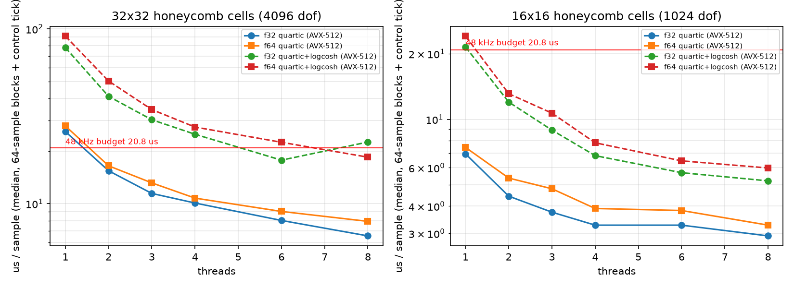

**图 2 exp1 无损能量漂移与 CFL**

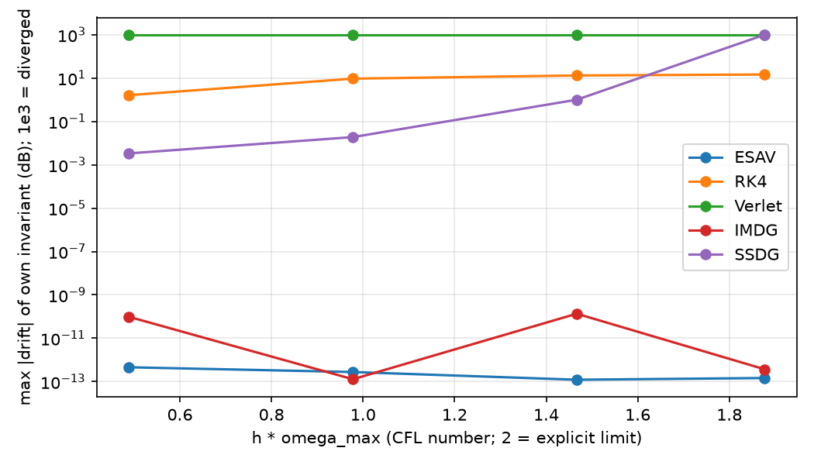

**图 3 exp1 压力测试发散率**

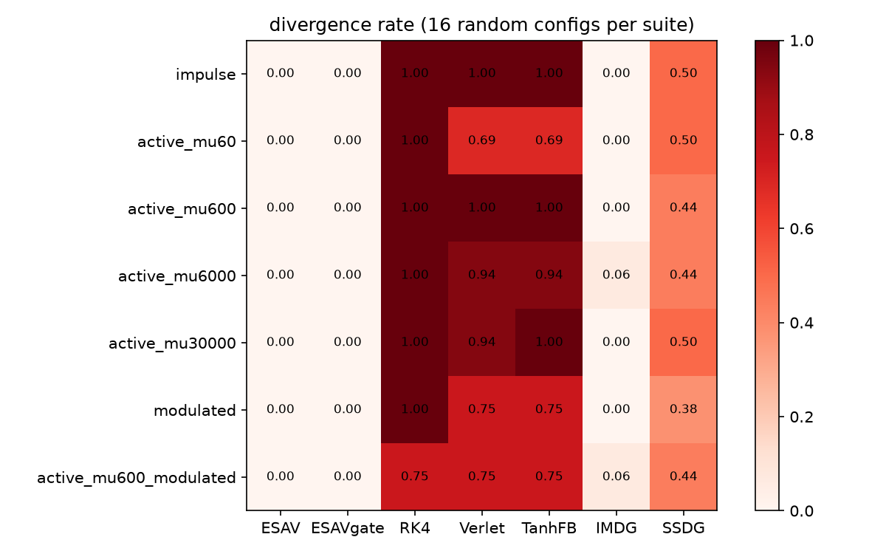

**图 4 exp1 正弦驱动的输出谱（混叠 / SNHR）**

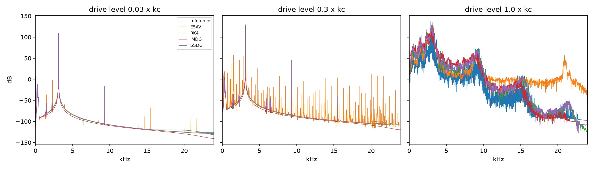

**图 5 exp2 频率分辨的方向性 D(f)**

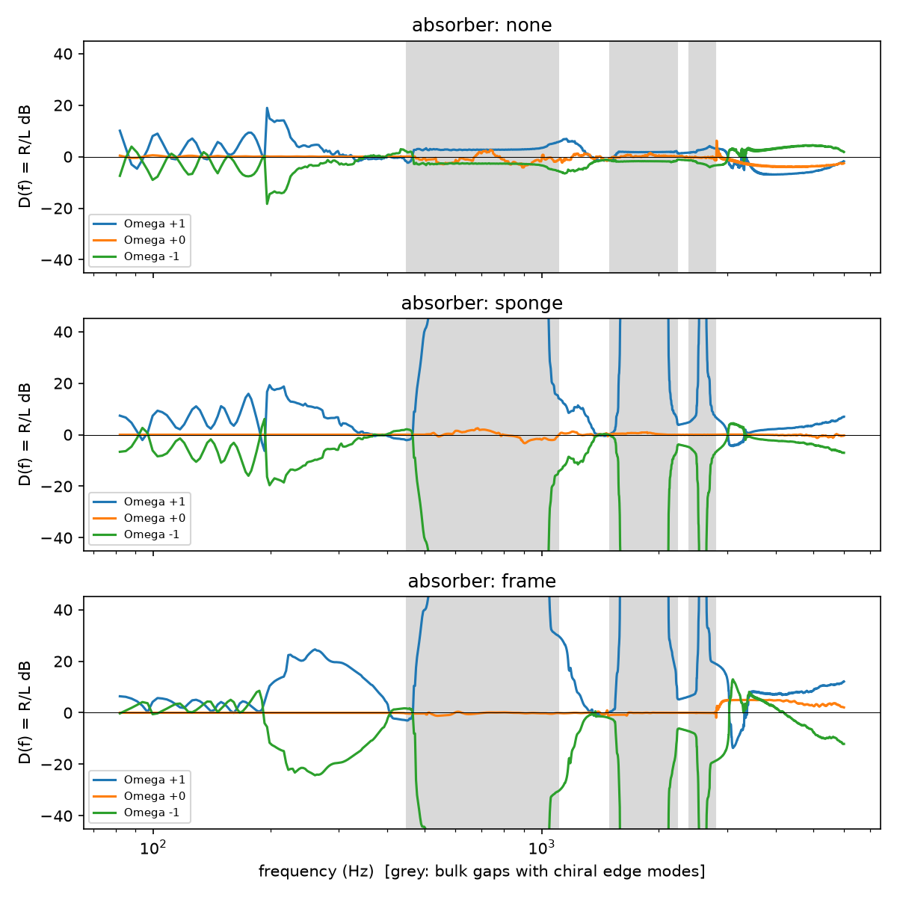

**图 6 exp2 拾音距离扫描**

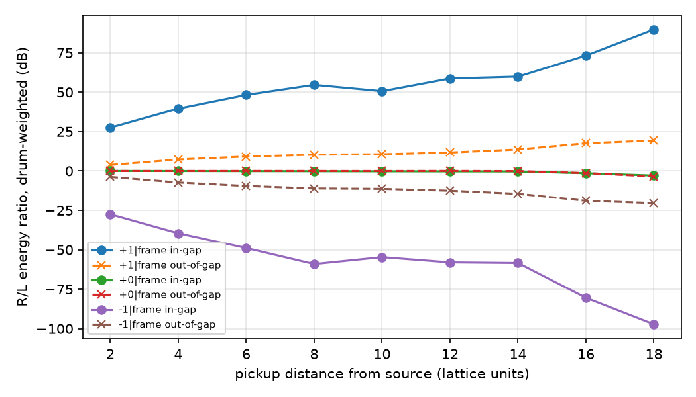

**图 7 exp2 群延迟**

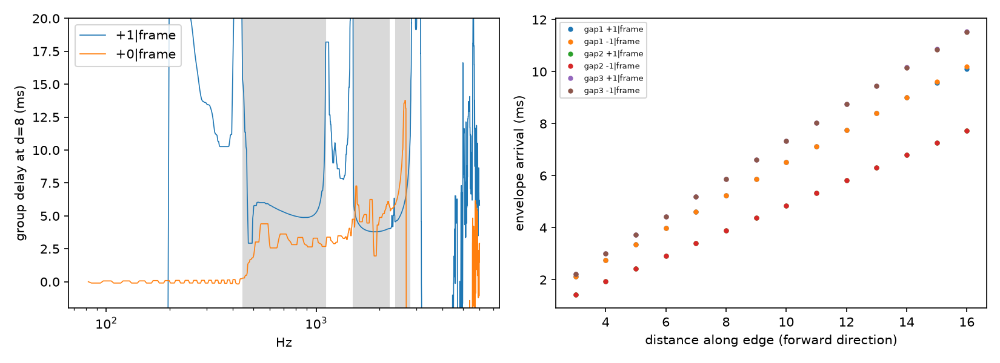

**图 8 exp2 带隙 1 tone burst 的时空图（含缺陷）**

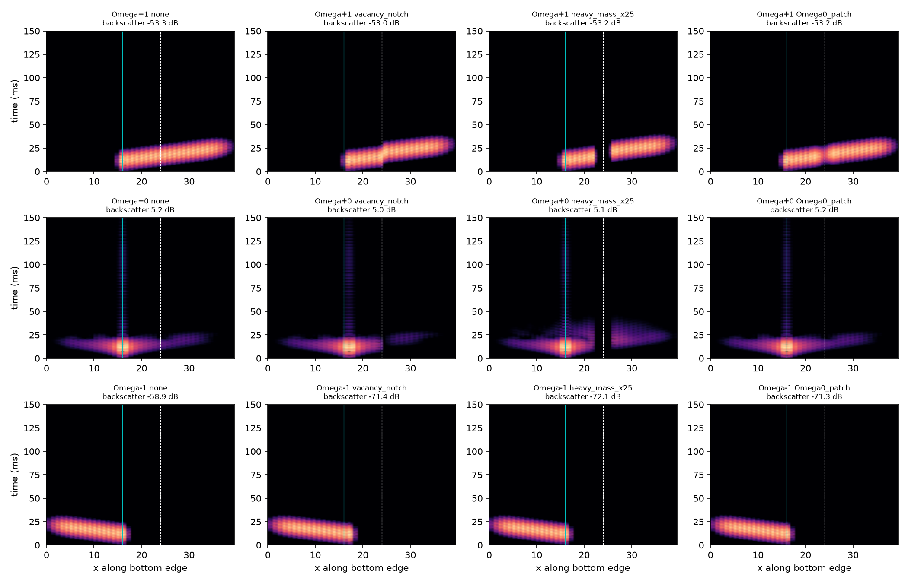

**图 9 exp3 耦合指标**

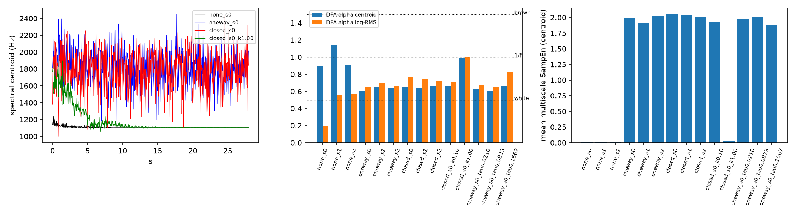

**图 10 ENPU A/B/C**

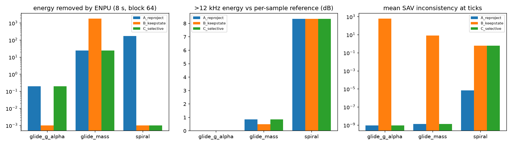

**图 11 exp4 损失曲线与拟合频谱**

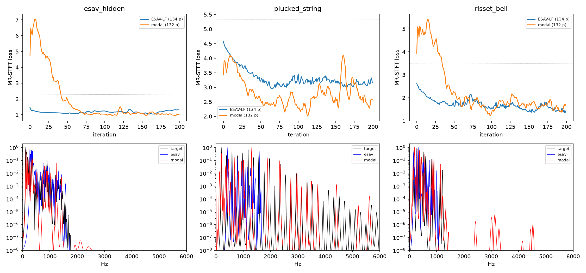
