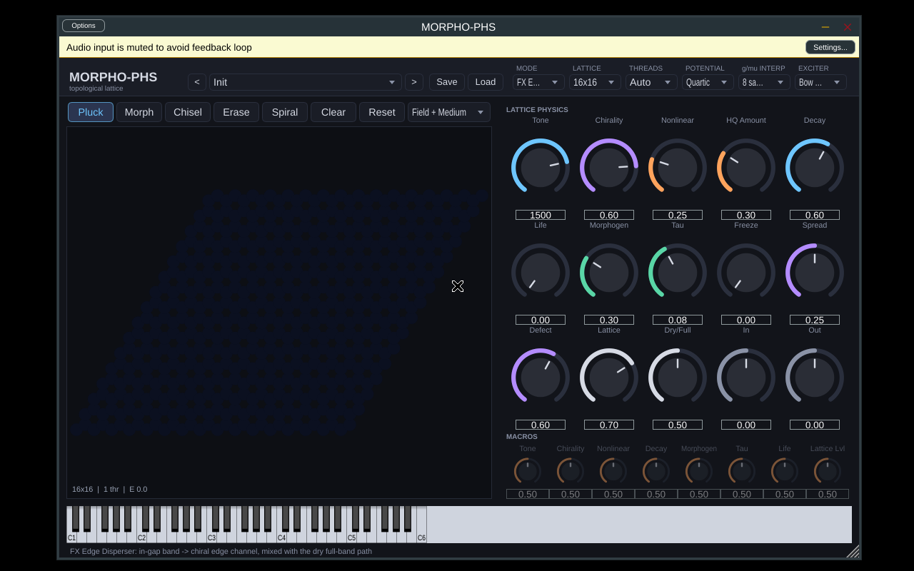

# Phase 3 阶段报告：JUCE 8 插件 MORPHO-PHS

日期：2026-10-30（Asia/Shanghai）。全部工作都在 box 上完成，box 是 Linux 虚拟机，8 个逻辑核，处理器标识为 Intel Xeon。用户的 i9 PC 本阶段一直离线，所以 **没有任何在 i9 上实测的数字**；Windows 部分只提供脚本。

## 1. 结论摘要

| 项目 | 结果 | 状态 |
|---|---|---|
| 插件构建 | JUCE 8.0.9 + CMake/Ninja + g++ 14：**VST3、Standalone、CLAP** 和 morpho_cli 都已构建（每个约 6 MB） | ✅ |
| pluginval（Linux，xvfb） | VST3 **strictness 5：SUCCESS**；**strictness 10：SUCCESS**（含 fuzz parameters、状态恢复、编辑器、总线布局） | ✅ |
| 引擎测试 P1–P7 | 全部通过：功率平衡相对误差 3.76e-15；无源性 0；1/2/3/4/6/8 线程逐位一致；processBlock 0 次堆分配 | ✅ |
| ENPU-C + 8 样本 g/μ 插值（默认） | 高频伪影：阶梯 +8.33 dB，8 样本插值 +2.42 dB，逐样本 0.00 dB（参考 = 逐样本线性插值） | ✅（见决策 D1） |
| 向量化 log-cosh 近似（HQ-fast） | K=3 sqrt 和式；\|s\|≤10 时 \|U−logcosh\|≤1.25e-3，\|U′−tanh\|≤1.23e-3；在网格上凸、非负；与精确 HQ 输出相差 −162 dB；能量证明照样成立（见 §3） | ✅ |
| 32×32 HQ 在 ≤8 线程内是否满足预算 | 插件引擎（f32，块 128）：HQ-fast **3 线程 11.2 µs/样本**（预算 20.83），p99 为块预算的 0.68；4 线程 9.1 | ✅（box 实测） |
| 并联带隙拓扑通道 | 干声/全频路径 ∥ 3 段 Cheby-II 带隙滤波器组 → 边缘源端口；带边跟随 tone 和 HQ 的在位刚度 | ✅ |
| 预设系统 | `.morpho` JSON 规范、加载器（校验、按标签取值、越界值钳位）、**27 个工厂预设**（7 类）、8 个宏旋钮 | ✅ |
| 离线渲染 | 3 种模式 × 8 个任务 × L8/16/32，加 HQ-fast 和 27 个预设，共 63 个 WAV：全部有限，0 次 NaN 复位，0 个触发限幅器 | ✅ |
| CPU 基准 | 48 kHz，块 64/128/512 × L 8/16/32 × 线程 1/2/3/4/6/8，FX 四次势 / FX HQ-fast / 乐器 / HQ-exact，输出 JSON+TXT | ✅（box 实测） |
| Windows | `scripts/windows/build_windows.ps1`、`bench_windows.ps1`、`README_WINDOWS.md` | ⏳ 未在 Windows 上运行 |
| 1/f 说法 | 已删除，新文档统一写成“有界、持续的不规则性”（bounded sustained irregularity） | ✅ |

## 2. 插件架构

```
          ┌──────── 消息线程 ────────┐                         ┌──────────── 音频线程 ─────────────┐
 APVTS ──►│ 15 Hz 计时器：           │  pending_（原子指针）   │ processBlock：ScopedNoDenormals    │
 宏映射 ──►│  request_build(L, 线程)  │ ──────────────────────► │  20 ms 参数平滑（tone/tau 取对数）  │
 编辑器  ──►│  collect_garbage()       │   256 样本淡出/淡入切换  │  每 64 样本一个控制 tick：           │
  画笔   ──►│  切换后重新推送缺陷       │                         │   ENPU-C + 核内 g/μ 8 样本插值      │
          └─────────────────────────┘  SPSC 事件队列（256）    │   Barkley 介质 + 形态发生耦合       │
 LatticeView ◄── 三缓冲快照（约 60 Hz）◄──────────────────────── │  ESAV-LF 多线程内核（SpinBarrier）   │
                                                                 └───────────────────────────────────┘
```

* **实时安全**：processBlock 里没有分配，也没有锁（P7 测得 0 次分配）。改变格点尺寸或线程数时，新的格点在消息线程上构建，音频线程只做指针交换和淡入淡出。工作线程打开 FTZ/DAZ。
* **模式**：
  * **FX Edge Disperser**：干声/全频路径与带隙通道并联，后者经手性边缘态传播后由 L/R 拾音输出。
  * **FX Defect Freezer**：Freeze 把 μ、η 和输入一起乘以 (1−freeze)，Freeze=1 时格点无损。
  * **Instrument**：MPE（下区；成员通道弯音 ±48，主通道 ±2）；最多 16 个声部共用一个多端口格点；激励为 PolyBLEP 锯齿弓或升余弦拨弦；Life>0 时为门控自激。
* **编辑器**：
  * 格点能量场与介质场叠加显示，约 60 fps，数据来自无锁快照。
  * 画笔：Pluck、Morphogen、Chisel、Erase、Spiral，右键擦除。
  * 15 个物理旋钮、8 个宏旋钮（未映射的变暗）、预设浏览、保存和载入、MIDI 键盘。按钮上的 Morph、Clear、Reset 分别对应 Morphogen 画笔、清除缺陷和重置场。



截图中能看到一个已知小问题：顶部的六个下拉框较窄，选项名被截断（例如 “FX E…”），下拉后能看到全名。

## 3. log-cosh 近似（HQ-fast）

近似式为 Û(s) = Σₖ wₖ s²/(√(cₖ²+s²)+cₖ)，取 K=3。约束为 Σw=1 和 Σw/c=1，因此小 s 时 Û ≈ s²/2，大 s 时 Û ≈ |s|。第三个约束 Σwc = ln2 在 w≥0 时与前两个不可兼容，已放弃，并在 `logcosh_fit.json` 里如实记录。

* **误差界**（f64，long double 参考）：
  * \|s\|≤10 时 \|Û−logcosh\| ≤ 1.25e-3，\|Û′−tanh\| ≤ 1.23e-3；
  * \|s\|≥10 时相对误差 ≤ 8.7e-5；
  * 渐近偏移 −3.05e-3；
  * Û ≥ 0；在整个网格上 Û″ > 0（凸）。
  * f32 在 \|s\|≤10 内的结果相同。f32 在 s ≈ 1e6 时绝对误差为 1.34，这是 Û ≈ \|s\| 本身的舍入，相对误差仍是 1e-6 量级。
* **能量证明为什么仍然成立**：ESAV-LF 的离散能量恒等式只要求势函数 U ≥ 0、可微，并且用同一个 U 计算 SAV 系数。Û 满足这几条，所以定理 1（功率平衡）和定理 2（CFL 下无源）原样适用于 Û；变化的只是“物理势”本身，从 log-cosh 换成了 Û。数值验证：P3 功率平衡 3.76e-15，P4 无源性 0，P5 在势函数之间来回热切换 30 次时能量最大相对增量为 −6.4e-7（不增）。
* **向量化**：SAV 系数拆成逐元素的独立 pass，每项只做一次除法，每个标量共 4 次 sqrt + 4 次除法。
* **成本**（引擎基准，L32，64 块，box，安静重跑）：

| f32 µs/样本 | 1T | 2T | 3T | 4T | 6T | 8T |
|---|---|---|---|---|---|---|
| 四次势 | 24.3 | 13.3 | 11.0 | 7.9 | 6.9 | 5.7 |
| HQ-fast | 28.7 | 21.4* | 11.3 | 9.4 | 7.5 | 7.0 |
| HQ exact（log/exp） | 66.6 | 40.0 | 27.1 | 19.3 | 15.2 | 13.6 |

  \*该点受 VM 噪声影响，前一次运行为 16.8。四次势和 HQ-exact 两行来自 `bench_engine_L32.csv`（首次完整运行），HQ-fast 来自 `bench_engine_L32_hqfast_v2_quiet.txt`。HQ-fast 只比四次势多约 3–23%，而精确 HQ 是四次势的约 2.7 倍。

## 4. 插件级 CPU 基准（box 实测，morpho_cli bench，48 kHz）

测试条件：每个配置测 2 s 音频，另有 0.5 s 预热；计的是整个 `EngineHost::process` 的时间，包括带隙滤波器组、控制 tick、介质、MPE 和输出级。“负载”指块耗时中位数占块预算的比例，p99/预算 < 1 才算没有爆音风险。完整表格在 `experiments/results/phase3/bench_cli_*.txt/json`。

**块 128，µs/样本中位数（括号内为 p99 块耗时 / 块预算）**

| 配置 | 1T | 2T | 3T | 4T | 6T | 8T |
|---|---|---|---|---|---|---|
| FX 四次势 L8 | 1.53 | 1.42 | 1.65 | 1.53 | 1.50 | 1.50 |
| FX 四次势 L16 | 5.88 (0.46) | 3.76 | 3.17 | 2.57 (0.18) | 2.62 | 2.22 |
| FX 四次势 L32 | 23.0 (1.47 ✗) | 13.1 (0.90) | 9.68 (0.70) | 8.25 (0.60) | 6.56 (0.72) | 5.39 (2.01 ✗) |
| FX HQ-fast L32 | 26.6 (1.49 ✗) | 15.8 (1.14 ✗) | 11.2 (0.68) | 9.11 (0.60) | 7.30 (0.52) | 6.16 (0.74) |
| FX HQ-exact L32 | 54.3 (3.49 ✗) | 28.7 (1.71 ✗) | 21.6 (1.47 ✗) | 16.3 (1.22 ✗) | 12.5 (0.81) | 11.8 (1.43 ✗) |
| 乐器 四次势 L32 | 24.4 (1.85 ✗) | 14.7 (1.23 ✗) | 11.6 (0.99) | 8.95 (0.59) | 7.23 (0.47) | 6.99 (1.19 ✗) |

* **L8/L16**：单线程就足够，L16 约占 28–36% 负载。L8 多开线程没有收益，因为格点太小，分不出足够的块。
* **L32**：需要 ≥3 线程，推荐 4 线程；“Auto” 设置在 L32 时选 4 线程。在这台 8 vCPU 的 VM 上，8 线程时 p99 经常变差，原因是 SpinBarrier 线程与宿主机的其他负载争抢 CPU。i9 物理核更多，**估计**会好一些，但这只是估计，需要 Windows 基准来确认。
* **i9-13900H 估算**：沿用 Phase 2 的时钟换算（×3.55/5.4 为乐观，×3.55/4.0 为持续频率；只用 P 核），L32 HQ-fast 单线程**估计**为 17.5–23.6 µs/样本，处在预算 20.83 附近；4 线程**估计**为 6.0–8.1。**这些都是估算，不是实测**，需要用 `bench_windows.ps1` 确认。

## 5. 离线渲染与电平

`experiments/audio/phase3/`：

* 每个尺寸一个目录：`L0`（8×8）、`L1`（16×16）、`L2`（32×32）、`L1_hqfast`。每个目录包含 8 个任务、一条输入参考和每个任务的 JSON。8 个任务是：
  * edge_disperser 及其 chir_neg、chir_zero 变体；
  * defect_freezer 及其 frozen 变体；
  * bow_mpe、pluck_mpe、life_spiral。
* `presets/`：27 个工厂预设的渲染。
* 电平审计：`experiments/results/phase3/render_levels.txt`。63 个文件全部有限；**0 个**文件有超过 0.1% 的样本超过 0.9（即安全软限幅器的起点）。

**本阶段发现并修复的三个电平问题（如实记录）**

1. **乐器 MPE 声部过轻**：峰值约 −54 dBFS。新增声部激励增益 kVoiceGain = 300 后，L16 的 bow 峰值约 −6 dBFS。
2. **FX Edge 下游声道严重削波**：L16 右声道 27% 的样本 ≥ 0.98。原因是单向手性边缘态把能量几乎全部送到下游拾音：测得湿声 RMS 下游/上游 = 0.060/0.0013，约 33 dB，这正好说明拓扑隔离确实存在。之前的归一化是按上游声道标定的。重新标定后（kOutNorm 250 → 1.75，尺寸系数 1/1/1.4），各尺寸峰值为 −0.2…−2.5 dBFS。
3. **预设电平**：有 5 个预设触发了限幅器，3 个过轻。在生成器里加入只作用于输出增益的 TRIM（音色不变），重新渲染后全部合格。

## 6. 预设与宏

* 规范见 `docs/morpho_preset_spec.md`：格式与版本号、参数表及其物理映射、宏、格点状态（缺陷、形态发生点、螺旋种子）。
* 宏是**覆盖语义**：被映射的参数完全由宏决定，log 参数按对数曲线映射；一个宏最多可驱动多个目标，全部宏合计最多 32 个目标。
* 27 个工厂预设：FX Edge 8 个、FX Freezer 5 个、Inst Bowed 4 个、Inst Plucked 4 个、Inst Living 3 个、Showcase 32×32 2 个、Showcase 8×8 1 个。`morpho_cli validate presets` 结果为 27 OK、0 failed。

## 7. 许可

* JUCE 8 只有两种许可：**AGPLv3 或商业许可**。
* clap-juce-extensions、CLAP、clap-helpers 均为 MIT。
* 随 JUCE 附带的 VST3 SDK 为 Steinberg VST3 许可或 GPLv3。
* 详见 `docs/LICENSES_phase3.md`。**当前构建按 AGPLv3 处理。**

## 8. 待用户决定

* **D1 插值步长**：默认是 8 样本（按 17:43 的决定），仍有 +2.4 dB 高频伪影；改成 1 样本则为 0 dB。实测 CPU（HQ-fast，块 128，`bench_cli_interp{0,1,2}`）：L32 4 线程下 1 样本 9.30、8 样本 9.49、关闭 12.3 µs/样本；L16 单线程 6.75 / 6.74 / 7.26。也就是说，1 样本和 8 样本的差别在噪声范围内。**建议改为 1 样本**，或至少在 Showcase 预设里用 1。
* **D2 合成器变体**：目前是一个接收 MIDI 的效果器插件，IS_SYNTH=FALSE。有些 DAW（例如 FL Studio、Ableton）把乐器插件和效果插件分开列出，是否另外出一个 `MORPHO-PHS Synth`，作为 IS_SYNTH 的第二个目标？
* **D3 默认宏映射**：没有载入预设时，默认宏会覆盖 Tone、Chirality 等 8 个参数，所以这些旋钮本身不起作用。是保留覆盖语义，还是改成“宏只在预设定义时生效”，或者改成相对偏移？
* **D4 Edge 模式的立体声**：上下游拾音相差约 33 dB，这是拓扑隔离本身造成的，chir_neg 时左右对调。是否加一个“边缘宽度/串音”旋钮，用来混合上下游？
* **D5 工作线程**：要不要把工作线程设为实时优先级（Windows 上用 MMCSS）？目前是普通优先级，自旋 20000 次后让出 CPU。
* **D6 许可**：项目自有代码采用什么许可？是否购买 JUCE 商业许可，用于闭源发布？
* **D7** `logcosh_fit.json` 里有一条过时的 K2 备注，可以删除。

## 9. 阻塞与风险

* 用户 PC 离线，所以 i9 实测、Windows/MSVC 构建和宿主 DAW 测试都没有做。为了降低 MSVC 风险，已经用 zig 以 x86_64-windows 为目标做过语法检查，并修复了 M_PI 问题。
* box 上的 apt 走代理会失败，已经用直接下载 .deb 并解包到 /workspace/sysroot 的办法绕过，不影响交付。
* Linux 构建只用 pluginval 验证过（in-process + xvfb），没有在真实 DAW 里测试。
* CLAP 已构建，但没有用 clap-validator 验证。
