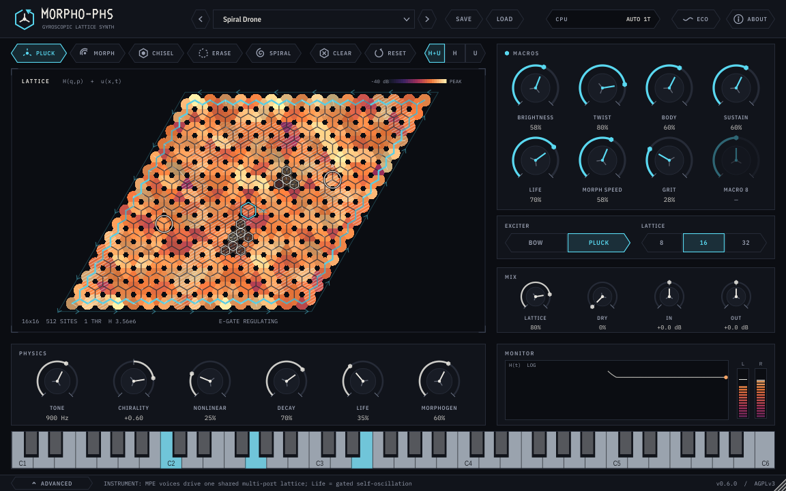
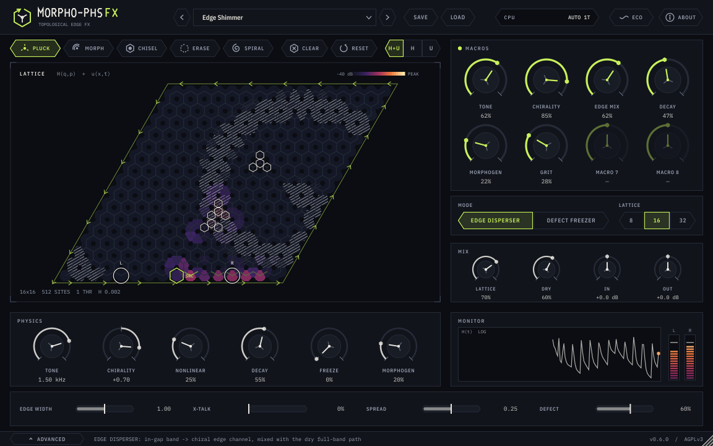
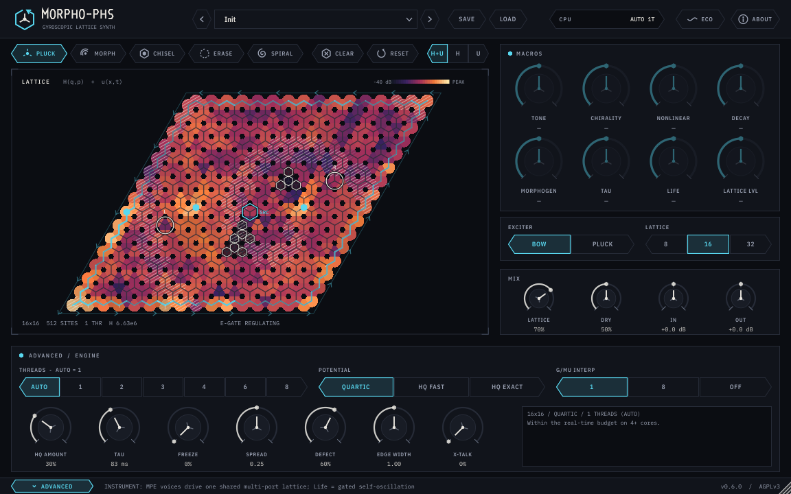
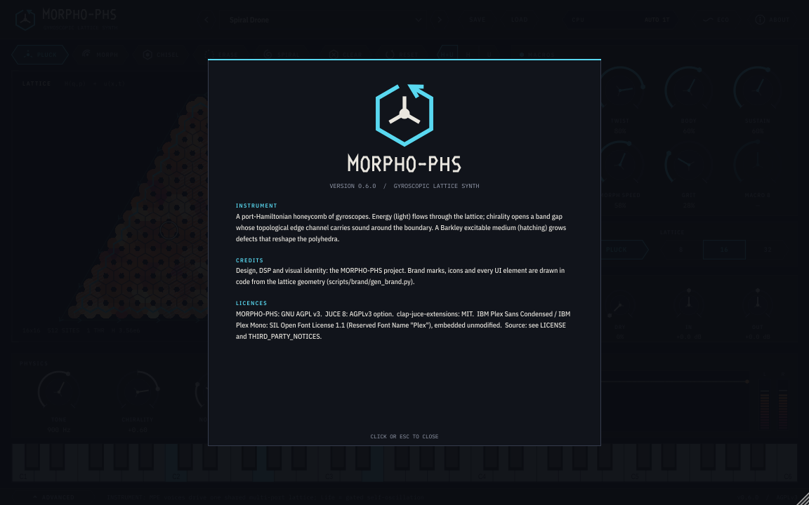

<!-- SPDX-License-Identifier: AGPL-3.0-only -->
# MORPHO-PHS Phase 6a 美术包装报告

日期：2026-10-31（Asia/Shanghai）。版本：0.6.0。环境：box（Linux，Intel Xeon，8 逻辑核）。用户 PC 在本阶段离线，所有构建、测试、截图与资料调研都在 box 上完成（调研走 box 网络）；Windows 侧只做了交叉编译检查，需要在 PC 上重新构建（§9）。

## 1. 目标与结论

用户要求：先做美术包装，把插件做成商业产品；借鉴非常规开源插件的审美，但**不直接套用预设 / 模板**；自行判断继续深化项目，并注意性能。

结论：
- 新界面「体暗边明」（BULK · EDGE）已在两个插件中实现，视觉语言全部来自本项目的物理（蜂窝、端口哈密顿能量、Barkley 介质、拓扑边缘通道、变形多面体），规范见 `docs/phase6/art_direction.md`。
- 音频线程开销：快照发布约为块预算的 0.02–0.03 %（要求 < 1 %），编辑器关闭或隐藏时为 0。
- 全部测试、压力测试、pluginval 严格度 10（两个插件）、zig 交叉编译（引擎 / 测试）通过；一次压力测试的偶发超时说明见 §6。

## 2. 调研（摘要）

调研笔记：`docs/phase6/art_research.md`（参考图存放于 `research/phase6_refs/`，不随同步包分发）。看过的开源插件：Vital、Surge XT、Cardinal / VCV、Dexed、ChowDSP、Odin 2、Airwindows Consolidated 等。取用的是**原则**而不是外观：

- 一个绝对主角（Vital 的波形区）；其余控件退后一层。
- 等宽数值读数、拖动时不跳字（Surge、ChowDSP）。
- 单一强调色、深色哑光底、不用拟物光影（Airwindows 的克制）。
- 每个装饰都要承载信息（VCV 模块面板的“功能即装饰”）。

没有复制任何皮肤、LookAndFeel、图标或色板。

## 3. 概念「体暗边明」

手性打开带隙后，体是绝缘的，能量只能沿拓扑边缘单向绕行——界面就是这样一块材料：

| 物理 | 视觉 |
|---|---|
| 体在带隙内绝缘 | 哑光深色面板（bulk0/1/2），无渐变、无模糊、无阴影 |
| 边缘通道导通 | 强调色只出现在“正在导通”的边：选中按钮、宏旋钮弧、边缘通道描边与箭头 |
| 只有能量发光 | 唯一亮度来源是 log 能量热度色阶（40 dB 窗口） |
| Barkley 介质 | 60° 排线，而不是第二种颜色 |
| 手性 | 边缘箭头的绕行方向；手性≈0 时箭头消失 |
| 蜂窝 / 陀螺 | 一切角度为 60° 倍数；旋钮指针 = 一个三配位陀螺格点（主键 + ±120° 尾键） |

乐器 = 冰青 `#59D8F0`（GYROSCOPIC LATTICE SYNTH，底行 MPE 键盘）；FX = 酸性黄绿 `#C8F05A`（TOPOLOGICAL EDGE FX，底行 4 个推子）。

### 3.1 关键截图

乐器，预设 “Spiral Drone”，默认尺寸 1x：

FX，预设 “Edge Shimmer”，默认尺寸 1x：

高级抽屉（乐器，Init）：

About / 致谢面板：

全部截图（min 960×600 / default 1152×720 / max 1728×1080，各 1x 与 2x）在 `reports/phase6a_screens/`：`showcase_*` 为工厂预设，`init_*` 为 Init 状态，`critique/` 为评审过程截图。

## 4. 实现

| 部分 | 文件 | 要点 |
|---|---|---|
| 色板 / 字体 / 绘图辅助 | `plugin/Source/ui/Theme.{h,cpp}` | 设计画布 1152×720、8 px 网格；变体感知的 `pal()`；256 项热度 LUT；IBM Plex 从 BinaryData 加载 |
| 控件 | `plugin/Source/ui/Controls.{h,cpp}` | `MorphoLnF`（六角胶囊按钮、下拉、菜单、提示）；`ParamKnob`（宏 / 主 / 小 / 推子四种）；`ChoiceSeg`；`GlyphButton`（12 个代码图标） |
| 品牌 | `scripts/brand/gen_brand.py` → `plugin/Assets/brand/*`、`ui/BrandGeometry.h`；`ui/Brand.h` | 标志、字标、插件图标（512/256，CMake `ICON_BIG/ICON_SMALL`）同源 |
| Hero | `plugin/Source/LatticeView.{h,cpp}` | 物理像素缓存（站点图、键掩码、排线）+ 每帧一次逐像素合成；矢量覆盖层（边缘、箭头、能量短划、陀螺针、缺陷、端口） |
| 编辑器 | `plugin/Source/PluginEditor.{h,cpp}` | 顶栏（字标、预设栏、CPU 芯片、ECO、ABOUT）、工具行、Hero、宏、配置、混音、物理、监视器、键盘 / 推子、高级抽屉、状态栏 |
| 状态 | `PluginProcessor.{h,cpp}` | `ui_width`、`eco` 存入插件状态 |
| 快照工具 | `plugin/Source/harness/UiSnapHarness.cpp` | `morpho_ui_snap_{inst,fx}`：驱动真实处理器与编辑器，1x/2x 截图 + 绘制计时 + 订阅检查 |

旋钮交互：相对拖动 (dx−dy)/220，Shift 精细 /1100；双击或 Alt/Cmd 单击复位；滚轮 0.1（Shift 0.02）；方向键 0.01（Shift 0.002）；Home/Delete 复位；无障碍 slider 接口。缩放：固定长宽比 1.6，960×600 … 1728×1080，单个子组件仿射缩放（不调用 `setScaleFactor`），HiDPI 下矢量按物理像素重绘。

CPU 指示：CPU 芯片显示 `AUTO nT` / `HIGH …` / `HQ>FAST …`，警告复用热度色 H3；高级抽屉说明框、POTENTIAL / THREADS 标题与状态栏同步提示。

## 5. 评审记录（快照 → Read 审阅 → 修改）

| 轮次 | 发现 | 处理 |
|---|---|---|
| 0（启动） | 快照工具在 `createEditor()` 崩溃：构造函数第一行 `setSize` 触发 `resized()`，此时子控件尚未创建 | `setSize` 移到构造函数末尾；工具改为真正的 JUCE GUI 应用（控制台程序下 X11 窗口属性报 BadAtom） |
| 1 | 键盘白键过亮，抢 Hero 的亮度 | 白键改为 `#9AA3AE`，C 标签对比度 6.1:1 |
| 1 | 未分配的宏整体降到 50 % 透明度，标签 / 数值对比度跌破 4.5:1 | 只淡化表盘（42 %，非文字图形 ≈3.4:1），标签保持 inkDim 7.1:1，数值显示 “—” |
| 1 | 热度图例 “PEAK” 贴着色条 | 留 5 px 间隔 |
| 1 | H 读数 `12938528.0` 难读 | 大数用科学计数法（`1.29e7`） |
| 1 | “ENERGY GATE” 用警告色，但能量门是弓 / Life 增益的设计内限幅器（E_cap），正常演奏也会触发 | 改为中性 inkDim 的 “E-GATE REGULATING” |
| 2 | Hero 左上角外有一个多余的手性箭头（放大见 `critique/pass2_stray_chevron_zoom.png`） | 原因：每段起点距离 `step/2 − acc` 可能为负。改为“到下一个箭头的剩余距离”累计；几何重建时清空箭头缓存 |
| 2 | FX 底行推子的读数与下一个标签挤在一起 | 推子宽 244、间距 280，标签 84 / 读数 54 |
| 2 | 最大尺寸 2x 绘制 13 ms：逐像素层被限制在 1.6 Mpx 后需要重采样放大，重采样比逐像素合成更贵 | 上限提到 2.6 Mpx（最大尺寸 2x 也 1:1），中位数降到 4.2–5.3 ms |
| 2 | 2x 的 p95 是中位数的 4 倍 | 原因在测量：屏幕上的 1x 重绘与 2x 快照交替触发几何重建。统计按像素比例分开，并单独报告重建时间 |
| 3 | 饱和（白热）场上，L/R 拾音环和缺陷环看不清 | 覆盖层加 bulk0 暗衬线 |

## 6. 测试与回归

| 项目 | 结果 | 数据 |
|---|---|---|
| test_main / test_mt / test_phase3 / test_phase4 | 全部通过 | `experiments/results/phase6a/tests/` |
| test_phase5 | 通过（首轮与整套插件 LTO 构建并行，S4 纯自旋测试因 CPU 争用失败；空闲时重跑通过） | 同上 |
| 压力测试 30 s × 种子 1/2/3 | 全部通过 | `test_phase5_stress_s*.txt` |
| 插桩压力测试 20 s × 种子 1/2/3 | 种子 2 首轮通过。种子 1 首轮被系统中断打断，重跑通过。种子 3 首轮 P3 有一次启停耗时 3.02 s（判据 < 2 s，9906 次中的 1 次，无卡死），单独重跑 2 次均通过（最大 107 / 109 ms） | `test_phase5_stress_hooks_s3_run1_FAIL.txt` 与重跑结果 |
| pluginval 严格度 10（VST3，进程内） | MORPHO-PHS：SUCCESS；MORPHO-PHS FX：SUCCESS（各 25 组测试，含 Editor、Open editor whilst processing、Editor Automation） | `experiments/results/phase6a/pluginval/` |
| zig 交叉编译（x86_64-windows-gnu） | test_phase5、test_phase4、stress、stress_hooks 全部 EXIT 0 | `experiments/results/phase6a/wincheck/zig_windows_check.txt` |
| UI 源码的 zig / MinGW 检查 | 无法进行：JUCE 8.0.9 在 `juce_TargetPlatform.h` 中 `#error "MinGW is not supported"`。UI 只能在 PC 上用 MSVC 编译 | `wincheck/zig_ui_syntax_check.txt` |
| 构建 | VST3、CLAP、Standalone（两个插件）与 morpho_cli 均成功，只有 LTO 提示 | — |

说明：Phase 6a 没有修改 `include/` 与 `tests/`（与 5c 同步包时间戳比对），因此 P3 偶发超时与本阶段改动无关。它更像 box 虚拟机的一次停顿：同一时间段的非插桩压力测试与重跑都正常。该判据本来就是为发现卡死设计的，10 s 看门狗没有触发。

## 7. 性能

### 7.1 音频线程（交错 A/B，32×32、块 128、6 s = 2250 块 × 3 轮）

快照频率：0 = 编辑器关闭；30 = 编辑器打开。请求 60 Hz 时引擎封顶为 30 Hz（`kMaxSnapshotHz`）。

| 配置 | 快照 Hz | 中位数 µs（3 轮） | 中位数的中位数 | p99 中位数 | 超时（3 轮） | 发布开销 |
|---|---|---|---|---|---|---|
| 1T 乐器，不限速 | 0 | 724.5 / 699.1 / 710.8 | 710.8 | 1031.7 | 1 / 0 / 0 | — |
| 1T 乐器，不限速 | 30 | 767.3 / 702.6 / 727.6 | 727.6 | 943.7 | 3 / 0 / 0 | 6.2–7.5 µs/次，0.019–0.022 % 预算 |
| 1T 乐器，不限速 | 60→30 | 701.6 / 730.5 / 771.5 | 730.5 | 925.4 | 4 / 1 / 0 | 6.7–7.4 µs/次，0.020–0.022 % |
| 3T FX，限速 | 0 | 437.3 / 423.7 / 424.0 | 424.0 | 745.0 | 2 / 4 / 0 | — |
| 3T FX，限速 | 30 | 430.1 / 429.8 / 438.5 | 430.1 | 673.0 | 2 / 5 / 0 | 10.1–10.4 µs/次，0.030–0.031 % |
| 3T FX，限速 | 60→30 | 422.1 / 421.4 / 424.5 | 422.1 | 601.9 | 2 / 2 / 0 | 9.2–10.3 µs/次（另有 1 轮一次 36.8 ms 的抢占，使该轮均值为 0.62 %） |

预算 2666.7 µs/块。结论：
- 直接计时的发布开销约为预算的 0.02–0.03 %，远低于 1 % 的要求。
- 中位数差异（+2.4 % / +1.4 %）小于轮间波动（1T 在 699–767 之间）。
- 超时在 0 Hz 时同样出现（box 虚拟机噪声），与快照无关。
- Phase 5c 的 box 参考值为 1T 乐器 705.3 µs，本次 710.8 µs，无回退。

数据：`experiments/results/phase6a/bench/`（`summary.txt`、每次运行的 txt/json）。

### 7.2 消息线程：Hero 绘制（`morpho_ui_snap`，中位数 / p95，µs）

| 尺寸 | 1x | 2x |
|---|---|---|
| min 960×600 | 1027–1333 / 1203–1847 | 1775–2151 / 2077–2407 |
| default 1152×720 | 832–1100 / 1030–1253 | 2157–2785 / 2372–3544 |
| max 1728×1080 | 1347–1917 / 1555–2147 | 4214–5312 / 4795–6443 |

- 范围覆盖四次运行：乐器 / FX，Init / 工厂预设。
- 几何重建只在尺寸、像素比例或晶格大小变化时发生：默认 2x 约 8 ms，最大 2x 约 18 ms。
- ECO（默认 2x）：绘制 2.1–2.7 ms，帧率 12 fps，发布频率 12 Hz。
- 隐藏与关闭时，发布频率都是 0 Hz（四次运行都验证过）。
- 折算成单核占用（默认 2x）：活跃 30 fps 约 8 %，ECO 12 fps 约 3 %，低运动 8 fps 约 2 %。其它控件只在参数变化时重绘；静态背景缓存为图像。

## 8. 需要在 DAW 里人工判断的项目

1. **第一眼**：Hero 是否是唯一主角？面板是否“退后”到位？乐器（冰青）与 FX（黄绿）能否一眼区分？
2. **真实 HiDPI**：Windows 150 % / 200 % 缩放下文字与发丝线是否清晰；拖动窗口角缩放是否平滑；重新打开时尺寸是否恢复。
3. **手感**：旋钮拖动速度、Shift 精细、双击复位、滚轮步长是否顺手；读数是否不抖。
4. **Hero 是否“读得懂”**：拨弦、弓、Spiral、Chisel 时能量是否沿边缘流动；手性正负时箭头是否反向；H / H+u / u 三个图层是否有用。
5. **饱和场**：Spiral Drone 这类持续能量很高的预设，整片场接近白热、细节少（自动量程以最大值为参考）。是否需要改成按分位数归一化，请判断。
6. **E-GATE REGULATING**：持续弓奏时会常亮（能量门在调节），中性显示是否合适。
7. **CPU**：在宿主的 CPU 表上对比“编辑器打开 / 关闭 / ECO”；多开实例时界面是否卡顿。
8. **未分配的宏**：表盘变淡、数值显示 “—” 是否清楚；宏名称是否需要 6b 的预设一起调整。
9. **About 页与图标**：宿主插件列表中图标（512/256）是否清晰；致谢与许可证文字是否完整。

## 9. PC 重新构建步骤（PC 联网后）

1. 解压同步包（若分卷，先校验各分卷与整体 SHA256，再按序合并：`copy /b part01+part02+… morpho-phs-phase6a-sync.zip`），覆盖到项目根目录。
2. PowerShell（项目根目录）：`powershell -ExecutionPolicy Bypass -File scripts\windows\build_windows.ps1 -VsPath C:\SDKs\AetherBuildTools -Generator Ninja`（CMake 会自动带上新的 UI 源码、字体 BinaryData 与图标；快照工具在 Windows 上不构建）。
3. 可选安装：加 `-Install`（管理员）把 VST3 / CLAP 复制到 Common Files。
4. 验证：`tools\pluginval\pluginval.exe --strictness-level 10 --validate-in-process --output-dir logs dist\windows\MORPHO-PHS.vst3`，FX 同理。
5. 回归：`dist\windows\morpho_stress.exe 15 1`；`scripts\windows\bench_windows.ps1 -Quick`（不涉及编辑器，应与 5c 一致）。
6. 在 DAW 中打开两个插件，按 §8 检查。

## 10. 许可证

AGPLv3（`LICENSE`）。JUCE 8 以其 AGPLv3 选项使用；IBM Plex Sans Condensed / Mono 以 SIL OFL 1.1 未修改嵌入（`plugin/Assets/fonts/IBMPlex-OFL.txt`）；第三方清单见 `THIRD_PARTY_NOTICES.md`。所有新文件带 SPDX 头。

## 11. 后续

- 6b：预设（预设栏、宏名称与分配已就绪）。
- 6c：MUSHRA 听测。
- 可选：按分位数归一化热度（§8 第 5 条）；多显示器、不同像素比例时缓存两套几何。
