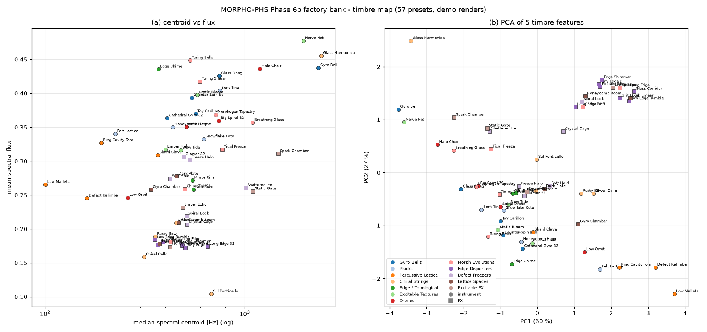
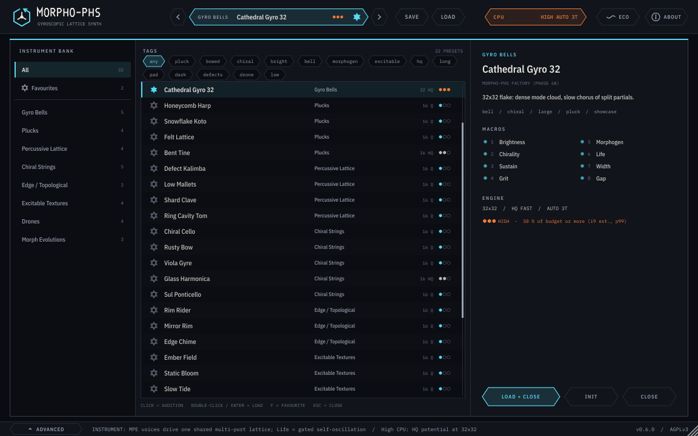
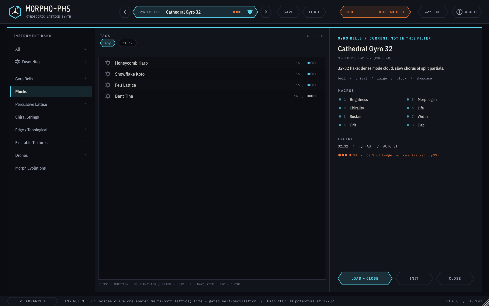
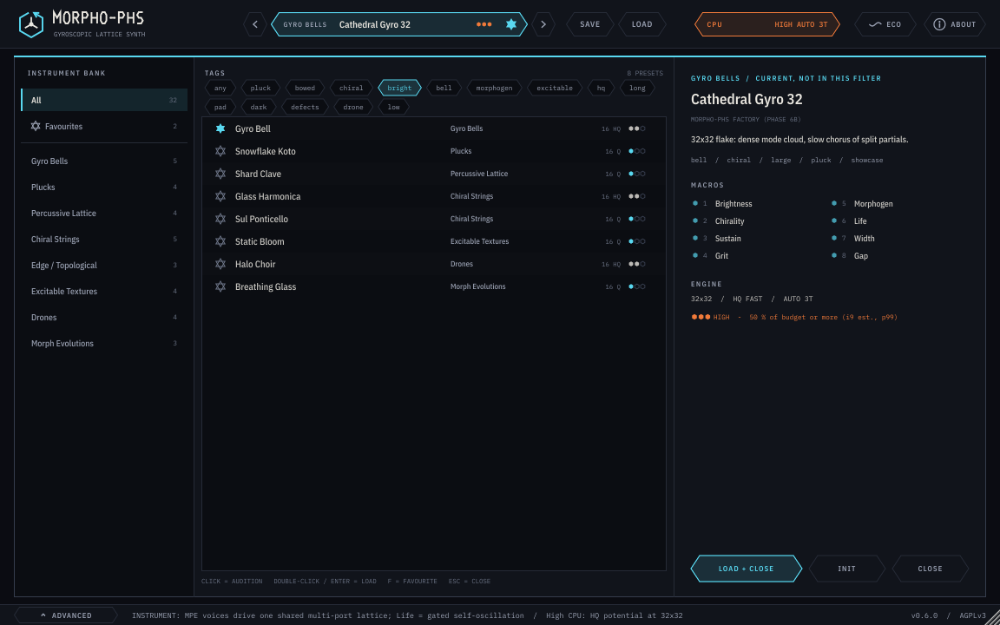
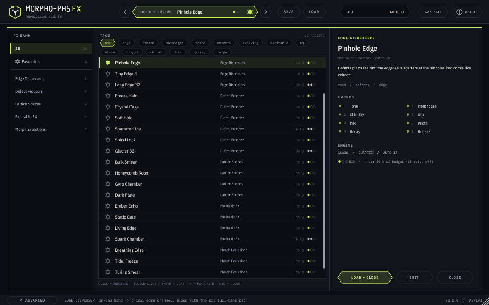
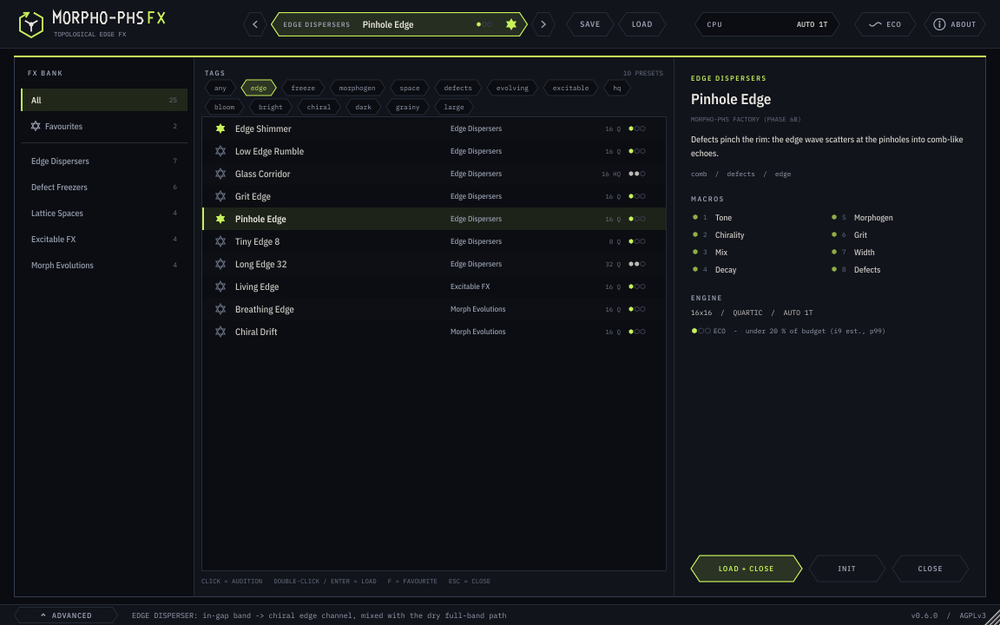
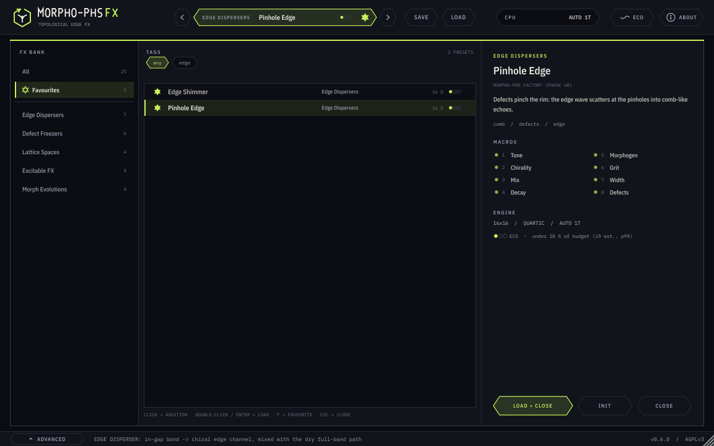
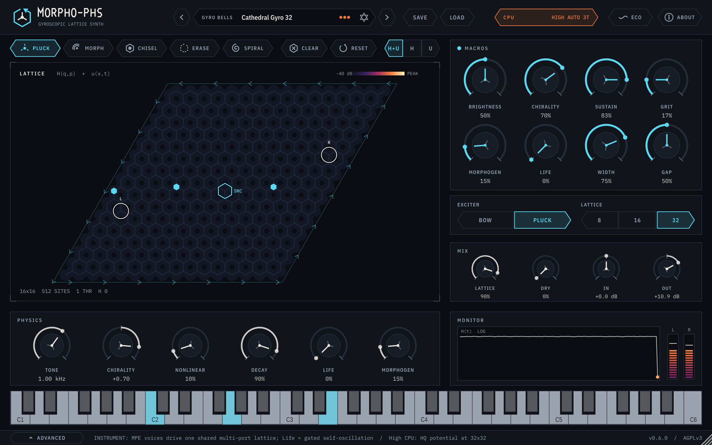
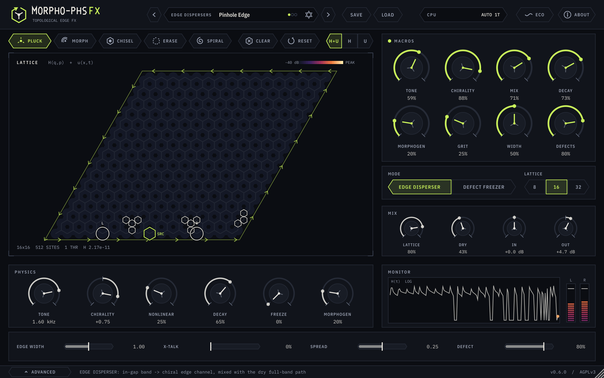

<!-- SPDX-License-Identifier: AGPL-3.0-only -->
# MORPHO-PHS Phase 6b 报告：原创出厂预设库与预设浏览器

日期：2026-10-31（Asia/Shanghai）· 版本 0.6.0 · 授权 AGPL-3.0-only

## 0. 摘要

- **审计**：旧 27 个预设用新 QA 门限复测，24 个不通过；保留 3、重做 22、退役 2（`docs/phase6/preset_audit.md`）。
- **新库 57 个**：乐器 32（8 个类别），FX 25（5 个类别），其中 32 个是全新设计。每个预设都有中英文描述、标签、作者、8 个命名且有目标的宏，以及实测 CPU 等级。
- **CPU**（i9 p99 / 预算，**估算**）：eco 43、standard 12、high 2（两个 32×32 HQ fast）。
- **声音 QA**：57/57 通过。乐器 −18 LUFS-I，FX −20 LUFS-I；真峰值 ≤ −1.1 dBTP；限幅器 0 次；无 NaN 或 DC；无失控；余音最长 6.1 s，都会结束。
- **演示**：每个预设有 WAV（16 bit / 48 kHz）、OGG 和 MP3。
- **浏览器**：类别与标签筛选、收藏、前后切换、Init、详情卡，风格与 6a「体暗边明」一致。
- **回归**：见 §9。

**工作环境**：所有工作都在 box 上完成，用户的 PC 离线，未被触碰。本阶段没有做网络检索；6a 时的检索也是在 box 的网络上进行的。本项目与 AETHER 及其它 bot 完全隔离。专家给出的数字只当作假设，CPU 等级是从 box 实测换算到 i9 的估算，需要在 i9 上复测。

## 1. 旧预设审计

详细的逐个决定见 `docs/phase6/preset_audit.md`，证据在 `/workspace/p6b/old27/analysis.json`（box）。系统性问题：

1. 边缘色散 FX 偏轻约 6–8 LU。Edge 模式的湿声只有能隙内的窄带，峰值由干声决定。
2. 超临界 Life 与螺旋波预设永不结束。
3. 冻结器默认冻结太深。
4. 6 个预设触发限幅器，Glass Harmonica 能量失控。
5. 宏只分配了 3–5 个。

退役的 2 个：Reverse Edge 等于 Edge Shimmer 的 Chirality 宏；Wide Pickups 与 Edge Shimmer 只差 spread。`validate --factory 1` 下 27/27 不满足出厂规则（`experiments/results/phase6b/validate/validate_factory_retired27.txt`）。

## 2. 声音设计方法（不套用模板）

每个类别对应 Morphohedra 的一种物理现象。参数先从物理推出，再用测量来校准；没有借用任何商业预设或通用合成器模板。

| 类别 | 物理来源 | 设计要点 |
|---|---|---|
| Gyro Bells | 陀螺手性劈裂简并模态 | 手性越大，拍频越快；32×32 时模态云更密 |
| Plucks / Percussive Lattice | 拨奏激励 + 缺陷局域模 | 拾音点位置决定鼻音感；缺陷行产生类似拇指琴的局域音高 |
| Chiral Strings | 弓擦（锯齿）激励 + 手性 | HQ 势的在位能隙抬高音色；Life 宏推入有界自持 |
| Edge / Topological | 能隙内的单向边缘态 | 边缘通道宽度与串扰作为宏 |
| Excitable Textures / Drones | Barkley 可激介质（形态场） | 亚临界 Life（Hopf 阈值的 0.5–0.75 倍）；螺旋波种子 ⇒ Life = 0 |
| Morph Evolutions | 形态场慢速调制 | 慢 tau，带形态素刺激点 |
| Edge Dispersers（FX） | 输入经能隙内边缘通道色散 | 湿声在前（wet 0.8 / dry ≈0.43） |
| Defect Freezers（FX） | 缺陷 + Freeze（无损） | 默认部分冻结，余音有限；Freeze 宏到 1 才无限保持 |
| Lattice Spaces / Excitable FX | 体模态混响 / 介质触发 | 用作空间与瞬态效果 |

**生成器规则**（`scripts/presets/bank6b.py` 断言，`validate --factory 1` 复查）：

- 8 个宏全部命名；每个参数只属于一个宏；宏位置由设计值反推（宏目标会覆盖参数）。
- 宏不指向结构性参数或增益。
- 32×32 只用 Quartic 或 HQ fast，线程 Auto。
- Life 宏的上端约为 Hopf 阈值 life* = −mu0/(120−mu0) 的 1.35 倍。越过阈值后晶格进入有界自持（能量门限制在 E_cap），这是“活体”音色的设计。

**增益拟合**：每个预设渲染标准演示后，按目标响度迭代输出增益（fit1–fit5）。最后一轮 iter0 改了 1 个、iter1 改了 0 个，0 个失败。Halo Choir 的 life_frac 从 0.65 降到 0.5，因为原设定在约 5.6 s 后出现宽带噪声底。

## 3. 库概览与预设列表

完整列表（中英文、宏名与来源）在 `presets/PRESET_LIST.md`，由 `scripts/presets/docs6b.py` 自动生成。

- 乐器 32：Gyro Bells 5、Plucks 4、Percussive Lattice 4、Chiral Strings 5、Edge / Topological 3、Excitable Textures 4、Drones 4、Morph Evolutions 3。晶格 16×16 29 个、32×32 2 个、8×8 1 个；Quartic 23 个、HQ fast 9 个。
- FX 25：Edge Dispersers 7、Defect Freezers 6、Lattice Spaces 4、Excitable FX 4、Morph Evolutions 4。晶格 16×16 22 个、32×32 2 个、8×8 1 个；Quartic 22 个、HQ fast 3 个。
- 文件名 `NNN_slug.morpho` 决定库顺序：乐器 001–032，FX 101–125。

### 3.1 乐器

| # | 名称 | 标签 | 说明 | 8 个宏 |
|---|---|---|---|---|
| 001 | **Gyro Bell** | bell, bright, chiral, pluck | 强陀螺耦合的拨奏晶格：简并模态被劈裂，像敲击的钟一样缓慢拍频。 | Brightness · Chirality · Sustain · Grit · Morphogen · Life · Width · Gap |
| 002 | **Counter-Spin Bell** | bell, chiral, dark, pluck | 手性反向：同一口钟，泛音沿雪花反方向拍动。 | Brightness · Chirality · Sustain · Grit · Morphogen · Life · Width · Gap |
| 003 | **Glass Gong** | bell, chiral, hq, long, pluck | 宽的在位能隙拉伸泛音列；长而闪烁的锣尾。 | Brightness · Chirality · Sustain · Grit · Morphogen · Life · Width · Gap |
| 004 | **Toy Carillon** | bell, chiral, eco, pluck, small | 8x8 小雪花：模态少，清晰的非谐和钟声；库里最省 CPU 的钟。 | Brightness · Chirality · Sustain · Grit · Morphogen · Life · Width · Defects |
| 005 | **Cathedral Gyro 32** | bell, chiral, large, pluck, showcase | 32x32 大雪花：稠密的模态云，劈裂泛音形成缓慢的合唱。 | Brightness · Chirality · Sustain · Grit · Morphogen · Life · Width · Gap |
| 006 | **Honeycomb Harp** | pluck, warm | 蜂窝上的柔和拨奏；轻微手性让余音略带旋动。 | Brightness · Chirality · Sustain · Grit · Morphogen · Life · Width · Crosstalk |
| 007 | **Snowflake Koto** | bright, narrow, pluck | 拾音点贴近中心：鼻音般、类似古筝的起音，随后快速绽开。 | Brightness · Chirality · Sustain · Grit · Morphogen · Life · Width · Crosstalk |
| 008 | **Felt Lattice** | dark, pluck, soft | 低音调、短衰减：像包了毛毡的闷音拨奏。 | Brightness · Chirality · Sustain · Grit · Morphogen · Life · Width · Crosstalk |
| 009 | **Bent Tine** | hq, metallic, pluck | HQ 能隙加非线性：像音叉齿的拨奏，振幅衰减时音高随之弯曲。 | Brightness · Chirality · Sustain · Grit · Morphogen · Life · Width · Crosstalk |
| 010 | **Defect Kalimba** | defects, percussion, tuned | 一排重缺陷把模态困在小腔里：短促、有音高、像拇指琴的敲击。 | Brightness · Chirality · Sustain · Grit · Morphogen · Life · Width · Defects |
| 011 | **Low Mallets** | defects, low, percussion, wood | 低音调、散布缺陷：带木质感的马林巴式槌击。 | Brightness · Chirality · Sustain · Grit · Morphogen · Life · Width · Defects |
| 012 | **Shard Clave** | bright, defects, percussion, short | 密集随机缺陷与快速阻尼：干脆、玻璃质、带音高的咔哒声。 | Brightness · Chirality · Sustain · Grit · Morphogen · Life · Width · Defects |
| 013 | **Ring Cavity Tom** | defects, drum, low, percussion | 缺陷围成的圆环像鼓皮腔体；腔内的声部低沉轰鸣。 | Brightness · Chirality · Sustain · Grit · Morphogen · Life · Width · Defects |
| 014 | **Chiral Cello** | bowed, low, warm | 弓擦锯齿波穿过低调手性雪花：木质、略带扭转感的大提琴腔体。 | Brightness · Chirality · Sustain · Grit · Morphogen · Life · Width · Crosstalk |
| 015 | **Rusty Bow** | bowed, dark, grit | 高四次非线性：弓在刮擦，泛音拥挤并发出低吼。 | Brightness · Chirality · Sustain · Grit · Morphogen · Life · Width · Crosstalk |
| 016 | **Viola Gyre** | bowed, chiral, mid | 中音区；强手性把弓擦音拉成旋转的合唱感。 | Brightness · Chirality · Sustain · Grit · Morphogen · Life · Width · Crosstalk |
| 017 | **Glass Harmonica** | bowed, bright, glass, hq | HQ 能隙加高音调：湿指摩擦玻璃般纯净，略带不稳定。 | Brightness · Chirality · Sustain · Grit · Morphogen · Life · Width · Gap |
| 018 | **Sul Ponticello** | bowed, bright, thin | 拾音点外移至边缘：贴近琴码的纤细玻璃质弓音。 | Brightness · Chirality · Sustain · Grit · Morphogen · Life · Width · Crosstalk |
| 019 | **Rim Rider** | bowed, chiral, edge, wide | 最大手性：弓擦能量沿雪花边缘传播，边缘拾音点听到它绕圈。 | Brightness · Chirality · Sustain · Grit · Morphogen · Life · Width · Crosstalk |
| 020 | **Mirror Rim** | bowed, chiral, edge | 同一条边缘反向旋转，串扰把两个拾音点折叠在一起。 | Brightness · Chirality · Sustain · Grit · Morphogen · Life · Width · Crosstalk |
| 021 | **Edge Chime** | bell, chiral, edge, pluck, topological | 满手性拨奏：钟声泛音在衰减时仍沿边缘行进。 | Brightness · Chirality · Sustain · Grit · Morphogen · Life · Width · Defects |
| 022 | **Ember Field** | excitable, morphogen, pluck, warm | 拨奏激发形态场波，像余烬被短暂扇旺，随后冷却。 | Brightness · Chirality · Sustain · Grit · Morphogen · Life · Width · Defects |
| 023 | **Static Bloom** | bright, excitable, grainy, morphogen | 快速 Barkley 介质（短 tau）：每个音符后都绽开噼啪作响的颗粒。 | Brightness · Chirality · Sustain · Grit · Morphogen · Life · Width · Defects |
| 024 | **Slow Tide** | bowed, excitable, morphogen, pad, slow | 慢速介质（长 tau）配合弓擦：音色像潮汐一样涨落。 | Brightness · Chirality · Sustain · Grit · Morphogen · Life · Width · Defects |
| 025 | **Nerve Net** | excitable, hq, morphogen, pluck, restless | HQ 势加敏感介质：拨奏在雪花上激发神经脉冲般的连发。 | Brightness · Chirality · Sustain · Grit · Morphogen · Life · Width · Gap |
| 026 | **Spiral Drone** | drone, long, low, pad, spiral | 介质中植入的螺旋波缓慢旋转，扫动弓擦长音的音色。 | Brightness · Chirality · Sustain · Grit · Morphogen · Life · Width · Crosstalk |
| 027 | **Low Orbit** | dark, drone, long, pad, sub | 极低音调、接近临界的 Life：释放后仍久久不散的厚重低频长音。 | Brightness · Chirality · Sustain · Grit · Morphogen · Life · Width · Crosstalk |
| 028 | **Halo Choir** | bright, choir, drone, hq, long, pad | HQ 能隙、宽拾音、慢形态场：空灵、带元音感的合唱铺底。 | Brightness · Chirality · Sustain · Grit · Morphogen · Life · Width · Gap |
| 029 | **Big Spiral 32** | drone, large, long, pad, showcase, spiral | 32x32 雪花加螺旋种子：缓慢旋转的稠密长音。 | Brightness · Chirality · Sustain · Grit · Morphogen · Life · Width · Gap |
| 030 | **Morphogen Tapestry** | bowed, evolving, morphogen, slow | 两个形态场源相撞；弓擦音慢慢重新编织泛音。 | Brightness · Chirality · Sustain · Grit · Morphogen · Life · Width · Crosstalk |
| 031 | **Turing Bells** | bell, evolving, excitable, morphogen | 在植入螺旋的介质上拨奏的钟：每一次敲击落在不同的纹理上。 | Brightness · Chirality · Sustain · Grit · Morphogen · Life · Width · Defects |
| 032 | **Breathing Glass** | bowed, bright, evolving, excitable, glass, morphogen | 弓擦高音玻璃，其明亮度随介质慢波呼吸。 | Brightness · Chirality · Sustain · Grit · Morphogen · Life · Width · Defects |

### 3.2 FX

| # | 名称 | 标签 | 说明 | 8 个宏 |
|---|---|---|---|---|
| 101 | **Edge Shimmer** | bright, dispersion, edge | 能隙内频带沿单向手性边缘传播：在干声旁形成明亮、色散的鸣响。 | Tone · Chirality · Mix · Decay · Morphogen · Grit · Width · Crosstalk |
| 102 | **Low Edge Rumble** | dark, edge, low | 边缘调低：在底鼓与贝斯下方缓慢色散的暗沉低鸣。 | Tone · Chirality · Mix · Decay · Morphogen · Grit · Width · Crosstalk |
| 103 | **Glass Corridor** | edge, glass, hq | HQ 能隙抬高边缘频带：长而透明的玻璃走廊，尾音高而纯。 | Tone · Chirality · Mix · Decay · Morphogen · Grit · Width · Gap |
| 104 | **Grit Edge** | drive, edge, grit | 边缘上的四次非线性：瞬态返回时带着颗粒感与音高涂抹。 | Tone · Chirality · Mix · Decay · Morphogen · Grit · Width · Crosstalk |
| 105 | **Pinhole Edge** | comb, defects, edge | 缺陷夹窄了边缘：边缘波在针孔处散射成梳状回声。 | Tone · Chirality · Mix · Decay · Morphogen · Grit · Width · Defects |
| 106 | **Tiny Edge 8** | eco, edge, small | 8x8 小雪花：短边缘、紧凑的边缘回声颤动；最轻量的效果器。 | Tone · Chirality · Mix · Decay · Morphogen · Grit · Width · Crosstalk |
| 107 | **Long Edge 32** | edge, large, showcase | 32x32 边缘：路径长四倍，色散被拉成缓慢扫动的尾音。 | Tone · Chirality · Mix · Decay · Morphogen · Grit · Width · Crosstalk |
| 108 | **Freeze Halo** | defects, freeze, halo | 缺陷环周围的部分冻结：每次敲击后悬停的柔和光晕。 | Tone · Chirality · Mix · Decay · Morphogen · Grit · Width · Freeze |
| 109 | **Crystal Cage** | cavity, defects, freeze | 重缺陷腔体：冻结的模态被困在腔内，像水晶和弦般鸣响。 | Tone · Chirality · Mix · Decay · Morphogen · Grit · Width · Freeze |
| 110 | **Soft Hold** | freeze, pad, soft | 无缺陷的轻度冻结：整片雪花维持柔和、模糊的延音。 | Tone · Chirality · Mix · Decay · Morphogen · Grit · Width · Freeze |
| 111 | **Shattered Ice** | freeze, grainy, hq | 散布缺陷加 HQ：充满颗粒与闪光泛音的冻结场。 | Tone · Chirality · Mix · Decay · Morphogen · Grit · Width · Freeze |
| 112 | **Spiral Lock** | defects, freeze, spiral | 缺陷沿螺旋臂排布：冻结的音色在消退时向外盘旋。 | Tone · Chirality · Mix · Decay · Morphogen · Grit · Width · Freeze |
| 113 | **Glacier 32** | freeze, large, showcase | 32x32 冻结：带一条断层缺陷的巨大、缓慢的冻结模态冰川。 | Tone · Chirality · Mix · Decay · Morphogen · Grit · Width · Freeze |
| 114 | **Bulk Smear** | dark, smear, space | 低手性体态腔体：短而涂抹的共振，让鼓更厚实。 | Tone · Chirality · Mix · Decay · Morphogen · Grit · Width · Defects |
| 115 | **Honeycomb Room** | room, space, warm | 中等衰减、宽拾音：把雪花当作一间温暖的小木屋。 | Tone · Chirality · Mix · Decay · Morphogen · Grit · Width · Defects |
| 116 | **Gyro Chamber** | chiral, space, wide | 体态中的强手性：反射盘旋，立体声像随之旋转。 | Tone · Chirality · Mix · Decay · Morphogen · Grit · Width · Crosstalk |
| 117 | **Dark Plate** | long, plate, space | 低音调、长衰减：垫在人声或键盘下方的暗色板式混响。 | Tone · Chirality · Mix · Decay · Morphogen · Grit · Width · Defects |
| 118 | **Ember Echo** | bloom, excitable, morphogen, warm | 敲击扇起形态场波；回声在冷却前会微微变亮。 | Tone · Chirality · Mix · Decay · Morphogen · Grit · Width · Defects |
| 119 | **Static Gate** | excitable, grainy, morphogen, rhythmic | 快速介质：每个瞬态留下短暂的噼啪声，随后归于寂静。 | Tone · Chirality · Mix · Decay · Morphogen · Grit · Width · Defects |
| 120 | **Living Edge** | bloom, edge, excitable, morphogen | 接近临界 Life 的边缘色散器：输入之后边缘鸣响会膨胀。 | Tone · Chirality · Mix · Decay · Morphogen · Grit · Width · Crosstalk |
| 121 | **Spark Chamber** | bright, excitable, hq, morphogen | HQ 体态配敏感介质：瞬态在高频带上迸出火花。 | Tone · Chirality · Mix · Decay · Morphogen · Grit · Width · Gap |
| 122 | **Breathing Edge** | edge, evolving, morphogen | 形态场波调制边缘阻尼：鸣响自行呼吸。 | Tone · Chirality · Mix · Decay · Morphogen · Grit · Width · Crosstalk |
| 123 | **Tidal Freeze** | evolving, freeze, slow | 慢速介质调制部分冻结：保持的音像潮水般起落。 | Tone · Chirality · Mix · Decay · Morphogen · Grit · Width · Freeze |
| 124 | **Turing Smear** | evolving, space, spiral | 介质中旋转的螺旋波带动腔体音色一同旋转。 | Tone · Chirality · Mix · Decay · Morphogen · Grit · Width · Defects |
| 125 | **Chiral Drift** | chiral, edge, evolving | 形态场直接调制手性：边缘频带在音高与方向上漂移。 | Tone · Chirality · Mix · Decay · Morphogen · Grit · Width · Crosstalk |

## 4. 性能门

**方法**（`scripts/presets/cpu6b.py`）：

1. 每个预设在 box 上用 `morpho_cli qa --cost 4` 计时（块 128，1500 块）。
2. 把 box 中位数乘以 Phase 5 在 i9 实测的同配置比值 r = i9 中位数 / box 中位数，再乘以 i9 尾部比 tail = i9 最差 p99 / i9 中位数，得到 i9 p99 估计。
3. 除以预算 20.83 µs/样本（48 kHz）。
4. 分级：eco < 0.2，standard < 0.5，high ≥ 0.5。

在 bank 运行里出现 box p99 尖峰的预设，用 10 s 重测（`experiments/results/phase6b/cpu/rerun/`）。例如 Long Edge 32 在 bank 运行中 box p99 为 0.852，有 11 次超时；两次重测为 0.353 和 0.295，判为 box 虚拟机停顿。

| 配置 | box 中位数 µs | i9 中位数 µs | i9 最差 p99/预算 | 用于 |
|---|---|---|---|---|
| L32 HQ fast 3T | 5.195 | 4.745 | 0.757 | 32×32 HQ fast |
| L32 Quartic 2T | 3.957 | 3.520 | 0.310 | 32×32 FX Quartic |
| L32 Quartic 3T | 3.858 | 3.500 | 0.480 | 32×32 乐器 Quartic |
| L16 1T | 1.478 | 1.635 | 0.145 | 16×16（Quartic / HQ fast）与 8×8 |

**结果**：eco 43、standard 12、high 2。

- high：Cathedral Gyro 32（0.856）和 Big Spiral 32（0.888），都是 32×32 HQ fast 3T，界面标“High CPU”，CPU 芯片显示三个六边形。
- standard：L16 HQ fast（0.25–0.29），以及 Long Edge 32 / Glacier 32（0.337 / 0.313）。
- eco：L16 Quartic（约 0.14–0.19）和 L8（0.046）。

所有 32×32 预设都只用 Quartic 或 HQ fast，线程 Auto。HQ exact 只在合成测试里使用，用来检查 L32 回退到 HQ fast（§9）。**注意**：i9 数字是估算；Phase 5 的比值来自 FX 与乐器的 bench，不同预设的介质 / 缺陷负载会让实际值有几个百分点的偏差。

### 4.1 乐器（逐个预设）

| # | 名称 | 类别 | 晶格 / 势 / 线程 | box µs/样本 | i9 p99/预算（估算） | CPU | LUFS-I | 真峰值 dBTP | 余音 s | 质心 Hz | 滚降 85 % Hz |
|---|---|---|---|---|---|---|---|---|---|---|---|
| 001 | Gyro Bell | Gyro Bells | 16x16 HQf 1T | 2.86 | 0.280 | standard | -18.1 | -2.9 | 0.55 | 2342 | 3586 |
| 002 | Counter-Spin Bell | Gyro Bells | 16x16 HQf 1T | 2.56 | 0.251 | standard | -18.1 | -4.3 | 0.80 | 543 | 539 |
| 003 | Glass Gong | Gyro Bells | 16x16 HQf 1T | 2.52 | 0.247 | standard | -18.0 | -2.8 | 2.30 | 746 | 1453 |
| 004 | Toy Carillon | Gyro Bells | 8x8 Q 1T | 0.46 | 0.046 | eco | -18.0 | -2.3 | 0.00 | 569 | 656 |
| 005 | Cathedral Gyro 32 | Gyro Bells | 32x32 HQf 3T | 5.88 | 0.856 | **high** | -18.1 | -3.8 | 4.70 | 408 | 445 |
| 006 | Honeycomb Harp | Plucks | 16x16 Q 1T | 1.48 | 0.145 | eco | -18.0 | -2.0 | 0.00 | 436 | 469 |
| 007 | Snowflake Koto | Plucks | 16x16 Q 1T | 1.46 | 0.143 | eco | -19.7 | -1.2 | 0.00 | 625 | 656 |
| 008 | Felt Lattice | Plucks | 16x16 Q 1T | 1.52 | 0.149 | eco | -20.4 PL | -1.3 | 0.00 | 225 | 258 |
| 009 | Bent Tine | Plucks | 16x16 HQf 1T | 2.52 | 0.247 | standard | -19.2 | -1.2 | 0.00 | 748 | 773 |
| 010 | Defect Kalimba | Percussive Lattice | 16x16 Q 1T | 1.51 | 0.148 | eco | -20.4 PL | -1.3 | 1.70 | 162 | 188 |
| 011 | Low Mallets | Percussive Lattice | 16x16 Q 1T | 1.54 | 0.151 | eco | -23.7 PL | -1.3 | 0.00 | 100 | 164 |
| 012 | Shard Clave | Percussive Lattice | 16x16 Q 1T | 1.48 | 0.145 | eco | -25.9 PL | -1.1 | 0.00 | 367 | 562 |
| 013 | Ring Cavity Tom | Percussive Lattice | 16x16 Q 1T | 1.46 | 0.143 | eco | -20.7 PL | -1.3 | 0.00 | 191 | 258 |
| 014 | Chiral Cello | Chiral Strings | 16x16 Q 1T | 1.57 | 0.154 | eco | -18.0 | -6.5 | 1.00 | 314 | 586 |
| 015 | Rusty Bow | Chiral Strings | 16x16 Q 1T | 1.57 | 0.154 | eco | -19.3 | -1.2 | 0.55 | 357 | 609 |
| 016 | Viola Gyre | Chiral Strings | 16x16 Q 1T | 1.48 | 0.145 | eco | -18.0 | -5.7 | 1.25 | 453 | 797 |
| 017 | Glass Harmonica | Chiral Strings | 16x16 HQf 1T | 2.55 | 0.250 | standard | -18.0 | -5.4 | 2.00 | 2419 | 4102 |
| 018 | Sul Ponticello | Chiral Strings | 16x16 Q 1T | 1.51 | 0.149 | eco | -18.0 | -5.8 | 0.35 | 680 | 773 |
| 019 | Rim Rider | Edge / Topological | 16x16 Q 1T | 1.57 | 0.154 | eco | -18.0 | -3.1 | 4.10 | 556 | 820 |
| 020 | Mirror Rim | Edge / Topological | 16x16 Q 1T | 1.58 | 0.155 | eco | -18.0 | -2.6 | 4.00 | 547 | 867 |
| 021 | Edge Chime | Edge / Topological | 16x16 Q 1T | 1.48 | 0.145 | eco | -19.1 | -1.2 | 3.65 | 369 | 469 |
| 022 | Ember Field | Excitable Textures | 16x16 Q 1T | 1.51 | 0.149 | eco | -18.0 | -3.1 | 2.80 | 402 | 422 |
| 023 | Static Bloom | Excitable Textures | 16x16 Q 1T | 1.59 | 0.156 | eco | -18.0 | -5.8 | 0.85 | 579 | 586 |
| 024 | Slow Tide | Excitable Textures | 16x16 Q 1T | 1.57 | 0.154 | eco | -18.0 | -2.6 | 6.10 | 478 | 914 |
| 025 | Nerve Net | Excitable Textures | 16x16 HQf 1T | 2.67 | 0.262 | standard | -18.0 | -5.5 | 3.10 | 1969 | 3023 |
| 026 | Spiral Drone | Drones | 16x16 Q 1T | 1.57 | 0.154 | eco | -18.0 | -3.2 | 2.75 | 510 | 938 |
| 027 | Low Orbit | Drones | 16x16 Q 1T | 1.56 | 0.153 | eco | -18.0 | -4.3 | 5.70 | 259 | 305 |
| 028 | Halo Choir | Drones | 16x16 HQf 1T | 2.74 | 0.269 | standard | -18.0 | -3.9 | 3.40 | 1192 | 2156 |
| 029 | Big Spiral 32 | Drones | 32x32 HQf 3T | 6.10 | 0.888 | **high** | -18.0 | -3.3 | 2.65 | 742 | 1172 |
| 030 | Morphogen Tapestry | Morph Evolutions | 16x16 Q 1T | 1.64 | 0.161 | eco | -18.0 | -6.5 | 2.45 | 716 | 1242 |
| 031 | Turing Bells | Morph Evolutions | 16x16 Q 1T | 1.68 | 0.165 | eco | -18.0 | -3.2 | 1.75 | 533 | 680 |
| 032 | Breathing Glass | Morph Evolutions | 16x16 Q 1T | 1.60 | 0.157 | eco | -18.0 | -1.9 | 1.50 | 1097 | 1898 |

### 4.2 FX

| # | 名称 | 类别 | 晶格 / 势 / 线程 | box µs/样本 | i9 p99/预算（估算） | CPU | LUFS-I | 真峰值 dBTP | 余音 s | 质心 Hz | 滚降 85 % Hz |
|---|---|---|---|---|---|---|---|---|---|---|---|
| 101 | Edge Shimmer | Edge Dispersers | 16x16 Q 1T | 1.71 | 0.168 | eco | -21.8 | -1.2 | 0.05 | 483 | 773 |
| 102 | Low Edge Rumble | Edge Dispersers | 16x16 Q 1T | 1.66 | 0.163 | eco | -20.0 | -1.5 | 0.10 | 355 | 469 |
| 103 | Glass Corridor | Edge Dispersers | 16x16 HQf 1T | 2.65 | 0.260 | standard | -21.1 | -1.2 | 0.05 | 367 | 445 |
| 104 | Grit Edge | Edge Dispersers | 16x16 Q 1T | 1.58 | 0.155 | eco | -20.0 | -1.5 | 0.05 | 389 | 539 |
| 105 | Pinhole Edge | Edge Dispersers | 16x16 Q 1T | 1.59 | 0.156 | eco | -20.0 | -1.6 | 0.05 | 487 | 750 |
| 106 | Tiny Edge 8 | Edge Dispersers | 8x8 Q 1T | 0.47 | 0.046 | eco | -20.7 | -1.2 | 0.05 | 504 | 773 |
| 107 | Long Edge 32 | Edge Dispersers | 32x32 Q 2T | 4.30 | 0.337 | standard | -20.0 | -2.3 | 0.05 | 653 | 797 |
| 108 | Freeze Halo | Defect Freezers | 16x16 Q 1T | 1.80 | 0.176 | eco | -20.0 | -7.3 | 4.20 | 532 | 891 |
| 109 | Crystal Cage | Defect Freezers | 16x16 Q 1T | 1.85 | 0.182 | eco | -20.0 | -6.0 | 0.60 | 516 | 867 |
| 110 | Soft Hold | Defect Freezers | 16x16 Q 1T | 1.93 | 0.189 | eco | -20.0 | -6.4 | 1.70 | 423 | 773 |
| 111 | Shattered Ice | Defect Freezers | 16x16 HQf 1T | 2.99 | 0.293 | standard | -20.0 | -6.0 | 1.85 | 1011 | 1570 |
| 112 | Spiral Lock | Defect Freezers | 16x16 Q 1T | 1.68 | 0.165 | eco | -20.0 | -4.6 | 2.70 | 512 | 797 |
| 113 | Glacier 32 | Defect Freezers | 32x32 Q 2T | 4.00 | 0.313 | standard | -20.0 | -6.7 | 4.85 | 495 | 797 |
| 114 | Bulk Smear | Lattice Spaces | 16x16 Q 1T | 1.68 | 0.165 | eco | -20.0 | -1.5 | 0.05 | 375 | 445 |
| 115 | Honeycomb Room | Lattice Spaces | 16x16 Q 1T | 1.63 | 0.160 | eco | -20.0 | -6.4 | 0.20 | 467 | 867 |
| 116 | Gyro Chamber | Lattice Spaces | 16x16 Q 1T | 1.62 | 0.159 | eco | -20.0 | -6.8 | 0.70 | 340 | 352 |
| 117 | Dark Plate | Lattice Spaces | 16x16 Q 1T | 1.64 | 0.161 | eco | -20.0 | -7.8 | 1.20 | 457 | 773 |
| 118 | Ember Echo | Excitable FX | 16x16 Q 1T | 1.71 | 0.168 | eco | -19.9 | -7.8 | 3.25 | 488 | 820 |
| 119 | Static Gate | Excitable FX | 16x16 Q 1T | 1.54 | 0.151 | eco | -20.0 | -8.4 | 0.90 | 1102 | 1570 |
| 120 | Living Edge | Excitable FX | 16x16 Q 1T | 1.60 | 0.157 | eco | -20.0 | -2.0 | 0.05 | 423 | 656 |
| 121 | Spark Chamber | Excitable FX | 16x16 HQf 1T | 2.69 | 0.264 | standard | -20.0 | -8.5 | 1.75 | 1472 | 2203 |
| 122 | Breathing Edge | Morph Evolutions | 16x16 Q 1T | 1.66 | 0.163 | eco | -20.0 | -1.6 | 0.05 | 424 | 539 |
| 123 | Tidal Freeze | Morph Evolutions | 16x16 Q 1T | 1.50 | 0.148 | eco | -20.0 | -8.0 | 2.50 | 772 | 1547 |
| 124 | Turing Smear | Morph Evolutions | 16x16 Q 1T | 1.77 | 0.174 | eco | -20.0 | -5.1 | 0.50 | 598 | 961 |
| 125 | Chiral Drift | Morph Evolutions | 16x16 Q 1T | 1.80 | 0.176 | eco | -20.0 | -2.4 | 0.10 | 502 | 727 |

“PL” = 峰值受限（打击类按峰值归一，见 §5）。余音 = 演奏结束后降到 −60 dBFS 以下所需的时间（0 = 演奏结束前已经衰减完）。

## 5. 声音门

**标准演示**（合成，无采样，可复现）：

- 乐器：8 s 的 MPE 乐句，包括旋律、滑音、压力渐强和 CC74 扫动，最后是带压力起伏的三和弦。
- FX：0–4 s 鼓组，4–8 s 小七和弦琶音加低音持续二度。干声为 −20.1 LUFS-I，峰值 −3.1 dBFS。
- 之后都留 8 s 余音。

**门限**（`scripts/presets/qa_analyze.py`）：

- 有限值，NaN 复位 0 次；DC < −60 dBFS。
- 无能量失控：末端能量 ≤ 1.1·E_cap，且末 2 s 不再增长。
- 余音在 12 s 内降到 −60 dBFS。
- 真峰值 ≤ −1 dBTP，限幅器 0 次。
- 响度：乐器 −18 ±2 LUFS-I；FX −20 ±2 LUFS-I，等于干声，所以旁通对比时响度中性。
- 打击类（峰均比高）如果按积分响度归一会超过真峰值，所以改按峰值归一（−1.3 dBTP），并标为“峰值受限”。这与 EBU 对单发音效的做法一致。

**结果**：57/57 通过（`experiments/results/phase6b/qa/analysis.json`）。

| 项目 | 乐器（32） | FX（25） |
|---|---|---|
| LUFS-I（非峰值受限） | −19.7 ~ −18.0 | −21.8 ~ −19.9 |
| 峰值受限 | 5 个：Felt Lattice −20.4、Defect Kalimba −20.4、Ring Cavity Tom −20.7、Low Mallets −23.7、Shard Clave −25.9 | 0 |
| 最大真峰值 | −1.1 dBTP | −1.2 dBTP |
| 最长余音 | 6.1 s | 4.85 s |
| 最大 DC | −137.5 dBFS | −74.2 dBFS |
| 谱质心范围 | 100–2419 Hz | 340–1472 Hz |
| 限幅器 / NaN / 失控 | 0 / 0 / 0 | 0 / 0 / 0 |

每个预设的频谱图在 `experiments/results/phase6b/qa/*_spec.png`。

### 5.1 音色图

- (a) 谱质心中位数（对数）对平均谱通量。
- (b) 5 个特征的 PCA：log 质心、log 85 % 滚降、通量、平坦度、低频占比。PC1 解释 60 %，PC2 解释 27 %。

最近邻（PCA 前的标准化 5 维空间，`timbre_nn.json`）的距离中位数为 0.415。最相近的组合：

| 预设 A | 预设 B | 距离 |
|---|---|---|
| Pinhole Edge | Tiny Edge 8 | 0.097 |
| Bulk Smear | Low Edge Rumble | 0.145 |
| Big Spiral 32 | Morphogen Tapestry | 0.147 |
| Mirror Rim | Rim Rider | 0.167 |
| Shattered Ice | Static Gate | 0.169 |
| Edge Shimmer | Pinhole Edge | 0.173 |
| Counter-Spin Bell | Static Bloom | 0.178 |
| Cathedral Gyro 32 | Honeycomb Harp | 0.199 |

**局限**：边缘色散 FX 在图中聚在一起（右上方）。原因是演示里干声占主导，湿声只有能隙内的窄带，长时间平均的特征差别小。听感上的区别（边缘频带的位置、手性方向、颗粒）需要 6c 听测确认；必要时在 6c 之后把 Pinhole Edge / Tiny Edge 8 拉开，或者合并。

## 6. 演示音频

- 位置：`experiments/results/phase6b/demos/NNN_slug.{wav,ogg,mp3}`，57 × 3 个文件，共 128 MB。另有分卷 zip，见 §10。
- 长度 8.5–16 s，即演奏 + 余音 + 0.5 s，末尾 40 ms 淡出。
- WAV 为 16 bit / 48 kHz（TPDF 抖动），OGG 为 q5，MP3 为 192 kbps。`demos.json` 记录每个文件的响度与真峰值。

**推荐试听**（按测量挑选：在音色图上位置独特、物理特征鲜明。未经人耳评价，6c 会验证）：

| 演示 | 理由 |
|---|---|
| `005_cathedral_gyro_32` | 32×32 稠密模态云，劈裂泛音形成缓慢合唱；余音 4.7 s；high CPU |
| `003_glass_gong` | 宽的在位能隙拉伸泛音列，长而闪烁的锣尾 |
| `017_glass_harmonica` | PCA 上的离群点之一：高通量、纯净且略带不稳定；旧版失控，新版已修 |
| `028_halo_choir` | HQ 能隙 + 宽拾音 + 慢形态场，带元音感的铺底（重调后测量中不再出现噪声底） |
| `031_turing_bells` | 拨奏落在植入螺旋波的介质上，每次敲击的纹理都不同 |
| `121_spark_chamber` | FX：瞬态在高频带上迸出火花，是 FX 中质心最高的之一 |

备选：`111_shattered_ice`（冻结颗粒场）、`025_nerve_net`（神经脉冲式连发）、`026_spiral_drone`。

## 7. 预设浏览器

**实现**：`plugin/Source/ui/PresetBrowser.{h,cpp}`，替代 6a 的下拉框。

- **标题栏芯片**：类别、名称、CPU 六边形（1–3 个：eco 用强调色，standard 用 ink，high 用警告色）和收藏星。两侧是前 / 后按钮，按库顺序切换，在 Init 状态下跳到首个或末个预设。
- **覆盖层**（标题栏与状态栏之间）：
  - 左列：All、Favourites 以及各类别和数量。
  - 标签筛选条：只列 ≥ 2 个预设共有的标签，最多 14 个。
  - 列表：星、名称、类别、晶格 / 势、CPU。
  - 详情卡：描述、标签、8 个宏名、引擎配置、CPU 说明（“under 20 % of budget (19 est., p99)”）。如果当前预设被筛掉，详情卡仍显示它并加注。
  - 按钮：Load + close、Init、Close。
  - 操作：单击试听，双击或 Enter 载入，F 收藏，Esc 关闭，方向键移动。
- **收藏**：保存在 `userApplicationDataDirectory/MORPHO-PHS/favourites_{inst|fx}.txt`（Windows 上是 `%APPDATA%`）。
- **Init**：全部默认参数 + 默认宏映射，程序号 −1。
- **宿主与状态**：宿主的程序列表按库顺序；插件状态按名称恢复当前预设。保存用户预设时继承当前出厂预设的类别、标签和描述。
- 界面文字为英文，因为 IBM Plex 没有中文字形，中文描述在列表文件与报告里。

截图（`xvfb` 快照工具，`experiments/results/phase6b/ui/`，选取的放在 `reports/phase6b_screens/`）：

**自我评审**（逐张看截图后修改）：

1. 键位提示行压住列表最后一行 → 列表底部留 30 px，提示放在底部 −26 处。
2. Init 状态下芯片显示 “INIT Init” → Init 时类别为空。
3. 详情卡的 CPU 文本被截断 → 改短。
4. 当前预设被筛掉时详情卡为空 → 改为显示当前预设并加注。
5. 快照工具原本只拍到 Init → 改为载入程序 4 并临时设两个收藏，拍完恢复。

**与美术方向一致**：哑光体面板与发丝线；强调色只出现在“导通”的元素上，即选中的行、选中的标签、Load 按钮和收藏星。按钮用六角胶囊；收藏符号是六芒星；CPU 等级用六边形点。

**仍可改进**：

- 1x 下宏名的字号偏小。
- 标签多时第二行略挤。
- 音色图里的标签重叠（只影响报告图）。
- 浏览器没有搜索框（57 个预设靠类别和标签已足够，用户预设变多后再考虑）。

**绘制开销**（`*_paint.json`，Hero 晶格，box）：默认尺寸 1x 中位数 1.3 ms、2x 3.2 ms，最大尺寸 2x 6.6 ms。比 6a 报告的 0.8–1.1 / 2.2–2.8 / 4.2–5.3 ms 略高，原因未逐项分解（box 虚拟机波动或标题栏新芯片），浏览器覆盖层本身只在打开时绘制。音频线程契约不变：编辑器隐藏或关闭时快照发布为 0 Hz。

## 8. 宏的极端位置

- 乐器的 Life 宏推到顶时进入有界自持，松开音符后也不结束（“活体”设计，能量门限幅，不会失控）。
- FX 的 Freeze 宏推到 1 时无限保持。
- 带螺旋波种子的预设 Life = 0。

QA 测的是默认宏位置，极端位置的行为留给 6c 和 DAW 人工检查。

## 9. 回归测试

全部在 box 上于 19:19–19:28（Asia/Shanghai）完成。日志：`/workspace/p6b/regression.log`；输出：`experiments/results/phase6b/{tests,pluginval,wincheck,validate}/`。

| 项目 | 结果 |
|---|---|
| `test_main`、`test_mt`、`test_phase3`、`test_phase4`、`test_phase5`（含 S5c：L32 HQ-exact → HQ fast 回退、Auto 线程） | 全部 PASS，0 失败 |
| 压力测试 `test_phase5_stress 30 s`，种子 1/2/3 | 3/3 PASS（P3 每轮 23989–25008 次启停，每次 < 2 s；P4 148–159 次池切换，无卡死） |
| 插桩压力测试（`-DSTRESS_HOOKS`，20 s），种子 1/2/3 | 3/3 PASS（注入 38157–41065 次竞争休眠） |
| 预设校验 `validate presets --factory 1` | 57 个，0 失败 |
| `check-presets`（逐预设载入 / 引擎配置检查 + 合成的 L32 / L16 HQ-exact 用例） | 63 项，0 失败；L32 HQ exact → HQ fast 3T 且有警告，L16 HQ exact 保持 HQ exact 2T |
| 旧 27 个按出厂规则校验（对照） | 27/27 不满足（预期） |
| 声音 QA（§5） | 57/57 通过 |
| pluginval 严格度 10（VST3，xvfb，进程内） | MORPHO-PHS SUCCESS，MORPHO-PHS FX SUCCESS（含 Plugin programs（乐器 32 个、FX 25 个程序，名称全部检查）、编辑器、处理中打开编辑器、状态恢复、参数模糊测试） |
| zig 交叉编译（x86_64-windows-gnu，MinGW）引擎 / 测试 | `test_phase5`、`test_phase4`、`test_phase5_stress`、stress hooks 均 EXIT 0 |

**说明**：6b 的代码修改都在 JUCE 层，包括 PresetIO、Processor、Editor、浏览器和 CLI。JUCE 8 不支持 MinGW，所以这些文件不能用 zig 检查，要在 PC 上用 MSVC 编译验证（§10）。引擎代码自 5c 以来没有改动。`test_mt.cpp` 只能在 Linux 上运行，这是 Phase 3 起就有的限制，不在 Windows 检查范围内。

## 10. 同步包与 PC 步骤

- 代码 / 文档同步包：`/workspace/phase6_sync/morpho-phs-phase6b-sync.zip`。内容是相对 6a 同步包之后状态的新增与修改文件，附 `PHASE6B_SYNC_MANIFEST.txt`（每个文件的 SHA256）。不含演示音频、QA WAV 和 build。
- 演示音频：`/workspace/phase6_sync/morpho-phs-phase6b-demos.zip`，按 15 MB 分卷（`.zip.001`、`.zip.002`…），附各分卷与整体的 SHA256。

**PC 步骤**（PC 联网后，PowerShell，项目根目录）：

1. 校验 SHA256（`Get-FileHash -Algorithm SHA256 <文件>`），把同步包解压覆盖到项目根目录（包里的顶层目录是 `morpho-phs-workspace`）。
2. `powershell -ExecutionPolicy Bypass -File scripts\windows\apply_phase6b_sync.ps1`。zip 不能删除文件，这一步把旧的 `presets\NN_*.morpho` 移除（副本在 `presets\retired\`），并检查是否有 57 个新预设。
3. `powershell -ExecutionPolicy Bypass -File scripts\windows\build_windows.ps1 -VsPath C:\SDKs\AetherBuildTools -Generator Ninja`，可加 `-Install`。
4. `dist\windows\morpho_cli.exe validate presets --factory 1`，应为 57 OK、0 错误。
5. pluginval：`tools\pluginval\pluginval.exe --strictness-level 10 --validate-in-process --output-dir logs dist\windows\MORPHO-PHS.vst3`，FX 同理。
6. 可选：i9 实测 CPU 等级。运行 `dist\windows\morpho_cli.exe qa presets logs\qa6b --play 8 --tail 8 --cost 4`（约 340 MB WAV），把 `logs\qa6b\qa.json` 发回，即可用 i9 实测替代估算。
7. 演示音频分卷：`cmd /c copy /b morpho-phs-phase6b-demos.zip.001+morpho-phs-phase6b-demos.zip.002+…+morpho-phs-phase6b-demos.zip.008 morpho-phs-phase6b-demos.zip`（8 个分卷），校验整体 SHA256 后解压。
8. 在 DAW 中打开两个插件，检查：浏览器、收藏（重启宿主后仍在）、前后切换、Init、保存 / 载入工程后预设名恢复。

## 11. 给 6c 的 MUSHRA 听测设计建议

**目的**：

1. 验证新库相对旧库的感知质量提升。
2. 检查边缘色散 FX 是否真的彼此可分辨。
3. 检查 HQ fast 与 Quartic、32×32 与 16×16 的差别是否值得多出的 CPU。

**方法**：ITU-R BS.1534-3（MUSHRA），0–100 连续量表，网页工具（如 webMUSHRA，开源），耳机，安静环境。至少 15 名有经验的听者，事后剔除规则按 BS.1534-3：隐藏参考在 ≥ 15 % 的试次中得分 < 90 的听者剔除。

**刺激**：使用 §5 的标准演示（乐器乐句与 FX 干声输入），截 6–8 s，全部响度对齐到 −23 LUFS-I（播放端统一增益），避免“更响 = 更好”。

**实验 A：新旧对比**（每个试次 = 一个声音角色，选 10 组新旧对应的预设，如 Glass Harmonica、Halo Choir / Twisted Choir、Spiral Drone、Defect Kalimba、Edge Shimmer、Freeze Halo、Big Spiral 32、Glass Corridor、Chiral Cello、Low Mallets）。条件：

- 参考：新预设。这里的 MUSHRA 不是保真度评价，而是“与设计意图的接近程度 / 整体质量”，参考由声音设计者确认为目标声音。
- 隐藏参考：同一新预设。
- 旧预设（响度对齐，失控或不结束的截断到相同长度）。
- 旁通 / 干声（FX）或基础 Init 音色（乐器）。
- 低锚：参考的 3.5 kHz 低通（BS.1534-3 规定）。
- 中锚：参考的 7 kHz 低通，或 Quartic 16×16 降阶版。

**实验 B：配置差异**（选 6 个 HQ fast 或 32×32 预设）：参考为原配置；条件为同预设改 Quartic、改 16×16、改 8×8；锚点同上。回答“high CPU 是否换来可闻的质量”，结果用于决定 Auto 档位与 ECO 模式的降级策略。

**实验 C：边缘色散 FX 可分辨性**（重点）：参考为 Edge Shimmer；条件为 Pinhole Edge、Tiny Edge 8、Low Edge Rumble、Grit Edge、Glass Corridor 和干声。以“与参考的相似度”评分，配合一组 ABX：Pinhole Edge 对 Tiny Edge 8、Low Edge Rumble 对 Bulk Smear，各 16 次，检验 p < 0.05。不可分辨的组合在 6c 之后重做或合并。

**分析**：每个条件报告中位数和 95 % 置信区间（bootstrap），用 Wilcoxon 符号秩检验并做 Holm 校正，或用线性混合模型（听者为随机效应）。预注册假设：新库中位数 > 旧库中位数，且差值 ≥ 10 分；HQ fast 对 Quartic 的差值 < 5 分时，ECO 模式默认降级为 Quartic。

**时长**：每位听者约 45 分钟（A 10 试次、B 6 试次、C 1 试次 + ABX），中间休息。

## 12. 未解决与后续

- CPU 等级是估算，需要 i9 实测（§10 第 6 步）。多实例和真实 DAW 仍按 Phase 5 的结论，没有新测。
- 边缘色散 FX 的可分辨性需要听测（§11 实验 C）。
- 极端宏位置只通过设计规则保证，没有逐个预设渲染 QA。
- 所有判断都来自测量，未经人耳评价；推荐试听也是按测量挑的。
- 中文描述只在文件与文档里，界面字体没有 CJK 字形。

## 13. 文件清单

- 生成器与测量：`scripts/presets/{bank6b.py, bank6b_measured.json, fit_gain6b.py（增益拟合）, qa_analyze.py, cpu6b.py, make_demos6b.py, timbre_map6b.py, docs6b.py}`。
- 预设：`presets/NNN_*.morpho`（57 个）、`presets/PRESET_LIST.md`、`presets/retired/`（旧 27 个，不打包）。
- 代码：`plugin/Source/ui/PresetBrowser.{h,cpp}`（新）；`PresetIO.{h,cpp}`、`PluginProcessor.{h,cpp}`、`PluginEditor.{h,cpp}`、`cli/main.cpp`、`harness/UiSnapHarness.cpp`、`plugin/CMakeLists.txt`（改）。
- 文档：`docs/phase6/preset_audit.md`、`docs/morpho_preset_spec.md`（新字段与出厂规则）、`README.md` §3.8、`scripts/windows/README_WINDOWS.md`、`scripts/windows/apply_phase6b_sync.ps1`。
- 数据：`experiments/results/phase6b/`，包括 `qa/`、`cpu/`、`demos/`、`ui/`、`tests/`、`pluginval/`、`wincheck/`、`validate/`、`timbre_map.png`、`timbre_nn.json` 和 `bank_summary.json`。
