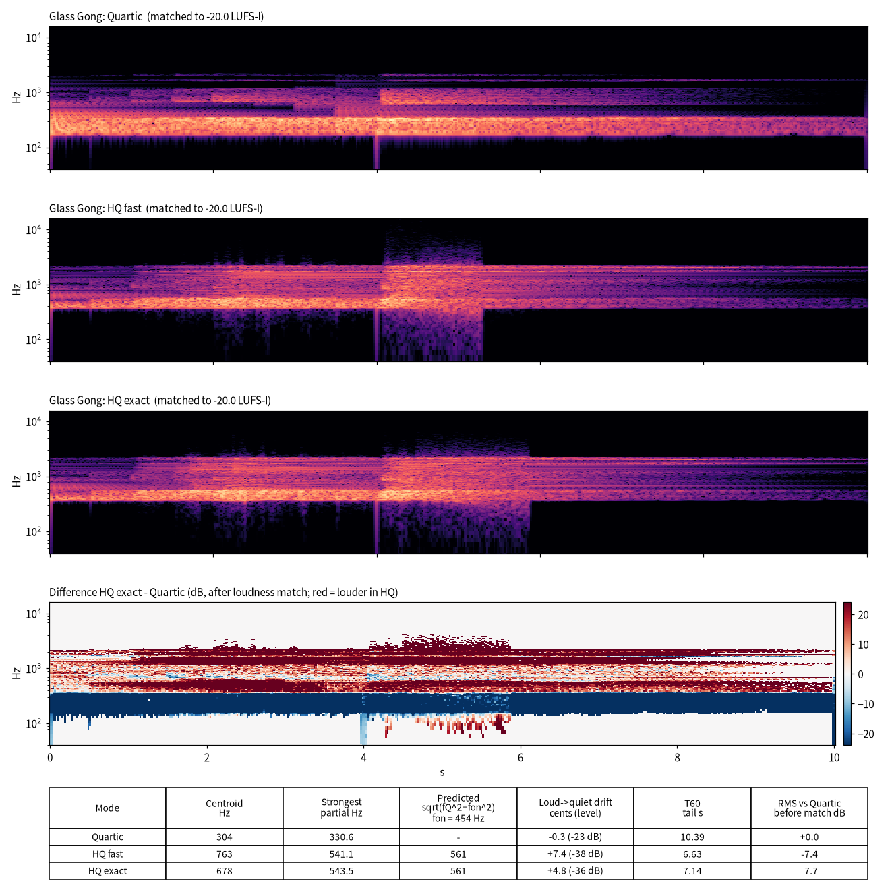
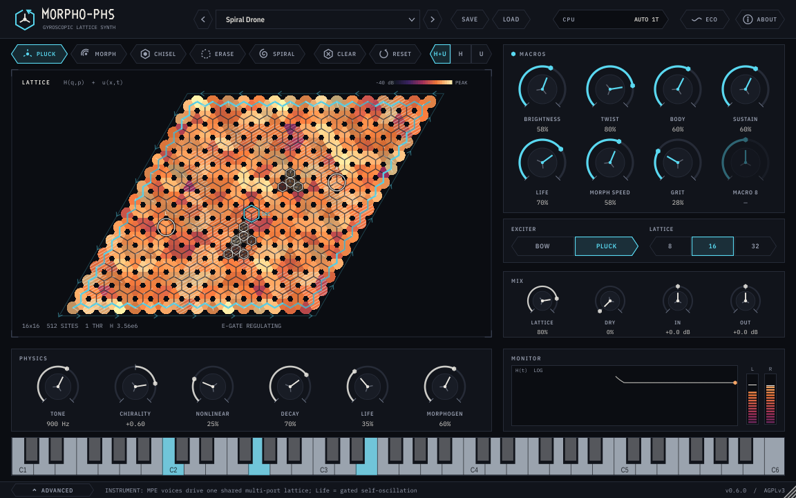

# Morphohedra 大白话说明书

**写给不懂物理、也不懂编程的人看的：这是个什么东西，它是怎么想出来的，怎么试出来的，现在做到哪一步了。**

> 写于 2026-10-31（Asia/Shanghai），开发已暂停。
> 文中所有数字都来自项目里已有的报告和测试记录，这次没有重新跑任何测试。
> 括号里的专业名词是给想深究的人看的，跳过不影响理解。

---

## 目录

1. 一句话说清楚：这是个什么东西
2. 它的原理：一张会唱歌的蜂窝网
3. 我们是怎么一步步做出来的（第 0 到第 6 阶段）
4. 每个阶段都做了哪些测试
5. 它长什么样：外观和声音库
6. 现在到哪一步了，还剩什么问题，接下来做什么
7. 名词小词典

---

## 1. 一句话说清楚：这是个什么东西

**Morphohedra（项目名，插件叫 MORPHO-PHS）是一套给电脑做音乐用的“插件”。** 插件就像给做音乐的软件装上一件新乐器或者一台新机器。

它有两个：

- **乐器版（MORPHO-PHS）**：你在键盘上弹，它就发出声音。
- **效果器版（MORPHO-PHS FX）**：你把一段现成的声音（比如鼓、人声）送进去，它把声音“改造”一遍再送出来。

**它听起来像什么？** 像敲玻璃、敲钟、拉玻璃琴，像金属片的颤音，像一大片慢慢翻滚、一直在变的长音。效果器版会让声音像沿着一条看不见的走廊绕圈、拖尾、结冰、发光。

**它和普通合成器有什么不一样？** 普通合成器大多是“用数学公式直接画波形”。Morphohedra 不画波形，它在电脑里**真的搭了一张由小珠子和弹簧连成的蜂窝网**，然后去“敲”这张网、“拉”这张网，网怎么振动，你就听到什么声音。所以它的声音是“物理上长出来的”，每次都有细微的不同，又不会乱。

---

## 2. 它的原理：一张会唱歌的蜂窝网

### 2.1 珠子和弹簧织成的蜂窝网（晶格）

想象一张像蜂窝一样的网：每个交点上挂着一颗小珠子，相邻的珠子之间用小弹簧连起来。

```
      o---o       o---o
     /     \     /     \
o---o       o---o       o---     o = 小珠子（格点）
     \     /     \     /         --- / \ = 小弹簧
      o---o       o---o
     /     \     /     \
o---o       o---o       o---
```

- 你轻轻拨一颗珠子，它会带着旁边的珠子一起抖，抖动像波纹一样在网上传开。
- 网上成千上万颗珠子一起抖，混在一起，就是你听到的声音。
- 网的大小有三档：8×8、16×16、32×32。32×32 的网有 2048 颗珠子，每颗珠子可以前后、左右两个方向动，一共要算 4096 个数（4096 个自由度）。网越大，声音越厚、越丰富，但电脑也越累。

每颗珠子可以在平面上往两个方向动（专业上叫“2 自由度”），这一点很重要，下面就说为什么。

### 2.2 每颗珠子里藏着一个小陀螺（陀螺效应）

我们在每颗珠子里放了一个**看不见的小陀螺**。陀螺有个脾气：你推它往东，它会往旁边偏一下，不老老实实地走直线。

整张网的珠子都有这个脾气，而且都往同一个方向偏。结果就是：**这张网有了“方向感”，顺时针和逆时针不一样了**（专业上叫“破坏时间反演对称”）。

这个“方向感”大小可以调，界面上叫 **Chirality（手性）**。它把同一个音劈成两个略有差别的音，听起来像两根弦微微不合拍地一起响，会有慢慢的“哇—哇—”的起伏。

### 2.3 涟漪只沿着池塘边跑（拓扑边缘通道）

这是整个项目最特别的地方。

想象一个池塘。正常情况下，扔块石头进去，涟漪向四面八方扩散。但我们这张“陀螺网”在某些音高范围里有个怪现象：

- **网的中间（专业上叫“体”）是“绝缘”的**：这些音高的振动在中间根本传不开。
- **但网的边上有一条“单行道”**：振动只能沿着边缘、朝一个方向绕圈跑。
- 更神奇的是，**边上就算有个坑、缺了一块，振动也会绕过去继续跑，几乎不反弹回来**。

```
  +-----------------------------+
  |  >  >  >  >  >  >  >  >  v  |
  |  ^                       v  |
  |  ^                       v  |
  |  ^                       v  |
  |  ^  <  <  <  <  <  <  <  <  |
  +-----------------------------+
```

*图：箭头是边缘的“单行道”，只能朝一个方向绕；中间空白处是“绝缘”的，落在带隙里的那些音高传不进来。*

这在物理学里叫“拓扑边缘态”，是近些年很热门的研究方向，原来多用于光学和材料。**我们把它搬进了乐器里。** 实测效果：

- 顺着跑和逆着跑，声音大小能差 **+52 到 +55 分贝**（第 1 阶段）；后来改进后，前两个“绝缘音区”能做到 **+72 到 +90 分贝**（第 2 阶段）。打个比方，就是一边像在你耳边说话，另一边几乎听不见。
- 绕过缺陷时，声音只损失 **不超过 0.003 分贝**，耳朵完全听不出来。

在效果器版里，送进来的声音会被分成几段音高，落在“绝缘音区”里的那几段被送到边缘的单行道上去跑（专业上叫“带隙滤波器组 + 边缘通道”），左右声道在路的上游和下游“偷听”，所以能听到声音像沿着走廊绕行、换边。

### 2.4 一片“野火”在网上蔓延（Barkley 可激介质）

光有一张网，声音会比较“规矩”。为了让声音**自己慢慢变化、像活的一样**，我们在网上又铺了一层“草地”，草地上会烧“野火”：

- 一块草被点着，会点燃旁边的草，火就蔓延开。
- 烧过的地方要过一会儿才能再长草、再被点着。
- 这样火会形成一圈一圈的“火环”，或者像蚊香一样转着的“螺旋”。

```
  . . o . .        . o o o .        o . . . o
  . o # o .        o # . # o        # . . . #
  . . o . .        . o o o .        o . . . o
```

*图：左边刚点着，中间火圈扩散，右边烧过的地方暂时熄灭、火继续往外走。（# 表示正在烧，o 表示刚被点着，点表示草地或刚烧过）*

这层草地在专业上叫“Barkley 可激介质”。**火烧到哪里，那里的弹簧和陀螺就被悄悄调一下**，所以声音会自己缓慢地变化。火蔓延的快慢是个旋钮（τ，界面上和“Morphogen/形态”有关的旋钮）。

**形态（Morph）** 这个名字就从这里来：火在网上画出不断变化的图案，像一个在慢慢变形的多面体，“Morphohedra”就是“变形的多面体”的意思。

> 诚实说明：最早的设想是用另一种“斑点图案”模型（Gray–Scott），还说能产生一种叫“1/f”的自然起伏。我们一试，在 16×16 网上那种图案几乎全部死掉或冻住；1/f 也测不出来。所以换成了“野火”，宣传语也改成“有边界的、持续的不规则变化”，不说做不到的事。

### 2.5 为什么它永远不会“炸”：能量账本和安全阀

做这类“物理乐器”最怕的是**声音失控**：越来越响、越来越响，最后变成刺耳的爆音，甚至把音箱和耳朵弄伤。专业上叫“发散”或“数值爆炸”。

我们用了三道保险：

**第一道：一本永远对得上的能量账本（ESAV-LF 算法）。**
电脑算振动，是一小步一小步往前算的。很多常见的算法每一步都会“凭空多出一点点能量”，积少成多就炸了。我们用的算法（专业上叫 ESAV-LF，显式能量稳定蛙跳格式）每走一步都记账：

> 这一步网里的能量变化 = 外面送进来的能量 − 摩擦消耗掉的能量

这个等式在数学上**一分不差**（已严格证明，见第 1 阶段）。没人往里送能量，能量就只会减少或不变，不可能自己变多。而且它不用“反复试算”，一次就算完，所以够快。

**第二道：拧旋钮也不会偷偷加能量（ENPU）。**
有个容易被忽视的坑：你在演奏中转旋钮（比如改珠子的重量、弹簧的硬度），这个动作本身可能偷偷往网里“灌”能量，就像荡秋千时在合适的时机蹲起，秋千会越荡越高。我们测过：在 43 毫秒里，能量能涨 **19 到 32 倍**。所以我们发明了一个规则（ENPU，“保证能量不增的参数更新”）：**每次改参数，都检查一下，保证改完之后能量不会变多。**

**第三道：安全阀（能量门）。**
有些声音我们**故意**让它自己持续发声（像拉琴时琴弓一直在送能量，专业上叫“负阻尼、自激”）。这时候能量可能会往上涨。我们装了一个“高压锅安全阀”：**能量一旦接近上限，就自动把“送能量”的那股劲收回来。** 这在数学上也证明了：能量永远不会超过一个固定的上限。

```
 能量
  ^
  |  - - - - - - - - - - - - - - -   <- 上限：安全阀从这里开始放气
  |        _____________
  |       /             \
  |      /               \______
  |     /
  +-----------------------------------> 时间
```

*图：有安全阀时，能量顶到上限附近就被按住，不会一直往上涨。*

**实测**：我们用各种最极端的方式去“砸”这张网（各种随机的猛烈冲击、各种参数乱跳），**4 组 × 1 万次，0 次失控**（第 1 阶段）。同样的测试里，原来设想的算法（SSDG）有 **11.9%** 会炸，常见的教科书算法（RK4）在 8×8 的冲击测试里 **33.9%** 会炸。能量账本的误差小到 **5×10⁻¹³ 分贝**（第 2 阶段），相当于没有误差。

还有一道“保底”：每个预设出厂前都检查过，输出端的“限幅器”（防止声音过响的最后一道闸）在正常演奏时不该被触发。

### 2.6 珠子的“脾气”：普通模式（四次势）和 HQ 模式（log-cosh）

每颗珠子除了被邻居的弹簧拉着，自己还被一根“特殊的弹簧”拴在原位。这根弹簧有两种脾气可选：

- **普通模式（Quartic，四次势）**：轻轻碰，它很软；用力推，它变得越来越硬，像一根越拉越紧的橡皮筋。算起来快，是默认选项。
- **HQ 模式（log-cosh 势）**：轻轻碰，它就已经有一股往回拉的力；用力推，这股力到了一定程度就“封顶”了，不再变大。

HQ 有两个版本：

- **HQ exact（HQ 精确版）**：用原本的数学公式算，最准，但很慢。
- **HQ fast（HQ 快速版）**：用一个“长得几乎一样”的近似公式，误差不超过 0.00125（在常用范围内），能被电脑批量快速计算，只比普通模式多花 **3% 到 23%** 的时间（精确版要 2.7 倍）。这个近似也保留了“能量账本对得上”的性质。

**HQ 实际听起来有什么不同？** 我们专门做了对比（同一个预设、同一段演奏、音量对齐后比较，见 `docs/phase6/hq_ab.md`）：

- **HQ 和普通模式差别非常大，不是“更高级”，而是“换了一件乐器”。** HQ 那根“原位弹簧”让低音被推高得最多，高音几乎不动，所以低频被挖空，整串泛音往上挤，声音更像玻璃或钟。
- 例子：**Glass Harmonica（玻璃琴）** 的“声音重心”（频谱质心）从 **942 Hz** 升到 **2272 Hz**，翻了一倍多；**Glass Gong（玻璃锣）** 从 **304 Hz** 升到 **763 Hz**（HQ fast）。最强的那个泛音普遍上移 **40% 到 80%**。
- **HQ 快速版和精确版几乎听不出区别。** 接近“规规矩矩”的声音（Shattered Ice）两者几乎一模一样，相减后剩下的差别只有 **−64 分贝**；会“自己乱动”的声音（Glass Gong、Glass Harmonica）波形会走岔，但整体音色只差 **0 到 3 分贝**。
- 物理上 HQ 会让音高随音量变化（敲得越响音越低，消失时慢慢滑回去），但在正常力度下很小：Glass Gong 在 HQ 下只上滑 **+5 到 +7 音分**（一个半音是 100 音分），几乎听不出来。



*图：同一段 Glass Gong 演奏在三种模式下的频谱。差值图里红色是 HQ 更响的地方（在某个音高以上），蓝色是 HQ 更弱的地方（在那个音高以下），这条分界线就是 HQ 打开的“带隙”。*

**所以我们的建议是：** 与其把 HQ 当成“更高品质”开关，不如把它当成一个音色选项（比如叫“玻璃化”）。这一点还要等用户和听感测试来定。

### 2.7 一张图看懂整个机器

```
 [乐器版] 你在键盘上弹  ->  敲 / 拉网上的某几颗珠子
 [效果器版] 送进一段声音 ->  按音高切成几段，绝缘音区那几段送上边缘单行道
                     |
                     v
 珠子 + 弹簧 + 小陀螺 的蜂窝网（晶格）  <--  野火层（Barkley）慢慢调弹簧和陀螺
   * 每一步都记能量账（ESAV-LF）
   * 改参数不偷加能量（ENPU）
   * 安全阀（能量门）
                     |
                     v
 在网上几个位置“偷听”振动  ->  音量、干湿比、限幅器  ->  你的耳朵
```

---

## 3. 我们是怎么一步步做出来的

整个项目分成 7 个大阶段（第 0 到第 6 阶段），每个阶段做完都写报告、同步到用户电脑、等用户拍板再往下走。

```
 第0阶段  查资料、给原方案挑错
   -> 第1阶段  把道理证明清楚，做原型
   -> 第2阶段  多核一起算，做一大批实验
   -> 第3阶段  做成真正的插件
   -> 第4阶段  针对 i9 改线程，拆成乐器版和效果器版
   -> 第5阶段  32x32 在 i9 上真正跑通
   -> 第6阶段  美术包装（6a）、出厂预设（6b）、听感盲测（6c，未开始）
```

### 第 0 阶段：先查资料、给原方案“挑错”

**做了什么**：最初有一份开题设想。我们没有急着动手，先把它当“考卷”逐条检查，查文献、做计算、跑实验。

**发现了好几个“原方案行不通”的地方**（每条都有计算证据）：

1. **原来的“正方格子，每个点只能上下动”根本没有“边缘单行道”。** 算出来那个关键指标（Chern 数）永远是 0。改成**蜂窝网 + 每颗珠子两个方向 + 小陀螺**，才有单行道。
2. **“只要不主动送能量就安全”这句话不对。** 转旋钮本身就会灌能量，43 毫秒内能量涨 19–32 倍。于是有了 ENPU。
3. **原来的算法不是“永远稳定”。** 8×8 网、1000 组猛烈冲击，原方案 10.5% 会炸，RK4 33.9%，Verlet 32.1%；我们后来用的 ESAV-LF 是 **0%**。1 万组的门槛测试：ESAV-LF 0 次炸，原方案 11.9%。
4. 原方案里一个公式在某个参数等于 0 时会出现“0 除以 0”，导致 100% 出错（NaN）。我们换了一种稳定写法，误差最大 1.6×10⁻¹⁶。
5. 原方案里另一种算法（Cayley 变换）太慢：16×16 网要用掉一个 CPU 核的 128%，不可能实时。
6. 原方案说某个方法是“新发明”，查文献发现前人已经做过。于是把论文的“新意”重新定位成：**拓扑网 + 永远稳定的快速算法 + 转旋钮不加能量 + 实时做成乐器**。
7. 到 9. 原来的“斑点图案”层在 16×16 上几乎全死掉或冻住，原来的反馈回路是“正反馈”会锁死。于是改用“野火”（Barkley）。
10. 估算电脑算力：8×8 用不到一个核的 2%，16×16 约 5%，32×32 必须多线程。

还发现好几条参考文献被引用错了，都核实更正了。

**用户在第 0 阶段后拍板（7 项）**：采用蜂窝 2 自由度陀螺网；算法用 ESAV-LF；加 ENPU；控制层用“野火”；多个琴键共用一张网、在不同位置敲（而不是每个音一张网）；用用户的笔记本 i9-13900H 作为性能标准；和其它项目、其它机器人完全隔离。

### 第 1 阶段：把道理证明清楚，做出第一个原型

- 把“能量账本对得上”“改参数不加能量”“安全阀有上限”等 **4 条定理、2 条命题**完整证明出来，又用电脑做符号推导和 50 位高精度计算核对。
- **4 组 × 1 万次**极端测试，**0 次失控**。
- 第一次在声音频段量到“边缘单行道”：方向差 **+52 到 +55 分贝**，绕过缺陷只损失 **≤ 0.003 分贝**。
- 用 C++ 写了核心程序，**10 项测试全部通过**，处理声音时不临时向电脑“借内存”（借内存会导致卡顿）。
- 16×16 网在云端电脑的一个核上占 **31%**（加上野火层 34%）；**32×32 一个核算不过来**。
- 默认用普通模式（四次势），HQ 作为选项。

**用户在第 1 阶段后拍板**：普通模式做默认、HQ 做高品质选项；32×32 必须靠多线程做到实时；野火速度 τ 做成用户旋钮；插件框架用 JUCE 8（与 AETHER 项目完全分开）；暂不在用户电脑上跑东西；ENPU 的三个版本做对比再定。

### 第 2 阶段：让多个 CPU 核一起算，再做一大批实验

**多线程**：把网切成小块，每块交给一个 CPU 核算。难点是：每算一小步，所有核都得“对一下表”（专业上叫“屏障同步”），等最慢的那个算完，才能一起走下一步。我们保证了**不管用几个核，算出来的结果和一个核算的一模一样**（逐位一致，差值恰好是 0）。云端电脑上 32×32：1 个核 **28.67**、2 个核 **16.96**、4 个核 **10.61**、8 个核 **7.81** 微秒/每个声音小片。

**四个实验，有成有败，都如实记录：**

- **实验 1（稳定性）**：所有压力测试 0 次失控，能量误差 ≤ 5×10⁻¹³ 分贝。**但也发现一个不足**：在非常强烈的非线性下，泛音的精确度比参考答案差 37 分贝。没达标，如实写进报告。
- **实验 2（单行道）**：前两个绝缘音区方向差 +72 到 +90 分贝，第三个只有 +34 到 +38。用一段鼓声做的宽频演示一开始只有 ±6 分贝，找到原因（鼓声只有 1.1% 的能量落在绝缘音区、声音绕回来了、滤波器漏能），加了“吸音边框”和更好的滤波器后修到 **+74.7 / −75.5 分贝**。
- **实验 3（自然起伏）**：网和野火耦合后，声音确实更复杂了，**但测不出稳健的 1/f 起伏**，宣传语改为“有边界的、持续的不规则变化”。
- **实验 4（让电脑反过来设计音色）**：想让电脑自动“学”出想要的音色（可微逆向设计）。**失败了**：一个简单的老办法在 3 个目标上都比它好，还快约 400 倍。于是放弃，改成“人设计预设 + 宏旋钮”。
- **ENPU 三个版本对比**：推荐版本 C。还发现“参数一块一块地跳变”比版本差异更要紧（12 kHz 以上能量多出 8.3 分贝），于是改成在一块里面平滑过渡。

**用户在第 2 阶段后拍板**：ENPU 默认用 C，并平滑过渡；HQ 要做成能快速计算的近似（并保住能量证明）；拓扑效果做成“并联的绝缘音区通道”；去掉 1/f 说法；暂停“电脑自动设计”，改做预设和宏旋钮；第 3 阶段主攻做成真正的插件。

### 第 3 阶段：做成真正能用的插件

- 用 JUCE 8 做出插件，支持 VST3、CLAP 和独立运行版，还有一个命令行工具。
- **插件兼容性测试 pluginval 最严格的第 10 档通过**（这是业内常用的“插件体检”）。
- 声音线程只做“换指针”这种瞬间完成的操作，网的重建在别的线程做好再换上来，换的时候用 256 个样本交叉淡化，避免爆音。
- 做出 HQ 快速版（误差 ≤ 0.00125，凸、非负，能量证明照样成立）。
- 做了 27 个出厂预设，63 次离线渲染全部正常、没有爆音；修了乐器版太轻（−54 dBFS）、边缘下游爆音等电平问题。
- 发现“每 8 个样本才平滑一次”还残留 +2.42 分贝的高频杂音，改成“每个样本都平滑”后为 0，耗时几乎不变。

**第一次在用户的 i9 笔记本上实测，结果不好**：32×32 最好的设置也有超时（8/2250 次），偶尔出现 40 到 100 毫秒的大卡顿，多加线程反而更差；HQ 快速版只有 8×8 能稳定。奇怪的是 i9 单核比云端快，表现却更差，说明问题出在**“几个核怎么配合”**，而不是“算力不够”。

### 第 4 阶段：针对 i9 改线程，拆成两个插件（决策 D1–D7）

**用户拍板的 7 项决策**：

| 编号 | 内容 | 大白话 |
|---|---|---|
| D1 | 每个样本都平滑参数 | 消除那 +2.42 分贝的高频杂音，几乎不多花时间 |
| D2 | 拆成两个插件 | 乐器版 MORPHO-PHS 和效果器版 MORPHO-PHS FX |
| D3 | 宏旋钮可以覆盖音色旋钮 | 写进预设规范 |
| D4 | 边缘宽度、边缘串音可自动化 | 预设格式升级到第 2 版，旧的照样能读 |
| D5 | 用 Windows 的“专业音频”优先级（MMCSS） | 让计算线程更优先 |
| D6 | 开源授权用 AGPLv3 | 加了完整授权文件 |
| D7 | 删掉过时的备注 | 顺便发现两处常数不一致，列为待办 |

**线程改造**：识别哪些是“大核”（P 核）、哪些是“小核”（E 核），把计算线程绑到大核上；同步时先空转等一会儿，等久了就去睡觉（混合屏障）；加了“专用线程池”；自动选择线程数。

**再上 i9 实测（“最佳性能”电源模式）**：

- **16×16 完全达标**：绑大核 + 专业音频优先级时，全部 0 超时。
- **32×32 仍然没有一种设置达标**。最好的是第 3 阶段那种“一直空转等”的方式，1500 块里超时 7 到 12 次。
- **关键发现**：平均速度其实够（11 到 14 微秒，低于 20.83 的预算），**问题出在“偶尔一次特别慢”**，就是尾巴。
- 只绑核、不开专业优先级时最糟，偶尔卡 89 到 163 毫秒。
- 电源模式影响巨大：从“平衡”换成“最佳性能”，超时少了 20 到 70 倍。
- 一个重要线索：除了“一直空转”那种，其它方式在等的时候会去“睡觉”，每次被叫醒都要排队。一组测试里“去睡觉”多达 219 到 12,395 次。

### 外部专家的报告：哪些说对了，哪些说错了

第 4 阶段后，用户请外部专家写了一份诊断报告。我们**没有全信，而是把每条说法都当成“待验证的猜想”，一条条实测**：

| 专家的说法 | 实测结论 |
|---|---|
| 换一种更规整的计算方式（模板 + SIMD），单线程能快 2.6–3.5 倍 | **说对了，而且更好**：i9 上快了约 5.5 倍（26.6 → 4.8 微秒） |
| 线程“去睡觉再被叫醒”是超时主因 | **说对了**：改成纯空转后，“去睡觉”0 次、超时 0 次 |
| 大核列表里混进了 0 号核和“同一个核的双胞胎” | **说对了**，已改成干净的大核 {2,4,6,8,10} |
| i9 单线程 23 微秒 | **不对**：那是云端电脑的数字，i9 实测是 26.2–27.0 |
| 程序全用双精度，换单精度能省 45–50% | **不对**：插件本来就是单精度 |
| 专业优先级变慢是因为 CPU 功耗墙 / 发热降频 | **数据不支持**：频率下降从第一分钟就有，没有越跑越慢，和超时基本无关。但我们没有功耗和温度记录，**不能完全排除** |
| 安全阀每 64 个样本才检查一次，可以把几步打包算 | **不对**：安全阀每个样本都检查全网能量，没法打包 |
| 乐器版慢是因为多个琴键 | **不对**：真正原因是 ENPU 每次都在一个线程上算全网能量，已修好 |
| 一行代码就能让泛音精度提升 25–32 分贝（E-RSAV） | **不对**：实测只有 ±2 分贝左右，所以这个开关默认关闭 |

### 第 5 阶段：32×32 终于真正跑通

这是性能上的转折点。做了五件事：

1. **测试规范化**：每次测之前让电脑冷却 20 秒，打乱顺序，每个设置重复 3 次，记录电源模式和频率。这样结果才可信。
2. **换一种计算方式（模板内核）**：原来每颗珠子要去一张大表里“查”邻居是谁（CSR 查表），很慢。蜂窝网其实很规整，可以分成 A、B 两类珠子，每颗珠子的 3 个邻居位置是固定的，于是可以排好队、成批地算（SIMD）。**结果和原来逐位一模一样**（112 组配置验证），但 i9 单线程从 **26.6 降到约 4.8 微秒**，约 **5.5 倍**。
3. **线程协议改成“纯空转”**：在一块声音里，等的线程不去睡觉，原地转圈等（只有等了 1 毫秒以上才去休息并记录）。只用干净的大核，关掉 Windows 的省电节流（EcoQoS），打开专业音频优先级。主线程自己也参与计算。
4. **修好乐器版的额外开销**：1.06 → 0.30 微秒。
5. 不做“几步打包算”（因为安全阀每个样本都要看全网）。

**i9 最终成绩（每个设置测 3 轮，每轮 3750 块，共 11250 块）**：

| 设置 | 平均每个小片用时 | 最坏情况占预算 | 超时次数 | 结论 |
|---|---|---|---|---|
| 效果器 32×32，2 个线程（默认） | 3.48–3.56 微秒 | 0.310 | **0 / 11250** | 3 轮全过 |
| 效果器 32×32，3 个线程 | 2.96–3.26 微秒 | 0.408 | 0 | 3 轮全过 |
| 乐器 32×32，3 个线程（默认） | 3.33–3.67 微秒 | 0.480 | **0 / 11250** | 3 轮全过 |
| 32×32，1 个线程（新内核） | 4.67–5.14 微秒 | 0.501 | 1 | 过/接近/过 |
| 32×32，1 个线程（旧内核） | 26.22–26.96 微秒 | 1.833 | 全部超时 | 不过 |
| HQ 快速版 32×32，3 个线程 | 4.60–4.89 微秒 | 0.757 | 1 | 勉强 |
| HQ 精确版 32×32，1/2/3 个线程 | 24–58 微秒 | 2.3 以上 | 全部超时 | 不可能实时 |
| 16×16 普通模式，1 个线程 | 1.61–1.66 微秒 | 0.145 | 0 | 轻松 |
| 第 4 阶段的旧方式 | 15.7–18.8 微秒 | 1.2 以上 | 621–1830 | 不过 |

**于是定下默认值**：32×32 时效果器用 2 个线程，乐器和 HQ 快速版用 3 个；HQ 精确版只允许 16×16 及以下，32×32 时自动换成 HQ 快速版并在界面上提示（预设和自动化照常能用）；HQ 在界面上标“HIGH CPU”。

还发现并修好一个**卡死 bug**（见第 4.6 节）。

### 第 6 阶段：做成商品（美术、预设、听测）

- **6a 美术包装**：已完成，见第 5 节。
- **6b 出厂预设**：已完成 57 个预设，见第 5 节。
- **6b2 修补**：做到一半，已暂停，见第 6 节。
- **6c 听感盲测（MUSHRA）**：还没开始。

---

## 4. 每个阶段都做了哪些测试

### 4.1 先弄懂“时间预算”

电脑发声，是把声音切成一个个极小的“小片”（样本），每秒 **48000 片**。所以：

> **每做一小片声音，只有 1 ÷ 48000 秒 ≈ 20.83 微秒的时间。**（1 微秒是百万分之一秒）

电脑不是一片一片交货的，而是 128 片打成一包（一“块”）交给声卡，所以每一包要在 **2666.7 微秒**（约 2.7 毫秒）内做完。

这就像**一条传送带**：每 2.7 毫秒就有一个空盘子过来，你必须把 128 个饺子包好放上去。**晚了哪怕一次，盘子就空着过去了，耳朵听到的就是“咔哒”一声或一小段断音。** 这就叫“超时”（overrun）。

我们的及格线定得很严：

- **超时 0 次**；
- 而且 **最慢的那 1% 也只能用掉预算的 70% 以内**（p99 / 预算 < 0.7），留出 30% 余量，以防电脑同时干别的事。

### 4.2 为什么 32×32 特别难

- 32×32 网有 4096 个数要算，每一小片都要全部算一遍。一个核算不过来，只能几个核一起算。
- 但网是连在一起的：每算一小步，所有核都要“对一下表”，等最慢的那个。一包 128 片，就要“对表”128 次。
- 只要其中一个核被 Windows 拉去干别的事、或者被放到了慢的小核上，**整包就晚了**。
- 所以 32×32 的难点不是“平均够不够快”，而是“**会不会偶尔一次特别慢**”。

**怎么解决的（第 5 阶段）**：

```
 以前：每颗珠子查表找邻居（慢）
       + 等的时候去睡觉，被叫醒要排队（偶尔很慢）
       => 1 个核 26.6 微秒；多核也总有超时

 现在：珠子分 A/B 两队，邻居位置固定，成批计算（快 5.5 倍）
       + 等的时候原地转圈，不睡觉
       + 只用干净的大核，关掉省电节流
       => 1 个核 4.8 微秒；2 个核 0 超时，最坏只用 31% 预算
```

算得快了，就不需要那么多核；核少了，“对表”和“有人迟到”的机会也少了。**最后 2 个线程反而比 4 个更稳。**

### 4.3 每个阶段的测试一览

| 阶段 | 测了什么 | 结果 |
|---|---|---|
| 0 | 原方案逐条计算验证；各种算法的“会不会炸”测试 | 发现 10 类问题；ESAV-LF 0% 失控，原方案 10.5–11.9% |
| 1 | 定理的符号验证 + 50 位高精度；4×1 万次极端测试；单行道测量；C++ 单元测试 | 0 失控；方向差 +52～+55 dB；10/10 测试通过 |
| 2 | 多线程结果是否与单线程一致；稳定性、单行道、起伏、自动设计 4 个实验；ENPU 对比 | 逐位一致；能量误差 ≤ 5×10⁻¹³ dB；1/f 和自动设计不成立，如实记录 |
| 3 | 插件体检 pluginval 第 10 档；63 次离线渲染；首次 i9 实测 | 体检通过；渲染全部正常；i9 上 32×32 有超时和大卡顿 |
| 4 | i9 大规模性能矩阵（多种线程方式 × 线程数 × 块大小 × 网大小） | 16×16 达标；32×32 没有一组达标；找到“尾巴慢”的线索 |
| 5 | 规范化性能测试（冷却、随机、3 轮）；多线程压力测试；卡死复现与修复 | 32×32 在 i9 上 0 超时；压力测试全部通过 |
| 6a | 界面对音频的额外负担；界面绘制耗时；单元测试；pluginval；i9 上编译 | 负担约为预算的 0.02–0.03%；pluginval 两个插件都通过 |
| 6b | 57 个预设的响度、余音、峰值、限幅器、能量；CPU 实测；pluginval；i9 复核 | 云端 57/57 通过；i9 上发现 2 个问题（见 4.8） |

### 4.4 单元测试和能量检查

- 每次改代码都跑一整套自动测试（test_main、test_mt、test_phase3、test_phase4、test_phase5），检查“能量账本对不对得上”“多线程结果是不是和单线程一模一样”“处理声音时有没有临时借内存”等。到第 6b 阶段为止**全部通过**。
- 能量账的误差：多线程 5.1×10⁻¹⁵，插件引擎 3.76×10⁻¹⁵，基本就是电脑能表示的最小误差。

### 4.5 i9 性能测试的演变（32×32，每包 128 片）

| | 第 3 阶段（首测） | 第 4 阶段（改线程） | 第 5 阶段（新内核 + 纯空转） |
|---|---|---|---|
| 最好的一组超时次数 | 8 / 2250（这组是每包 64 片） | 7–12 / 1500 | **0 / 11250** |
| 最慢 1% 占预算 | 0.82 | 0.958–0.992 | **0.310** |
| 结论 | 不达标 | 仍不达标 | **达标** |

### 4.6 压力测试和“卡死”bug

**发生了什么**：第 5 阶段在 i9 上测试时，有一个可选的“专用线程池”模式，跑着跑着突然**整整 16 分钟没有任何动静**，所有线程都在睡觉，CPU 用量是 0。这叫“死锁”。

**原因（打个比方）**：主线程要等工人干完活。工人干完会在黑板上写“第 s 号完成”。主线程的旧写法是：先看一眼黑板“还没完成吗？”，**然后又看了第二眼**，拿第二眼看到的内容去说“黑板变了再叫醒我”。如果工人恰好在两眼之间写上了“完成”，主线程第二眼看到的就是“完成”，结果它说的是“等黑板**不再是**‘完成’时叫醒我”。可黑板下次变，要等下一轮活，而下一轮活又要等主线程醒来安排。于是**谁也等不到谁**，全睡着了。

这个漏洞的“窗口”只有几纳秒，第 4 阶段一直没暴露。第 5 阶段给工人加了更高优先级后，工人能在那一瞬间插队，就撞上了。

**修法**：只看一眼黑板，就拿这一眼的内容去等。

**怎么证明真修好了**：

- 专门写了**压力测试**：极小的包、反复启停、反复切换线程数，还有一个“看门狗”，10 秒没进展就报警。
- 还做了一个“捣乱版”：在 6 个容易出问题的位置随机让线程睡一下、让一下，**故意制造最坏的时机**。
- 用旧写法，捣乱版**0 块或 170 块之后就卡死**；新写法在同样捣乱下**一次都没卡死**。
- 云端：普通版每个部分 30 秒 × 3 个随机种子，专用池跑了约 611 万块、主线程参与的线程池跑了约 577 万块、启停 7.3 万次；捣乱版注入了 12 万多次干扰，**全部通过**。
- i9 上也全部通过。中间有个小插曲：一项测试要求 15 秒内启停 1000 次，i9 只做了 256 次被判不合格。查下来不是卡死，而是 Windows 每次创建线程并注册专业优先级要约 **58.6 毫秒**，本来就做不到那么快。于是把标准改成“不卡死 + 至少 100 次 + 每次不超过 2 秒”。（这种启停只在你改网大小、改线程数时发生，不在声音线程上。）
- 第 6b 阶段在 i9 上复跑：4 项全部通过，启停 269 次 / 15.3 秒。

专用线程池虽然不再卡死，但仍有 22–60 次超时，所以**保持非默认**。

### 4.7 插件体检（pluginval）

pluginval 是业内常用的插件“体检”工具，会反复加载、乱拨参数、保存恢复、打开关闭界面等。我们用最严格的第 10 档：第 3、6a、6b 阶段**两个插件都通过**（在云端 Linux 上）。

### 4.8 预设质检：音量、余音和 i9 复核

**每个出厂预设都要过这些关**（第 6b 阶段）：

- **不炸、不出错**：没有 NaN、没有能量失控。
- **没有直流偏移**：≤ −74 dBFS（直流偏移会让音箱膜片“歪着”，浪费音量）。
- **余音会结束**：松开琴键后最多约 6 秒内安静下来，不能永远响下去。
- **峰值不过线**：真峰值 ≤ −1.1 dBTP，输出限幅器 0 次触发。
- **音量统一**：乐器统一在约 −18 LUFS，效果器约 −20 LUFS（和送进来的原声一样响，开关效果器时不会因为“更响”而误以为“更好”）；5 个打击类按峰值对齐。

LUFS 是“人耳感觉到的响度”的单位，统一响度是为了让切换预设时不会一个震耳、一个听不见。

**云端结果**：57/57 全部通过。

**拿到 i9 上实测后，发现两个问题**：

- **Big Spiral 32 在 i9 上不合格**：1500 块里超时 **56 次**，最慢 1% 用掉预算的 **1.226 倍**。原来按估算它应该是 0.888（“高 CPU”档），实际更重。
- **Chiral Drift 在 i9 上触发了 2 次限幅器**（云端 0 次）。之后用 25 个不同的随机输入反复测试，发现它对随机性比较敏感：换某些随机种子就会触发。
- 另外，Cathedral Gyro 32 的估算是 0.856，**i9 实测只有 0.411**，宽裕得多。其余预设在 i9 上都很宽裕。
- i9 上预设校验 57 个 0 失败，压力测试全部通过。

这两个问题的修补（第 6b2 阶段）做到一半已暂停，见第 6 节。

---

## 5. 它长什么样：外观和声音库

### 5.1 美术方向：「体暗边明」（BULK · EDGE）

**先做功课**：我们研究了 Vital、Surge XT、Cardinal、Dexed、ChowDSP、Odin 2、Airwindows、VCV 的 Sapphire 模块等风格另类的开源插件，总结出“显得高级”和“显得廉价”的做法：

- 好的插件把**内部真正发生的事**画成最大的东西，而不是摆一排旋钮；
- **颜色要克制**：一种强调色 + 一条有意义的亮度色阶显得贵，五颜六色显得廉价；
- 位图做的“仿真金属旋钮”放大就糊，矢量绘制更干净；
- 要避免霓虹发光、毛玻璃、仿金属渐变、螺丝钉、千篇一律的“赛博朋克”青紫配色。

**我们没有套用任何现成皮肤或模板**，所有视觉规则都从这台乐器自己的物理里推出来：

| 物理事实 | 界面上的样子 |
|---|---|
| 网的中间是“绝缘”的 | 背景和面板是哑光深色，没有渐变、没有发光 |
| 只有边缘在“导电” | 只有“正在起作用”的边才用强调色：选中的按钮、宏旋钮的弧线、边缘通道 |
| 只有能量会发光 | 唯一的亮光是“能量热度色”：从冷的深紫到白热 |
| 野火是另一种东西 | 用 60° 斜线排线表示，不用第二种颜色 |
| 陀螺的方向 | 边缘上的小箭头按手性方向绕行，手性为 0 时箭头消失 |
| 蜂窝 | 所有角度都是 60° 的倍数：六角形按钮；旋钮指针带两根 ±120° 的“尾巴”，像一个三叉的陀螺格点 |

一句话：**界面本身就是一块处在“绝缘音区”里的材料——暗的体、亮的边、只有能量会发光。**

- **两个插件两种颜色**：乐器版**冰青色**（#59D8F0），效果器版**酸性黄绿色**（#C8F05A）。一眼能分清，又明显是一家的。
- **字体**：IBM Plex（可免费商用）。文字对比度都实测过，主文字对比度 15.6:1，远超无障碍标准的 4.5:1。
- **标志和图标**：由同一套几何图形用程序生成，12 个图标全部代码绘制。

### 5.2 界面



*图：乐器版主界面。中间最大的是实时的“蜂窝网”画面，亮的地方就是能量多的地方。*

- **中间的主角**：实时显示网上每颗珠子的动向和能量分布。
- **8 个宏旋钮**：每个预设都给它们起好名字、配好作用，是最常用的“一把抓”旋钮。
- **其它区域**：网和物理参数、混音、能量和电平监视、乐器版的小键盘、效果器版的 4 个推子；不常用的高级参数（线程、势、平滑等）收进一个可展开的抽屉。
- **顶部的 CPU 小标签**：显示自动选了几个线程（AUTO nT），高负载时显示 HIGH，HQ 精确版被自动换成快速版时显示 HQ>FAST。
- **大小可调**：从 960×600 到 1728×1080，高分屏上也清晰。
- **ECO 省电模式**：降低动画帧率（12 帧，低动效 8 帧）。
- 旋钮手感：拖动、按住 Shift 微调、双击复位、滚轮、方向键都支持。

**界面不能拖慢声音**，这是硬要求：

- 界面每秒最多从声音线程取 30 次“快照”，每次 6–10 微秒，约占预算的 **0.02–0.03%**（目标是 1% 以内）。
- 界面窗口关掉或隐藏，就**完全停止**取快照。
- 画一帧：默认大小约 0.8–1.1 毫秒，2 倍缩放约 2.2–2.8 毫秒（这些在界面线程，不在声音线程）。

### 5.3 出厂预设库

**先审旧的**：原来的 27 个预设用新标准复测，**24 个不合格**：效果器偏轻 6–8 LU、几个持续音和“冻结器”收不住尾、6 个触发限幅器、Glass Harmonica 能量失控。最后**保留 3 个、重做 22 个、淘汰 2 个**（淘汰的放进 `presets\retired`）。

**新库一共 57 个**，其中 32 个是全新设计：

| 乐器版（32 个） | 数量 | 效果器版（25 个） | 数量 |
|---|---|---|---|
| Gyro Bells 陀螺钟 | 5 | Edge Dispersers 边缘色散 | 7 |
| Plucks 拨弦 | 4 | Defect Freezers 缺陷冻结 | 6 |
| Percussive Lattice 打击晶格 | 4 | Lattice Spaces 晶格空间 | 4 |
| Chiral Strings 手性弦乐 | 5 | Excitable FX 可激效果 | 4 |
| Edge / Topological 边缘拓扑 | 3 | Morph Evolutions 形态演化 | 4 |
| Excitable Textures 可激纹理 | 4 | | |
| Drones 持续长音 | 4 | | |
| Morph Evolutions 形态演化 | 3 | | |

- 每个预设都有中英文说明、至少 2 个标签、8 个命名好的宏旋钮（每个参数只归一个宏管）。
- **设计规则写进了生成程序，自动检查**：比如带螺旋火种的预设不能同时开“自激”；32×32 只能用普通模式或 HQ 快速版，线程自动。
- **CPU 等级**：每个预设都实测打分，分成省电（eco）43 个、标准 12 个、高负载 2 个（这是按云端换算到 i9 的估算；i9 实测后发现 Big Spiral 32 估低了、Cathedral Gyro 32 估高了）。
- **音色地图**：把 57 个预设按“明亮度”和“变化程度”画成一张图，检查覆盖面够不够广。最像的一对是效果器 Pinhole Edge 和 Tiny Edge 8，要在听感测试里重点检查是否能分辨。
- **预设浏览器**：按分类、标签筛选，收藏（星标），上一个/下一个，一键恢复初始音色（Init）。
- 每个预设都渲染了一段试听音频。

---

## 6. 现在到哪一步了，还剩什么问题，接下来做什么

### 6.1 现在的状态（开发已暂停）

- **已完成**：第 0 到第 5 阶段；第 6a 阶段美术包装；第 6b 阶段 57 个出厂预设。这些都已同步到用户电脑，在 i9 上编译通过，插件体检和压力测试都通过。
- **已完成**：HQ 对比包（5 个预设的对比音频和频谱图，说明文件 `docs/phase6/hq_ab.md`）。
- **做到一半、已暂停：第 6b2 阶段（修补 i9 上发现的两个问题）**。进度记录到 20:38（Asia/Shanghai）：
  - 用 25 个不同的随机种子反复测试，把“峰值余量”的规则改严了；
  - 计划把 Big Spiral 32 改用 16×16 网，已在云端重新生成了 57 个预设并重新质检，0 失败，24 个改动的预设重新渲染了试听；
  - 但最后一轮多种子测试显示，**仍有个别随机种子会触发限幅器**，正在排查时暂停了。
  - 这些改动**只在云端，还没有同步到用户电脑，也还没在 i9 上复测**。
- **还没开始：第 6c 阶段听感盲测（MUSHRA）**。

### 6.2 还没解决的问题（按重要性）

1. **Big Spiral 32 在 i9 上超时、Chiral Drift 偶尔触发限幅器**：修补做到一半（见上）。
2. **HQ 精确版在 32×32 上不可能实时**：i9 上 24–58 微秒，超过 20.83 的预算，加线程也没用。现在的做法是限制在 16×16 以下，32×32 自动换快速版。要彻底解决需要更便宜又有数学保证的近似公式。
3. **HQ 快速版在 32×32 上余量不够**：3 个线程 3 轮共 1 次超时，最慢 1% 占预算 0.543–0.757（有两轮超过 0.7）。现在标“HIGH CPU”，可用但不保证。
4. **乐器版能不能只用 2 个线程**：只测了 1 轮（0.626，离 0.7 只有约 10% 余量），所以默认用 3 个。
5. **16×16 的 HQ 精确版**：2 个线程仍有 12/11250 次超时，属于“接近实时”。
6. **同时开好几个插件实例**：每个实例都会让几个核“原地转圈”，多开会不会互相挤，还没测。
7. **还没在真实的音乐软件（DAW）里测**，也还没在 Windows 上跑 pluginval 和 clap-validator，没做 macOS 版。
8. **功耗和温度**：专家说的“功耗墙”猜想，数据不支持，但没有功耗和温度记录，不能下定论。
9. **强烈非线性下泛音精度**比参考答案差 37 分贝（第 2 阶段），还没处理。
10. **所有“好不好听”的判断都还没经过人耳**，推荐试听也是按测量数据挑的。界面字体没有中文字形，所以界面是英文。
11. 需要用户在音乐软件里亲自看的：Windows 150%、200% 缩放下文字是否清晰；旋钮手感；画面是否看得懂；Spiral Drone 让整张网亮成白热是否太刺眼；多开几个时 CPU 占用。

### 6.3 接下来做什么

1. **先把第 6b2 收尾**：查清剩下的限幅器触发，确认 Big Spiral 32 的修法，在 i9 上复测，再同步到用户电脑。
2. **决定 HQ 怎么定位**：建议把它当成音色选项（如“玻璃化”），而不是“高品质”开关。
3. **第 6c 听感盲测（MUSHRA，国际标准 ITU-R BS.1534-3）**：至少 15 位有经验的听众，戴耳机，每人约 45 分钟，所有声音响度对齐，不告诉听众哪个是哪个，按 0–100 打分。分三个实验：
   - **A：新旧对比**——10 组新旧预设，验证新库是否明显更好；
   - **B：配置对比**——HQ 快速版对普通模式、32×32 对 16×16 对 8×8，看“多花的 CPU 是否换来了听得出的好处”；
   - **C：边缘色散效果器能不能听出区别**——听不出区别的预设要重做或合并。
4. 之后：多实例和真实 DAW 测试、功耗温度记录，以及更省 CPU 的 HQ 算法等研究方向。

---

## 7. 名词小词典

| 名词 | 大白话 |
|---|---|
| 插件 | 装进做音乐软件里的“新乐器”或“新效果器” |
| 晶格（lattice） | 珠子和弹簧连成的蜂窝网 |
| 自由度 | 一颗珠子能往几个方向动；这里每颗 2 个 |
| 陀螺效应（gyroscopic） | 推它往东，它会往旁边偏；让整张网有了方向感 |
| 手性（Chirality） | 陀螺偏转的方向和大小，界面上的一个旋钮 |
| 拓扑边缘态 / 边缘通道 | 某些音高只能沿网的边缘单向绕行，遇到缺口也能绕过去 |
| 带隙（band gap） | 在网中间传不开的那段音高范围，“绝缘音区” |
| Barkley 可激介质 | 网上的一层“野火”，烧到哪里就悄悄调整哪里，让声音自己慢慢变 |
| ESAV-LF | 我们用的计算方法：每一步都记能量账，保证不会凭空多出能量 |
| ENPU | “转旋钮不偷加能量”的规则 |
| 能量门（energy gate） | 安全阀：能量接近上限就把送能量的劲收回来 |
| 四次势（Quartic） | 默认的珠子脾气：越推越硬，算得快 |
| HQ / log-cosh | 另一种珠子脾气：一碰就有回拉力、推到头力量封顶；听起来更像玻璃和钟 |
| HQ fast / HQ exact | HQ 的快速近似版 / 原公式精确版，两者听起来几乎一样 |
| 样本、块 | 声音的一小片 / 128 小片打成的一包 |
| 预算 20.83 微秒 | 做每一小片声音能用的时间（1/48000 秒） |
| 超时（overrun） | 一包没按时做完，会听到“咔哒”或断音 |
| p99 | 100 包里最慢的那 1 包大概用了多少时间 |
| 线程 / 多线程 | 让几个 CPU 核一起干活 |
| P 核 / E 核 | i9 里的大核（快）和小核（省电、慢） |
| 屏障（barrier） | 几个核每算一步要“对一下表”，等最慢的那个 |
| 模板内核（stencil） | 新的计算方式：珠子分两队、邻居位置固定，成批计算，快 5.5 倍 |
| MMCSS | Windows 给专业音频用的“优先通行证” |
| 死锁 / 卡死 | 几个线程互相等对方，全都睡着醒不来 |
| pluginval | 插件业内常用的“体检”工具，第 10 档最严格 |
| LUFS | 人耳感觉到的响度单位，用来统一预设音量 |
| 限幅器（limiter） | 最后一道闸，防止声音过响 |
| 宏旋钮（macro） | 一个旋钮同时管好几个参数，“一把抓” |
| MUSHRA | 国际标准的听感盲测打分方法 |
| box / i9 | 我们在云端用的电脑 / 用户的 i9-13900H 笔记本 |

---

*资料来源：`README.md`、`reports/` 下各阶段报告、`docs/expert_review_phase4.md`、`docs/phase6/`（art_direction、art_research、hq_ab、preset_audit）、`presets/PRESET_LIST.md`、第 6b/6b2 进度记录，以及 i9 上的预设复核数据 `experiments/results/phase6b2/i9/qa.json`。*
